## Abstract {.unnumbered}

This paper explores the application of biologically-inspired homeostatic control and fluid-dynamic models to 7G backhaul networks. We present the Multidimensional Kinematic Baselining (MKB) and Oxygen Extraction Fraction (OEF) frameworks, alongside a formal layering testbed and an AI-driven stack compiler. However, rigorous empirical evaluation across 30 paired seeds reveals a critical boundary condition: in this simulated testbed, under the stipulated discrete packet model, static per-flow isolation outperformed continuous bio-inspired control. This bounds these controllers and workloads; it is not a general claim about bio-inspired control.

Future communication systems may need to coordinate terrestrial, aerial, and
space-based networks as one service fabric, even when individual links vary
greatly in capacity, delay, cost, availability, and packet size. Building on
the author's master's thesis *Gezora: A Self-Scalable Content Distribution
Network* (2010), this paper presents a brain-inspired allegory for
AI-coordinated backhaul: network telemetry acts as distributed sensing, caches
provide distributed memory, forecasting anticipates changing conditions, and
routing and scaling policies act on the environment to maintain service. The
analogy organizes a long-horizon vision for cooperative, active-active
backhaul in which multiple heterogeneous paths can serve an application
concurrently and content replicas move toward predicted demand. A synthetic
public-safety study makes real-time voice/video on-time delivery, jitter,
freeze duration, and interruption during medium changes primary service
outcomes rather than relying on throughput alone.

A pre-registered testbed now supplies the control law that the paper's
observation layer leaves unspecified: kinematic spike detection on normalised
pressure, localised edits to a node's (alpha, queue policy, FIB) state bounded
by a per-node token bucket, and explicit speed and acceleration caps on
continuous knobs. Over 840 runs and 30 paired seeds the measured result is a
partial refutation of the thesis. The surgical controller holds a 1.08 p95
latency ratio where global pressure control degrades to 1.57, but a confound
control shows that per-flow queue isolation, not the kinematic trigger, accounts
for nearly all of the gain; the trigger's benefit is an order of magnitude less
control-plane churn. Compensatory hyper-specialisation is supported against symmetric scaling and
smooth gradient actuation, with a quantified optimum at a role shift of 0.85
and a collapse into cascading starvation beyond it, where neighbour throughput
falls rather than absorbing the shed load; it remains dominated by smooth
rate-controlled actuation. The reassembly-deadlock hypothesis is refuted at the
fiber-to-satellite boundary, where the adaptive trigger is itself masked by the
satellite buffer's pressure sawtooth. Orbital compute is
considered as a possible edge tier for selected workloads, not as a presumed
replacement for terrestrial data centers. The design is a distributed
engineering architecture, not a biological brain, sentient system, or
demonstrated autonomous global network. It treats quantum networking as a
separate resource plane rather than a byte-carrying IP path, and distinguishes
application-session continuity from an unattainable guarantee of zero packet
delay or loss. A second synthetic experiment compares reactive multipath with
forecast-assisted path activation and multicloud replica preparation under
link and cloud failures; its results are conditional on explicitly modeled
controller delays and resource assumptions. A controlled re-evaluation
replaces the original policy comparison with an independent-allocator
ablation and finds that pressure forecasting yields no goodput advantage,
whereas demand forecasting for cache scaling accounts for the measured gains;
the predictive-goodput claim is withdrawn. The transport model has also been
cross-validated against an independent ns-3.49 implementation for a two-path
handover scenario: agreement is within 0.02 % while links are lightly loaded,
and the queue-free abstraction's 6.5-point delivery overstatement under
handover overload is corrected by a bounded FIFO queue model. This is an
early-stage, single-author research vision and synthetic prototype, not a
peer-reviewed or independently validated network simulator; as of this version
there are no external issues, pull requests, or citations, and no independent
replication. The experiments generate hypotheses and do not establish
real-network performance or scientific priority.

The paper argues for a mathematical, time-varying, multilayer topology model
to coordinate services across heterogeneous networks. This model is proposed
as a cross-layer coordination and assurance plane alongside OSI and existing
protocol stacks, not as a replacement for their standardized interfaces or
encapsulation. Its hypothesized benefits in predictability, security, and
interoperability require formal specification and comparative validation. The
paper connects this thesis-inspired idea to multi-path transport,
delay-tolerant networking, edge inference, and space sustainability. It
presents a transparent control objective and an evaluation agenda, including
a synthetic public-safety handover study of acceleration-triggered
cross-medium overflow, rather than claiming demonstrated planetary-scale
performance. The accompanying repository is an educational prototype: its
cooperative failure benchmark uses deterministic forecast logic, not trained
distributed AI or live Kubernetes. It models mesh allocation and cache decisions,
verifies UDP transmission on local loopback, and provides an ONNX congestion
forecaster pretrained on synthetic data. It does not yet implement the
proposed topology model, transmit over a real multi-medium network, or execute
on an NPU in space or on Earth.

**Keywords:** heterogeneous backhaul; multipath networking; content delivery;
congestion forecasting; edge computing; orbital computing; delay-tolerant
networking; network sustainability

> **Document framing.** This paper is the long-horizon *vision* document. Its
> abstract summarises the empirical boundary condition, but that negative result is
> reported in full, and on its own terms, in [`m6-energy-paper.md`](m6-energy-paper.md);
> the layering testbed (P1–P16) is its own paper in
> [`paper-layering-testbed.md`](paper-layering-testbed.md). Readers who want a single
> focused negative result or a single focused layering study should use those two
> papers rather than this one.

## 1. Introduction

Network users experience a service session, while the infrastructure beneath
that session changes continually. A device may move between Wi-Fi and cellular
coverage; a rural or maritime service may depend on microwave, satellite, or
radio links; and an application may retrieve content from an edge cache, a
cloud, or a more distant origin. These are related but distinct control
problems: preserving identity and application state, choosing paths, adapting
to link constraints, and deciding where content or computation should reside.

The conceptual root is Nikolic's master's thesis *Gezora: A Self-Scalable
Content Distribution Network* (2010) [1]. In this paper, the author frames that
self-scaling CDN research as an early attempt to model an **artificial-brain-like
network**: a system that observes requests and network conditions, retains
useful content, anticipates future demand, and changes where service resources
are placed. This is an allegory for coordinated feedback and adaptation. It
does not imply that the thesis implemented modern AI, that the network is
conscious, or that a biological brain is an engineering blueprint.

This paper advances a vision of **cooperative multi-medium backhaul**: a planetary-scale
service fabric in which terrestrial, aerial, and orbital nodes cooperate to
deliver data and compute using available resources while adapting to changing
demand and network conditions. “7G” is retained only as the project's
speculative working label for research beyond IMT-2030. It is not an approved
generation, specification, or forecast of a deployment date, and this work
does not claim to represent the broader research agenda associated with
possible post-6G systems, including THz communication, light-wave backhaul and
AI-native air interfaces. The divergence is itemized in
[`docs/positioning-7g.md`](../docs/positioning-7g.md): the simulator has no THz
channel, beam or blockage model, no optical link budget or pointing model, and
no air-interface learning; its links are stipulated rate/latency/loss tuples,
and its learned components are a telemetry forecaster, a tabular router and a
cache-admission score. ITU-R Recommendation M.2160 defines the framework
and objectives for IMT-2030, providing a standards-oriented context for
future system research [2].

The motivating principle comes from self-scalable content distribution:
observe demand, learn where it is growing, and move capacity and content closer
to users [1]. The extension proposed here is to make the transport fabric part
of that adaptation. If congestion is rising rapidly on one route, traffic and
replication decisions should react before the link is unusable, while remaining
bounded by cost, energy, cache capacity, policy, and reliability constraints.

The vision's ambitious goal is broader access to useful communication and
computation, including underserved and remote regions. This is a research
objective, not a claim that the proposed design will necessarily improve global
communications. Achieving that outcome would require technical validation,
interoperability, affordability, security, regulatory coordination, and
demonstrated environmental responsibility.

## 2. Design principles

The architecture is guided by six principles:

1. **Service continuity, not “magic handover.”** Preserve application identity,
   session state, and reassembly across access changes. Do not equate this with
   zero interruption, zero loss, or uninterrupted radio coverage.
2. **Active-active when beneficial.** Use more than one eligible path
   concurrently when it improves service, but permit one path when parallel
   use increases cost, energy, reordering, or risk without useful benefit.
3. **Forecast before reacting.** Consider congestion level and its temporal
   velocity and acceleration, with uncertainty and conservative safety bounds.
4. **Scale content and computation together.** Place cache replicas and
   eligible workloads near predicted demand, subject to origin, capacity,
   residency, privacy, and egress constraints.
5. **Keep control explainable and bounded.** Separate policy recommendations
   from execution; verify proposed actions against hard constraints and retain
   operator override and auditability.
6. **Use each medium according to its properties.** Radio, fiber, satellite,
   optical links, and quantum resources have different failure modes and
   semantics; they are not interchangeable byte pipes.

### 2.1 The artificial-brain allegory

The brain analogy provides a high-level way to explain how the proposed network
coordinates sensing, memory, prediction, and action. It is an architectural
metaphor for distributed control, not a claim of biological equivalence or
general intelligence.

| Allegorical function | Network counterpart | Intended engineering role |
|---|---|---|
| Sensation | Link telemetry, request arrivals, cache outcomes, and node health | Observe local and shared operating conditions |
| Memory | Verified edge caches, bounded telemetry histories, and model state | Retain useful content and information needed for adaptation |
| Anticipation | Demand and congestion forecasts, including velocity and acceleration | Estimate near-future conditions and uncertainty |
| Coordination | Peer policies and federated control exchanging authorized summaries | Coordinate traffic and placement without requiring one global brain |
| Action | Path-share changes, cache replication, workload placement, and scaling requests | Apply bounded, auditable resource changes |
| Homeostasis | Availability constraints, hysteresis, redundancy, repair, and safe fallback | Maintain service objectives as individual components vary or fail |
| Learning | Evaluation of decisions against measured outcomes | Improve policies only within explicit safety and governance limits |

This mapping makes the thesis-inspired idea concrete: self-scaling is not only
adding resources when demand crosses a threshold; it is a feedback process
that couples demand memory, prediction, transport decisions, and placement.
“Self-healing” means detecting a fault and restoring an explicitly defined
service objective when alternate resources exist. It cannot restore a severed
network where no route or stored content remains. “Self-scaling” is bounded by
physical capacity, power, cost, operator policy, and environmental constraints.

The biological analogy is inspiration, not evidence that a network will work.
Acquired savant abilities after central-nervous-system injury have been
described in rare clinical cases and reviewed in the literature [15]. Those
observations do not establish that injury generally causes beneficial
rewiring, that savant abilities are a predictable result of brain
reorganization, or that biological mechanisms transfer directly to routers.
The engineering analogue is narrower and testable: after an injected path,
router, edge-site, or cloud-region failure, measure whether the system detects
the damage, reallocates traffic and eligible workloads over surviving
resources, and restores declared QoS without violating security, cost, or
stability constraints. No injury-to-savant mechanism is assumed in the model.

The allegory also emphasizes decentralization. A planetary system cannot
assume continuous control-plane connectivity, so local nodes should sense and
act safely using local state. Coordination among nodes may improve global
efficiency, but must tolerate delayed, missing, or conflicting information.
This leads to testable properties, including response time, stability, continuity,
resource efficiency, and safe fallback, rather than anthropomorphic claims.

### 2.2 Comparison with 6G mobile plus backhaul

“6G mobile network plus backhaul” is not one fixed topology or a finished
product architecture. ITU-R defines the IMT-2030 framework and objectives;
3GPP Release 20 contains 5G-Advanced work and early 6G studies, while Release
21 is identified by 3GPP as the first normative 6G release [2, 14]. As of
this paper's date, a fair comparison is therefore between a **6G-oriented
mobile system using operator-managed backhaul** and the **proposed cooperative
backhaul overlay**, not between deployed 6G and an established 7G standard.
Existing networks may already use redundant paths, multi-access steering,
edge compute, automation, and AI/ML. The proposal does not claim these
individual ingredients are new or absent from 6G research.

| Dimension | 6G mobile system plus managed backhaul (research/reference architecture) | Proposed 7G cooperative multipath backhaul |
|---|---|---|
| Scope | 6G radio/core and associated transport/backhaul, built from standardized functions and operator policies as they mature | Cross-domain coordination overlay spanning access, terrestrial/aerial/orbital backhaul, caches, edge sites, and multiple clouds |
| Path use | May use redundancy, multi-access steering, or multipath where protocols, endpoints, and operator configuration support it; not assumed to be single-path | Treat eligible heterogeneous paths as a shared active-active resource pool; stripe or duplicate deadline-sensitive traffic when policy and capacity permit |
| Congestion response | Operator control and automation can react or predict within deployed system capabilities; there is no single universal 6G backhaul algorithm | Forecast congestion level, velocity, and acceleration; pre-activate and rebalance routes before a threshold, with bounded hysteresis and cost/energy budgets |
| Self-reorganization | Resilience and automated management are valid design goals; specific recovery behavior depends on implementation | Brain-inspired functional loop: detect damage, assess surviving topology, re-route traffic, move/replicate eligible content or workloads, then verify service objectives |
| AI and control | AI/ML is a 5G-Advanced and 6G research/work area, not proof that all networks use autonomous AI routing | Cooperative AI may recommend cross-layer actions, but deterministic admission, safety limits, audit, and operator override constrain execution |
| Media QoS | Can provide service-specific QoS depending on supported transport and deployment; no universal guarantee across every access combination | Explicitly optimize application deadlines, freezes, jitter, and interruption, with selective duplication/FEC overhead measured |
| Cloud and edge | Mobile edge and NTN integration are within the broader standards and deployment landscape | Coordinate path choice with cache placement, multicloud workload placement, and bounded Kubernetes scale-out; these are slower control loops than packet routing |
| Evidence status | Future 6G requirements and specifications are in development; implementation will vary | Research vision and partial simulator prototype; not a standard, deployed network, or validated production design |

The proposed distinction is consequently **system-level cooperation and
measurable policy**, not the mere presence of AI, multipath, satellites, or
Kubernetes. A 6G operator could implement some of the proposal's functions;
that would be evidence of overlap and interoperability potential, not proof
that the complete architecture is already standardized or universally
available. Conversely, labeling a system “7G” does not establish novelty:
novelty must be demonstrated by a precise mechanism, baseline, and repeatable
QoS/resource results.

### 2.3 Closest related research

Several peer-reviewed studies directly overlap with the transport and media
parts of this proposal. Wu et al. evaluate high-quality mobile video over
heterogeneous MPTCP paths, including video-quality and FEC decisions [19].
Corbillon et al. use video-layer information to schedule data over MPTCP [20],
and Lim et al. evaluate an earliest-completion-time MPTCP scheduler for
heterogeneous paths [21]. Qin et al. specifically study reinforcement-learning
scheduling for heterogeneous MPTCP [22]. Kreith and Drozdy evaluate
rate-controlled real-time media delivery over multiple paths [23]. These are
strong precedents for heterogeneous multipath, video-aware scheduling,
learning-based path scheduling, and media QoS. DetNet's packet replication
and elimination architecture is a further standards-level precedent for
redundant real-time delivery [24].

The network/compute coupling also has direct precedents. Poularakis et al.
jointly optimize edge-service placement and request routing across
multi-cell mobile-edge networks [25]. FluidRAN jointly considers virtualized
RAN-function placement and routing paths while accounting for MEC services
[26]. These studies overlap with the proposed joint placement/routing
objective, but do not evaluate simultaneous heterogeneous multipath, media
packet duplication, or the proposed forecast-triggered recovery loop.

The closest studies address separate pieces of the vision; their reported
results do not validate this repository's forecast thresholds, congestion
velocity/acceleration signal, selective packet duplication, or combined
network/content/cloud control loop. In this focused comparison, no cited
study evaluates that full combination. This is not a claim that no such work
exists or a proof of novelty: a systematic search across networking,
multimedia, edge/cloud orchestration, and 3GPP/ETSI work is still required.
General AI-for-networking surveys and generic edge-orchestration references
are intentionally omitted here because they are not close enough to count as
direct precedents.

## 3. Beyond layer-centric coordination: a mathematical topology model

OSI and Internet protocol layering provide essential abstractions for
standardizing communication functions and interoperable protocol interfaces
[8, 9]. They should not be discarded. The research concern is narrower: a
stack of protocol layers and encapsulated packets does not, by itself, express
the changing end-to-end relationships among radio links, routes, caches,
compute services, trust domains, orbital contacts, and application objectives.
In a self-scaling system, decisions about one of these resources may affect
several others at once. Cross-layer signaling and policy can address parts of
this problem, but a common, explicit model of those relationships is still
needed for the vision proposed here.

The paper therefore proposes a **temporal, typed, multilayer service topology**
as a coordination model. This is a research hypothesis, not a result showing
that OSI is inadequate or that a mathematical graph automatically improves a
network. The graph describes which services and resources can interact, under
what conditions and trust relationships; conventional protocols continue to
carry the actual bits and preserve their own encapsulation and wire formats.
Multilayer network theory offers established vocabulary for representing
systems with multiple kinds of nodes and relations [10].

At time \(t\), define:

\[
\mathcal{G}(t) =
\left(V(t), E(t), \Lambda, \tau(t), \eta(t), \rho(t), \Pi(t)\right),
\]

where \(V(t)\) contains typed entities such as devices, links, caches, compute
sites, and services; \(E(t)\) contains directed relations such as
connectivity, forwarding, service dependency, replication, and control;
\(\Lambda\) labels the relation layers; \(\tau(t)\) records temporal state and
contact availability; \(\eta(t)\) carries measured or estimated properties
such as capacity, delay, loss, cost, energy, MTU, queue state, and uncertainty;
\(\rho(t)\) records identity and trust claims with provenance; and \(\Pi(t)\)
contains policy and service constraints. Higher-order relations may be needed
when a decision depends jointly on several resources, such as a service that
requires a compute site, a scheduled satellite contact, and a ground station.

Unlike a static network map, \(\mathcal{G}(t)\) changes as links appear or fail,
contacts open or close, queues evolve, and caches or compute capacity scale.
Each observation and forecast should carry a timestamp, source, validity
interval, and uncertainty. This allows the controller to distinguish a
measured link from a predicted state and to reject stale or untrusted
information.

An end-to-end service path \(P\) is admissible only if all required predicates
hold:

\[
\begin{aligned}
\operatorname{Admissible}(P,t) ={}&
  \operatorname{Reachable}(P,t)
  \land \operatorname{CapabilitiesMatch}(P) \\
 &\land \operatorname{PolicyAllows}(P,t)
  \land \operatorname{TrustValid}(P,t) \\
 &\land \operatorname{ResourceFeasible}(P,t).
\end{aligned}
\]

The predicates cover reachability, compatible service capabilities, data
residency and authorization, verified identity and telemetry, MTU and
capacity, and any application deadline or availability requirement. A
controller could then optimize a declared objective, for example:

\[
\min_{x \in \mathcal{F}(t)}
\left[
w_d D(x,t)+w_c C(x,t)+w_e E(x,t)+w_r R(x,t)
\right],
\]

where \(x\) is a set of path, cache, and compute allocations; \(\mathcal{F}(t)\)
is the set of allocations satisfying the admissibility predicates and hard
capacity and policy constraints; and \(D,C,E,R\) denote delay, monetary cost,
energy, and risk. Weights \(w_*\) express operator or application policy and
must not override hard safety, privacy, or regulatory constraints. The
objective is a starting point for formalization, not a solved optimization
algorithm.

### 3.1 Intended properties and limits

- **Predictability:** temporal reachability, path diversity, cut sets,
  scheduled contact windows, and resource bounds can be analyzed over the
  topology. Performance prediction additionally requires traffic, queueing,
  channel, and uncertainty models; topology alone cannot guarantee latency or
  delivery.
- **Security:** trust and policy labels can make authorization conditions
  explicit and machine-checkable. They do not create authentication,
  confidentiality, or integrity. Those require cryptographic protocols,
  credential lifecycle, authenticated telemetry, implementation assurance,
  and a defined threat model.
- **Interoperability:** a common semantic model can describe service
  capabilities and constraints across adapters. Actual interoperability still
  depends on agreed schemas, protocol bindings, conformance tests, governance,
  and backward-compatible mappings to deployed standards. A graph schema
  alone cannot make independently implemented systems interoperate.
- **Encapsulation:** each adapter maps between the service-topology model and
  existing protocol operations. Packet headers, MTU, tunnel overhead, security
  encapsulation, and transport semantics remain properties of the underlying
  protocols and paths; they must not be hidden by an abstract edge.

The distinction is important: the proposed topology model is a coordination,
prediction, and assurance layer **over** standardized protocol stacks, not a
new universal packet format intended to replace Ethernet, IP, transport, or
application protocols. This separation is intended to preserve proven
interoperability while giving the self-scaling controller a global view of
dependencies and constraints. Whether the model delivers better outcomes is an
open research question.

### 3.2 Evaluation hypotheses

The following are falsifiable hypotheses, not established conclusions:

1. Relative to independently optimized protocol layers, a typed temporal
   topology controller will reduce service-SLO violations under multi-medium
   failures without increasing control instability.
2. Explicit capability, policy, trust, and provenance predicates will reduce
   invalid placement and unauthorized-path decisions compared with implicit
   cross-layer state, while keeping adapter overhead measurable.
3. Standardized adapters and conformance suites will achieve interoperability
   across heterogeneous implementations without requiring identical internal
   topology representations.

Evaluate these hypotheses against a layer-local baseline and a simpler
cross-layer policy. Report SLO violation probability, reachability and
continuity, prediction error, failover time, path reordering, cache hit/cost,
energy per delivered byte, policy violations, control-plane overhead, and
cross-vendor conformance results. Inject stale telemetry, forged measurements,
schema mismatch, partial partitions, and unavailable resources. The model
should fail closed for authorization, degrade predictably for missing
measurements, and retain deterministic fallback. Topological invariants can
support proofs about connectivity or policy reachability only when the model
and assumptions correspond to the deployed system.

## 4. Proposed planetary architecture

The design is a federation of cooperating nodes rather than one global
controller:

- **Access and edge nodes** serve mobile, fixed, rural, maritime, and
  infrastructure users. They may host local caches, session anchors, and
  low-latency inference.
- **Terrestrial backhaul nodes** connect fiber, microwave, cellular, Wi-Fi,
  HF, and other operator-provided links. Link adapters expose common telemetry
  while preserving medium-specific limits.
- **Aerial relays** may provide temporary or mobile coverage. Their energy,
  capacity, position, and availability are explicit resource constraints.
- **Orbital relay and compute nodes** may provide inter-satellite transport,
  store-carry-forward service, or selected edge workloads. They participate
  only when their contact schedule, capacity, thermal state, power budget, and
  round-trip delay fit the application.
- **Cloud and AI data centers** provide large-scale storage, training, and
  compute. Workload placement considers network and compute conditions rather
  than assuming that the nearest network node has sufficient accelerator
  capacity.
- **A policy and trust plane** defines authorization, identity, data locality,
  model provenance, and safety bounds. Local nodes can continue operating
  during control-plane partition, subject to conservative policy.

The control plane observes topology and telemetry, forecasts demand and link
conditions, proposes route and cache actions, and checks them against policy.
The data plane forwards packets or bundles using installed, validated actions.
Fast local protection must not depend on a remote AI inference service. Models
may recommend slower-timescale changes, while deterministic fallback policies
handle link loss, stale models, missing telemetry, and partitions.

For long or intermittent paths, an IP session alone may not be the right
delivery abstraction. Delay-Tolerant Networking's Bundle Protocol v7 is an
existing standards-track store-carry-forward approach for stressed environments
with intermittent connectivity, long or variable delay, and high error rates
[3]. A future architecture could combine IP multipath for connected operation
with DTN bundles for delay-tolerant delivery; the two modes must not be
misrepresented as identical service.

## 5. Congestion-aware active-active allocation

Let link \(i\) have utilization \(u_i(t)\), queue delay \(q_i(t)\), loss
estimate \(\ell_i(t)\), capacity \(c_i\), and base latency \(d_i\). A normalized
pressure indicator can combine these measurements:

\[
p_i(t)=\operatorname{clip}\left(
0.70u_i(t)+0.20\frac{q_i(t)}{d_i+q_i(t)+1}
+0.10\ell_i(t),\,0,\,1\right).
\]

For sample interval \(\Delta t\), estimate pressure velocity and acceleration:

\[
v_i(t)=\frac{p_i(t)-p_i(t-\Delta t)}{\Delta t},\qquad
a_i(t)=\frac{p_i(t)-2p_i(t-\Delta t)+p_i(t-2\Delta t)}{(\Delta t)^2}.
\]

A transparent baseline forecasts pressure over horizon \(H\):

\[
\hat p_i(t+H)=\operatorname{clip}\left(
p_i(t)+v_i(t)H+\frac{1}{2}a_i(t)H^2,\,0,\,1\right).
\]

This polynomial is a baseline predictor, not a claim that congestion follows a
constant-acceleration law. A deployable policy should estimate uncertainty,
handle irregular samples, detect regime shifts, and compare the baseline with
learned predictors.

### 5.1 Congestion waves and threshold overflow

The proposed “congestion wave” analogy describes a rising disturbance in
offered load, queue occupancy, or normalized path pressure. It is not a claim
that network congestion follows seismic physics. In particular, delivered
throughput can flatten at a bottleneck, so a controller should forecast
offered demand and pressure telemetry rather than infer an approaching limit
from delivered throughput alone.

For normalized utilization \(u_i(t)\), estimate its velocity and acceleration
from samples and forecast utilization over a control horizon:

\[
\hat{u}_i(t+H)=\operatorname{clip}\left(
u_i(t)+H\dot{u}_i(t)+\frac{1}{2}H^2\ddot{u}_i(t),0,1\right).
\]

When forecast utilization approaches a configured safety threshold, the
controller can reserve or activate a secondary medium before the current path
fills. If forecast aggregate demand exceeds the active paths' safe capacity,
traffic is progressively spilled across additional eligible media, subject to
authorization, MTU, latency, cost, and reliability constraints. This is the
“water finding another opening” intuition: scale out before overflow, retain
hysteresis to avoid route flapping, and keep a deterministic fallback if
forecasts or telemetry are missing. It is a testable control hypothesis, not
a guarantee that prediction will prevent every interruption.

The sink analogy is intentionally limited: unlike water outlets, network
paths have distinct cost, delay, MTU, trust, and correlated-failure properties.
The controller must choose eligible paths and reserve enough headroom rather
than simply activate every available medium.

For each eligible path \(r\), define a non-negative score \(s_r\) based on
capacity, latency, forecast pressure, positive pressure derivatives, and
operator-configured cost. One illustrative score is:

\[
s_r=
\frac{C_r}{D_r+\epsilon}
\frac{\exp[-(\lambda\hat p_r+\mu\max(0,\hat v_r)
+\nu\max(0,\hat a_r))]}
{1+\kappa K_r}.
\]

Here \(C_r\) is a path capacity estimate, \(D_r\) a latency estimate, \(K_r\)
normalized cost, and the coefficients are policy parameters that require
calibration. Traffic shares are \(\alpha_r=s_r/\sum_j s_j\) across the selected
paths, subject to path availability, MTU, per-path capacity, and service
constraints. This score is a starting point for comparison, not a globally
optimal solution. A practical optimizer must account for shared bottlenecks,
flow ordering, reordering buffers, deadlines, loss recovery, energy, and
operator objectives.

The path set determines packetization. For each classical route, the usable
payload MTU is the minimum link MTU minus encapsulation overhead. If the route
set changes, packetization and reassembly rules must remain explicit; quantum
frame capacity is not a classical byte MTU. A deployed design should use
standardized transport and path-MTU mechanisms where possible, and test
fragmentation behavior across tunnels and heterogeneous domains.

**Session continuity** is defined here as retaining application-level identity
and recovering the intended data despite path changes, buffering, retries, or
reordering. It is not a guarantee of zero delay, zero packet loss, or
uninterrupted physical connectivity.

## 6. Self-scaling content and AI placement

The CDN layer learns regional demand and estimates which content is likely to
be requested. A cache or workload-placement action should be evaluated by its
expected service benefit, not demand alone. An illustrative net benefit for
replicating object \(o\) at node \(n\) is:

\[
\begin{aligned}
B_{o,n} ={} & \mathbb{E}[\text{miss cost avoided}] \\
            & - \text{replication transfer cost} \\
            & - \text{storage and energy cost} \\
            & - \text{policy and freshness risk}.
\end{aligned}
\]

Replicate only when \(B_{o,n}\) exceeds a policy threshold and the content is
authorized, verifiable, fresh, and eligible for that location. Similar
constraints apply to AI inference placement: estimate end-to-end network delay,
compute queueing, energy, model availability, accelerator compatibility, and
data-governance requirements. Training and bulk model distribution may be
scheduled opportunistically; interactive inference may need a nearby node or a
local fallback.

AI is not inherently safe, accurate, or economical. A model can produce a
forecast, but admission control, resource limits, rate limits, and fail-safe
routing should remain enforceable without model cooperation. Cache integrity
requires cryptographic publisher authorization and trustworthy key management;
a local checksum alone does not establish publisher identity.

## 7. Orbital AI data centers: a constrained edge tier

Orbital data centers are an intriguing but speculative extension. The near-term
research question is not whether to move terrestrial hyperscale data centers
into orbit, but whether a limited compute-and-storage payload can provide
useful network-edge services for selected missions or regions.

Potential roles include:

- temporary processing of Earth-observation data before downlink;
- caching or inference for remote regions and space missions;
- relaying data across otherwise intermittent contacts;
- coordination among satellites and terrestrial edge/cloud facilities.

These are candidate use cases, not demonstrated benefits of the proposed
architecture. Their value depends on workload demand, downlink scarcity,
constellation geometry, alternative terrestrial capacity, and lifecycle cost.

Orbital compute faces constraints unlike terrestrial data centers. Power is
limited and time-varying; electronics must tolerate radiation and thermal
cycling; heat must be managed through spacecraft thermal-control systems;
maintenance and replacement are difficult; launch mass is costly; and
connectivity to users or cloud regions is intermittent and geometry-dependent.
NASA's small-spacecraft technology reference describes spacecraft thermal
control as a balance of absorbed, stored, generated, and radiated heat [5].
Thus, abundant solar input does not imply unlimited usable compute: conversion,
storage, eclipse operation, radiator area, pointing, and thermal limits all
constrain the service envelope.

Optical communication can support high-rate space links under suitable
pointing, acquisition, tracking, and weather conditions. NASA's Deep Space
Optical Communications project is a technology demonstration, not evidence
that a global orbital data-center network is already available [6]. System
studies must include link availability, acquisition failures, ground-station
weather, spectrum and licensing, and the effects of intermittent contacts.

Space sustainability is a first-order design constraint. Additional orbital
compute hardware must be assessed for conjunction risk, debris mitigation,
post-mission disposal, servicing, and long-term orbital capacity. UNOOSA
documents international space-debris mitigation work and guidelines [7].
Energy and environmental comparisons must use a full lifecycle boundary:
manufacture, launch, operation, replacement, downlink, and end-of-life, not
orbital operating power alone.

Accordingly, the proposed scheduler treats orbital nodes as optional,
failure-prone resources. It should select them only when their expected
end-to-end service benefit exceeds terrestrial or aerial alternatives while
satisfying safety, thermal, power, and policy constraints. Delay-tolerant
applications may tolerate contact gaps; interactive applications may not.

## 8. Quantum networking boundary

Quantum networking may eventually contribute specialized services such as
quantum key distribution or entanglement distribution, depending on protocols
and infrastructure. It should not be modeled as an ordinary path carrying
application bytes. Classical coordination, authentication, and user payloads
still require classical channels. Qubit-frame capacity and key-resource
availability are separate quantities from Ethernet/IP MTU and classical
throughput.

The repository's quantum abstraction is only a simulated resource buffer; it
does not implement QKD, entanglement routing, or cryptographic protection. Any
future system must identify a specific quantum protocol, threat model,
classical-control requirements, and security proof before making security
claims.

## 9. Research and evaluation agenda

The vision should be evaluated incrementally against reproducible baselines:

1. **Trace-based forecasting:** compare the second-order predictor with
   persistence, moving-average, and appropriate learned baselines using
   temporally separated real link traces. Report MAE/RMSE, calibration,
   prediction lead time, and degradation under missing or delayed telemetry.
2. **Multipath transport:** compare single-path, static striping, and
   congestion-aware active-active policies under replayed path delay, capacity,
   loss, and failure. Where the transport is MPTCP, compare compatible
   congestion-control algorithms such as LIA [27] and OLIA [28], and
   schedulers such as ECF [21], without conflating congestion control with
   packet scheduling.
   Measure goodput, p50/p95/p99 completion time, reordering, retransmissions,
   continuity success, and energy/cost per delivered byte.
3. **Cache placement:** compare no-cache, reactive LRU, demand-only, and
   forecast-aware admission. Measure hit ratio, origin load, replication bytes,
   cache churn, freshness errors, and cost. Include high-cardinality and
   adversarial request workloads.
4. **Safety and robustness:** test stale or manipulated telemetry, corrupted
   content, model shift, NPU/runtime failure, control-plane partition, and
   unavailable links. Require bounded behavior and deterministic fallback.
5. **Orbital scenarios:** use documented orbital/contact schedules and
   link-budget assumptions. Compare orbital compute against terrestrial and
   aerial alternatives, including power, thermal limits, storage, downlink,
   launch and replacement assumptions, and end-of-life constraints.
6. **Simulator cross-check:** reproduce one bounded, documented scenario,
   such as link impairment and handover timing, in a network-level simulator
   such as ns-3 [29] or an OMNeT++ model framework such as INET [30]. Compare
   event timing, packet delivery, delay, and loss under matched inputs. Use
   Sionna [31] only for communication-system, channel, or PHY questions that
   require its models; it is not a substitute for end-to-end routing or cloud
   orchestration validation. Document model versions and the scope of any
   agreement.
7. **Testbed progression:** move from validated simulation to controlled
   network emulation, then a small authorized multi-node testbed. Verify
   interoperability and operator controls before any public-network experiment.

Every evaluation should disclose topology, trace provenance, model
hyperparameters, random seeds, software versions, baseline tuning, confidence
intervals, and failure cases. Claims of lower cost or environmental impact
require explicit and comparable accounting boundaries.

The first cross-simulator check is now complete. Scenario S1 — a two-path
constant-bit-rate UDP stream (20 Mbit/s, 5 ms; 8 Mbit/s, 25 ms), a 100-packet
FIFO buffer per path, and a four-second outage of the primary path — was
implemented independently in ns-3.49 and compared with the simulator seed by
seed. In the nominal case the queue-free transport model agreed with the
reference to 0.02 % on delivery, goodput, one-way delay and path share, which
is the kind of agreement that makes the scheduling, serialization and loss
logic credible for this class of scenario. Under handover overload the same
model over-reported delivery by 6.5 percentage points and under-reported the
95th-percentile one-way delay by a factor of 5.7. Adding a bounded FIFO
drop-tail queue per link — now part of the simulator as
[`simulation/link_queue.py`](../simulation/link_queue.py) — reproduced the
reference to within 0.01 points of delivery and 1.8 % of p95 delay. The
experiment, including the ns-3 configuration, seeds and reproduction commands,
is reported in [docs/external-validation.md](../docs/external-validation.md).

Two findings from that work matter beyond the numbers. First, the reference's
buffer configuration dominated the comparison: with ns-3's default FqCoDel
queue disc (10 240 packets) the same workload yielded 97.10 % delivery and a
1127 ms p95 delay, versus 93.23 % and 150 ms with a matched 100-packet FIFO.
Any cross-validation claim is therefore a claim about a fully specified
configuration, not about "the simulator". Second, the defect was invisible in
the repository's own benchmarks because none of them overloaded a path while
another path was unavailable.

Wireless PHY behaviour, TCP/MPTCP transport, trace calibration, CDN/cloud
semantics and testbed checks remain undone. ns-3, OMNeT++/INET and Sionna are
complementary modeling environments, not interchangeable gold standards, and
agreement in one narrow scenario validates only the matched behaviour.

The repository includes measured-trace replay for the event-driven benchmark,
a paired one-factor-at-a-time sensitivity runner, CSV normalization and
comparison tools for repeat-level results from external simulators or
testbeds, and a complete ns-3.49 reference implementation of scenario S1 with
its comparison pipeline. Measured-trace replay accepts 240 contiguous
one-second samples for critical and bulk traffic plus capacity, delay, and
loss probability for each configured path. It still applies configured outage
schedules and synthetic queue/jitter and cloud behavior; it is not
packet-for-packet replay. Sensitivity intervals describe replicate variation
at specified parameter values, not structural model uncertainty. No
OMNeT++/INET, Sionna or testbed adapter is implemented.

The simulator now includes a coupled-window congestion-control model: uncoupled
per-path Reno AIMD as a reference, plus LIA and OLIA using the coupling rules
of RFC 6356 [27, 28]. This is a window-level model, not an implementation of
TCP: there are no acknowledgements, retransmissions, SACK, or MPTCP schedulers,
so a kernel MPTCP stack and scheduler families such as ECF [21] remain external
baselines. The comparison is reported in §10.4 and is explicitly model-level.

## 10. Synthetic policy comparison

To make the tradeoffs concrete, a reproducible synthetic benchmark compares
three explicitly defined policies across four scenarios. These are **not**
implementations of 5G or 6G standards, vendor products, or deployed networks.
“5G-oriented single-path baseline” denotes a deliberately constrained
single-path, fixed-cache reference; “reactive multipath baseline
(6G-oriented)” denotes a reactive multipath reference; and “proposed
predictive-cooperative policy” denotes the forecast-assisted policy described
below. The graph/CSV labels identify experiment-specific policies, not
implementations of mobile generations. The comparison cannot establish that
one radio generation is better than another.

This qualification matters: simultaneous multipath is not absent from all
current systems. MPTCP specifies concurrent paths for a connection [11], and
3GPP's 5G system architecture includes access-traffic steering, switching, and
splitting mechanisms [12]. Their availability and behavior depend on device,
transport, network, operator configuration, and the particular access
combination; these standards do not imply that every device can bond arbitrary
Wi-Fi, mobile, HF, and satellite paths into one mission-critical session. The
comparison therefore tests explicitly defined control policies rather than
asserting that all 5G devices are single-path. Likewise, the 6G-oriented
profile is a research baseline, not a measured deployed 6G system; IMT-2030
work is a framework for future systems [2].

Each run simulates 180 steps of 30 seconds (90 minutes of synthetic time).
Thirty independent demand-noise seeds are generated from seed 2026 and reused
across policies for each scenario. The scenarios model an urban flash crowd
over fiber, microwave, cellular, and LEO links; rural growth over microwave,
cellular, and LEO links; mobility with link outages; and intermittent orbital
contacts with microwave and GEO fallback. Capacities, latency, packet loss,
availability schedules, link cost, and demand functions are synthetic
parameters in [`tools/benchmark_vision.py`](../tools/benchmark_vision.py).
They are not fitted to operator data.

The 5G-oriented reference selects one currently available path using observed
latency and keeps its initial cache-hit fraction. The 6G-oriented reference
allocates traffic over eligible paths using current pressure, capacity,
latency, and modeled cost, and adapts cache hit toward a recent demand
average. The proposed predictive-cooperative policy uses the same allocator,
forecasts normalized path pressure over three steps (90 seconds), forecasts
demand without clipping ratios above baseline, and allows faster bounded
cache warming. The current benchmark therefore does **not** simulate the full
active-active topology reorganization, learned AI controller, failure-driven
route/cache/compute recovery, or Kubernetes/multicloud orchestration described
in the vision. Its predictor is a hand-coded heuristic; using “AI” for these
particular graph results would overstate what was tested. The simple policies
isolate predictive routing and cache adaptation only; they are not tuned
production controllers.

Reported metrics are mean delivered goodput; delivered-traffic-weighted p95
latency, including a fixed 2 ms cache-service latency; the percentage of steps
delivering at least 95% of requested demand; mean cache-hit fraction; and
mean modeled share of demand served from cache (not an object- or
request-level hit ratio). Modeled cost per delivered GB combines configured
per-link transfer prices with $0.07 per newly replicated GB; it excludes
storage, energy, cache eviction, and infrastructure costs. Bars show means and
normal-approximation 95% confidence intervals (mean ± 1.96 standard errors
across 30 seeds). The intervals describe variation between these stochastic
runs, not uncertainty about real networks or a significance test of paired
policy differences. The full machine-readable output, including intervals,
is [`figures/vision_benchmark_summary.csv`](../figures/vision_benchmark_summary.csv).

| Scenario | Goodput (Mbps), single-path / reactive multipath / predictive-cooperative | Continuity (%), single-path / reactive multipath / predictive-cooperative |
|---|---:|---:|
| Urban flash crowd | 176.4 / 298.1 / 297.5 | 10.5 / 100.0 / 100.0 |
| Rural coverage and growth | 38.8 / 73.8 / 74.0 | 0.0 / 100.0 / 100.0 |
| Mobility and link outages | 119.5 / 148.6 / 148.7 | 45.8 / 100.0 / 100.0 |
| Intermittent orbital contacts | 71.8 / 102.2 / 103.3 | 50.0 / 95.0 / 100.0 |

Across these parameter settings, predictive caching increased the mean cache
hit fraction relative to the reactive reference in every scenario (for example,
25.4% versus 13.0% in the urban case). Modeled cost per delivered GB was also
lower than the reactive reference in all four cases: $0.0266 versus $0.0321
(urban), $0.0512 versus $0.0667 (rural), $0.0318 versus $0.0354 (mobility),
and $0.0811 versus $0.1007 (orbital). Goodput was nearly unchanged between
the predictive and reactive multipath policies in the first three scenarios;
the largest relative increase was about 1% in the orbital scenario. The
orbital-policy p95 latency was approximately 303 ms versus 477 ms for the
reactive policy, while their continuity was 100.0% and 95.0%, respectively.
These results show a modeled cache/cost and orbital-continuity tradeoff, not a
general performance gain. In particular, single-path had lower urban p95
latency (26 ms versus 58 ms for both multipath policies) but much lower
continuity. The predictive policy also cost more than the single-path
reference in every scenario because it uses additional paths and cache
replication.

The following side-by-side results make the intended distinction and the
current model's limits explicit:

| Synthetic comparison | Reactive 6G-oriented baseline | Proposed predictive/cooperative policy | Interpretation |
|---|---:|---:|---|
| Urban goodput | 298.1 Mbps | 297.5 Mbps | Retracted framing: near-equality is designed in by the shared allocator; the controlled ablation in §10.1 finds no predictive goodput gain |
| Urban mean cache-hit fraction | 13.0% | 25.4% | Predictive cache warming is the clear modeled difference |
| Urban modeled cost | $0.0321/GB | $0.0266/GB | Lower under the chosen synthetic transfer and replication prices |
| Orbital service continuity | 95.0% | 100.0% | Improvement in the scheduled-contact scenario only |
| Real-time video on-time, reactive vs predictive overflow | 97.13% | 97.72% | +0.59 percentage points under this workload |
| Real-time video on-time, predictive vs predictive + media assist | 97.72% | 99.18% | Additional gain from a separate duplication policy; 47.04% packet overhead and 1.862 Mbps duplicated payload |

These are model outputs, not measured 6G versus 7G network performance. The
last row includes a distinct media-assist policy and should not be attributed
to predictive AI routing alone. In particular, the benchmark contains neither
a trained AI controller nor failure-driven multicloud/Kubernetes recovery;
those remain untested parts of the vision.

The plots below provide the complete KPI comparison and an illustrative
single-seed urban trace. They are generated by running
`py tools/benchmark_vision.py --output-dir figures --replicates 30 --seed 2026`.

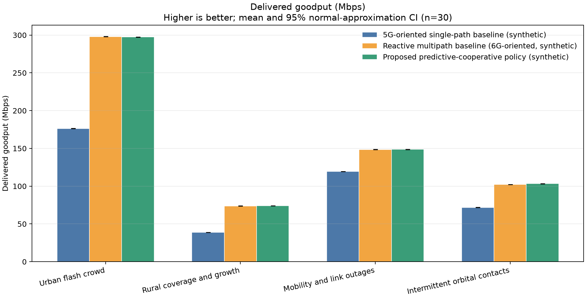

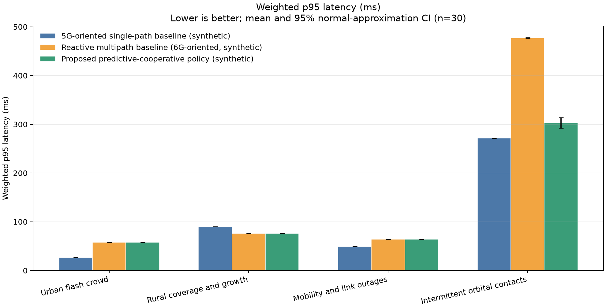

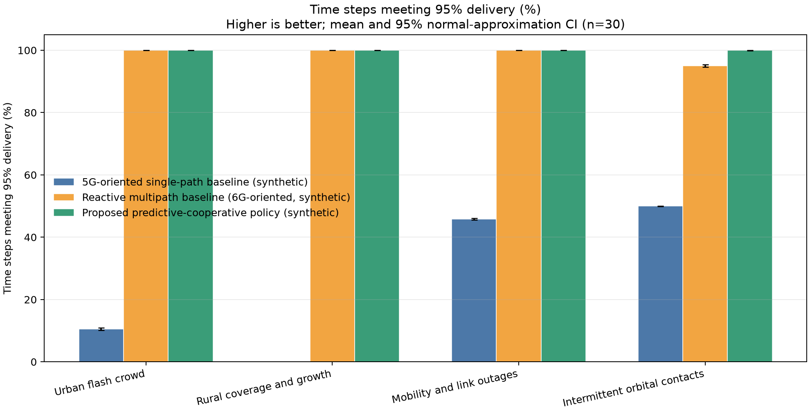

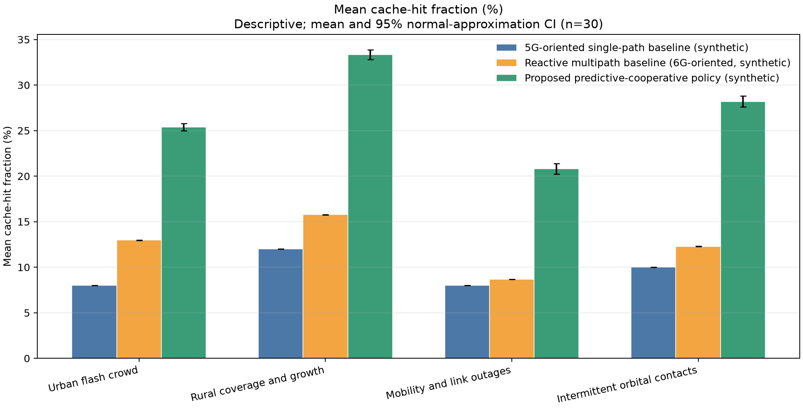

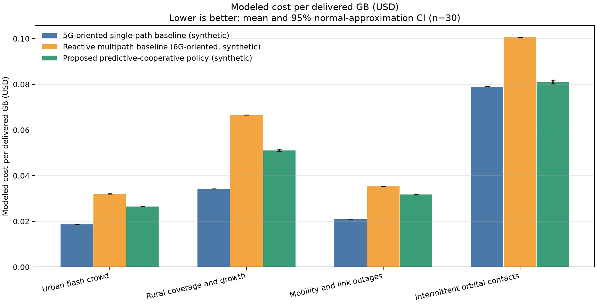

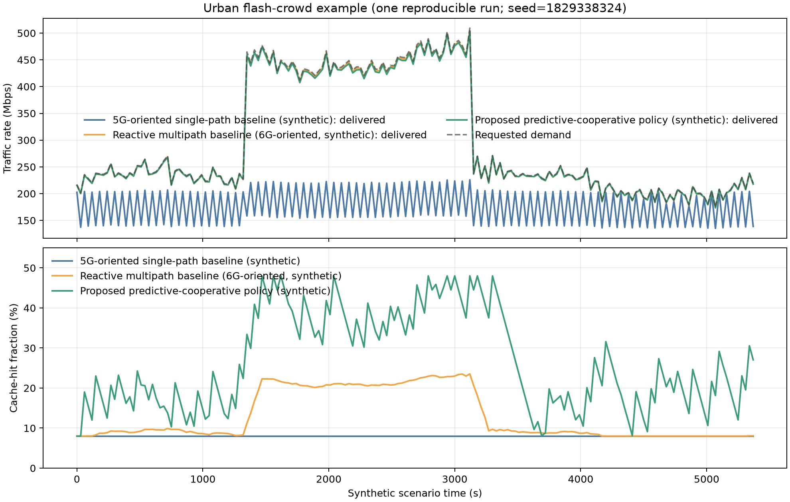

These are synthetic policy experiments with hand-selected assumptions. In
particular, the high single-path continuity failures are a consequence of the
configured capacity constraints, not evidence about real 5G coverage; the
reactive and predictive policies are abstractions rather than 6G/7G system
implementations. Their near-identical goodput is a property of the shared
allocator and equal total path capacity; the controlled re-evaluation in
§10.1 shows that removing that confound does not turn the predictive arm into a
winner — pressure prediction is mildly negative for goodput and cache
prediction supplies the measured gains. The tested proposal's defensible
differences are therefore cache prediction, modeled cost, and selected orbital
outcomes; it does not test the broader brain-inspired self-reorganization
claim, and it makes no predictive-goodput claim.
The results are sensitive to cost weights, demand and
outage schedules, cache limits, and policy parameters. They do not model
transport retransmission, shared bottlenecks, packet reordering, radio
scheduling, power, or physical infrastructure costs. Reproduction and
extension should begin with the benchmark code and CSV, then replace synthetic
assumptions with documented traces and validated policy baselines before
making operational claims.

### 10.1 Controlled re-evaluation of the predictive claim

The comparison above contains a design flaw that earlier versions of the
repository acknowledged and that this subsection corrects: every policy is
evaluated with the same allocation function, and the predictive-cooperative arm
uses larger cache gains than the reactive arm. A goodput difference between the
arms therefore cannot be attributed to prediction, and equal goodput is
expected by construction rather than measured.

The replacement experiment ([`tools/benchmark_fair.py`](../tools/benchmark_fair.py))
changes the design, not the physics:

- every arm owns an **allocator instance with its own state**, so no arm's
  result depends on another arm's predictor;
- cache gains are held constant inside each comparison;
- a 2×2 ablation separates the two mechanisms — arm A uses reactive pressure
  and reactive cache, B predictive pressure with reactive cache, C reactive
  pressure with predictive cache, and D both;
- 30 paired seeds are reused across arms and scenarios, and differences are
  reported with 95 % intervals and an exact paired sign test;
- a fifth pair (E/F) deliberately shares one allocator between a reactive and a
  predictive arm, reproducing the legacy artifact so that its magnitude can be
  measured rather than assumed.

Mean paired differences against arm A in delivered goodput (Mbit/s, 95 %
interval, 30 paired seeds):

| Comparison | Urban | Rural | Mobility | Orbital |
|---|---:|---:|---:|---:|
| B - A: predictive pressure only | -1.31 ± 0.01 | -0.11 ± 0.00 | -0.06 ± 0.00 | -0.00 ± 0.00 |
| C - A: predictive cache only | +0.38 ± 0.01 | +0.27 ± 0.01 | +0.21 ± 0.01 | +1.06 ± 0.04 |
| D - A: both predictive | -0.58 ± 0.04 | +0.26 ± 0.01 | +0.21 ± 0.01 | +1.04 ± 0.04 |

Every interval excludes zero and the sign test agrees (p < $10^{-8}$, n = 30). The
predictor's effect is negative in all four scenarios: forecasting pressure
while holding the cache controller fixed slightly *reduces* delivered goodput.
The gain is entirely attributable to cache prediction: C - A is positive in
every scenario and also lowers modeled cost per delivered GB (-$0.004 to
-$0.020) and, in the orbital scenario, lowers p95 latency (-174 ± 11 ms) and
raises continuity (+4.96 ± 0.41 points).

The shared-allocator pair E/F reproduces the independent-instance difference
D - A to three decimal places in every scenario. For this model, allocator
sharing is not the source of the earlier discrepancy — the unequal cache gains
are. Both flaws had to be fixed, but only one of them mattered for the result.

The paper therefore withdraws the claim that a predictive-cooperative policy
improves goodput and reclassifies the finding as a **negative result**:
second-order pressure forecasting, as implemented and as evaluated against the
matched reactive controller, does not pay for itself under these synthetic
dynamics, whereas demand forecasting for cache scaling does. A negative result
of this kind is a usable contribution precisely because the design now supports
it: the ablation isolates the mechanism, the paired statistics are reported,
and the alternative explanations are measured. What the experiment still
cannot establish is external validity — the demand, cost and outage schedules
remain synthetic, so the finding is a property of the model, not of deployed
networks. The summary and paired-difference CSVs are committed as
[`figures/vision_fair_summary.csv`](../figures/vision_fair_summary.csv) and
[`figures/vision_fair_paired.csv`](../figures/vision_fair_paired.csv).

### 10.2 Public-safety handover and congestion-wave study

A second experiment focuses on the stated continuity problem: an application
moving between Wi-Fi, mobile, HF, and satellite while traffic demand accelerates
toward a path bottleneck. A 180-second synthetic run uses one-second control
steps, 30 random seeds derived from root seed 2026, 12 Mbps of prioritized
mission-critical traffic, and a bursty bulk workload whose rate increases
quadratically before two additional load waves. The initial path capacities
are 80 Mbps (Wi-Fi), 150 Mbps (mobile), 60 Mbps (HF), and 280 Mbps
(satellite). The Wi-Fi path is unavailable from second 50 through second 64.
These are illustrative model inputs, not measured link or public-safety
service characteristics.

The **single-path handover** baseline uses one medium and incurs a modeled
two-second service gap when it changes paths at an 85% capacity threshold or
after a path loss. The **reactive multipath** profile activates additional
paths when current offered load reaches 90% of active aggregate capacity. The
**predictive overflow multipath** profile uses a five-sample median of demand
velocity and acceleration, bounds estimated acceleration to ±0.1 Mbps/s² to
limit noise amplification, and predicts six seconds ahead; it opens enough
additional paths to keep forecast demand below 80% of active capacity. Active
paths share traffic through the same bounded capacity allocator, with the
critical class allocated first. This is a simplified policy comparison, not
an implementation of MPTCP, 3GPP ATSSS, or a public-safety system.

The main outcomes are application-level multimedia QoS, not delivered
goodput. In each one-second control step, the simulator produces 30 video
frames per second, each represented by 14 independently transmitted segments,
and 50 audio packets per second. A video frame is considered on time only if
all segments arrive within a 150 ms deadline. Audio packets are duplicated
only by the predictive media-assist policy, over up to two active paths; other
policies send one audio copy. A packet counts as on time if at least one
eligible copy arrives within 50 ms. Path delay includes configured base
latency, a utilization-dependent queue term, and random variation; packet loss
is sampled independently.
Video stall time is the sum of missed 1/30-second frame intervals, while a
freeze event is a run of missed frames lasting at least 150 ms. Audio delay
variation is the p95 absolute difference between consecutive received-copy
delays. The p95 frame delay is computed over reconstructed frames, including
late frames but excluding frames with lost segments. The separate handover-gap
metric counts control steps where a single-path transition has no selected
route; it isolates modeled route-switch interruption from congestion-induced
late or lost media. These deadlines and packetization are scenario assumptions,
not certified application or public-safety requirements.

Thirty-replicate mean results are:
Here, V/J denotes p95 reconstructed-video-frame delay and p95 audio delay
variation, respectively. Media-assist packet overhead is the number of
duplicate video-segment and audio-packet transmissions divided by the number
of original media packets; it is a packet-count ratio, not a byte or capacity
percentage.

| Policy | Video on time | Audio on time | Stall total / max (s) | p95 V/J (ms) | Handover gap |
|---|---:|---:|---:|---:|---:|
| Single path | 43.64% | 39.79% | 101.44 / 95.93 | 138.6 / 9.21 | 4.0 s |
| Reactive | 97.13% | 99.19% | 5.17 / 1.00 | 137.1 / 2.24 | 1.0 s |
| Predictive | 97.72% | 99.75% | 4.10 / 0.07 | 137.3 / 2.25 | 0.0 s |
| Predictive + media assist | 99.18% | 99.90% | 1.47 / 0.05 | 48.9 / 2.30 | 0.0 s |

The single-path policy has two modeled transitions, each with a two-second
interval with no selected path: four seconds total and 120 missed video frames
at 30 frames/s. Reactive multipath has a one-second standby-path activation gap
(30 frames), while the predictive policy has none under this schedule. The
single-path's much larger cumulative stall and 95.93-second longest freeze
also reflect later capacity/queue overload in the scenario; they must not be
attributed to handover alone. Multipath avoids most or all of these modeled
switch gaps. Acceleration forecasting improves video on-time delivery by 0.59
percentage points and audio by 0.56 points versus reactive multipath, and
reduces cumulative stall by 1.07 seconds. Its p95 video delay and audio
variation are effectively unchanged, so the predictive policy alone does not
show a broad QoS advantage over reactive multipath.

Adding media assist improves video on-time delivery by a further 1.46
percentage points and audio by 0.15 points versus predictive multipath, while
reducing total stall by 2.63 seconds and p95 reconstructed-frame delay by
88.3 ms. The tradeoff is 47.04% duplicate packets relative to original media
packets and a mean 1.862 Mbps of duplicated media payload in this scenario.
The configured source media rates are 4 Mbps video and 0.128 Mbps audio; the
duplication rate measures selected packet copies, not the full source rate.
Duplicate payload load contributes to modeled utilization for subsequent
media packets, but the simplified allocator does not feed it back into
bulk-flow allocation. These are synthetic QoS and resource-model results, not
evidence that a deployed transport accelerator would achieve the same gains.

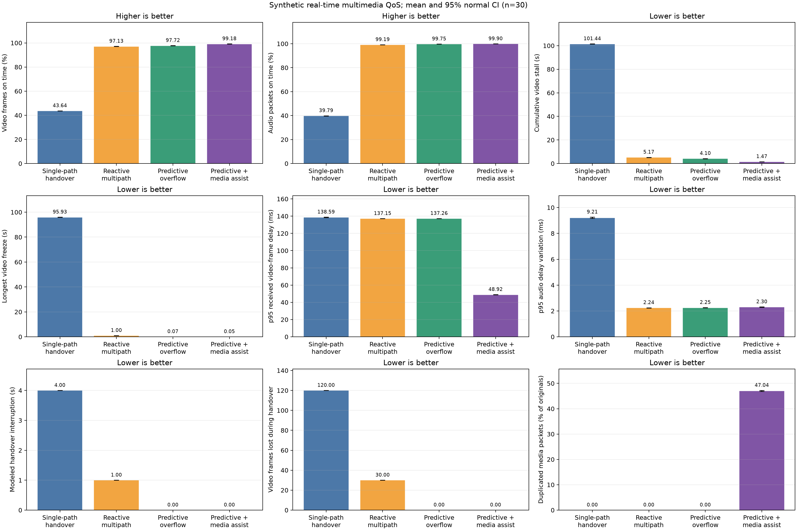

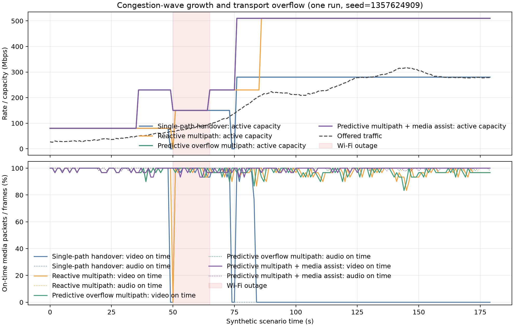

The figure and CSV report normal-approximation 95% confidence intervals across
the 30 seeds. These results illustrate the mechanism under the stated
assumptions; they are not deployment measurements or an estimate of real
public-safety availability. In particular, multipath activation is modeled
without path setup delay, the synthetic transport omits protocol retransmission
and reordering, and the Wi-Fi, mobile, HF, and satellite path characteristics
are not measured. A real evaluation must measure app-level voice/video
continuity, one-way latency, jitter, deadline misses, recovery time, and
correlated failure using a fair 5G multi-access baseline where available, plus
operator-approved 3GPP mission-critical service requirements [13]. The CSV
with replicate-level summary statistics is
[`figures/public_safety_benchmark_summary.csv`](../figures/public_safety_benchmark_summary.csv).

### 10.3 Cooperative path and multicloud reorganization experiment

The prior coarse comparison mixed route forecasting, replica preparation,
setup delay, and packet duplication in only two policies. Its bars therefore
could not identify which change caused an apparent gain, and its one-packet
video-frame abstraction was not a frame-completion QoS metric. The revised
experiment uses six matched policy arms and three paired scenario profiles
to separate those mechanisms:

| Policy arm | Predictive path activation | Early cloud preparation | Selective media duplication |
|---|---:|---:|---:|
| Reactive baseline | No | No | No |
| Reactive with selective duplication | No | No | Yes |
| Predictive paths only | Yes | No | No |
| Prepared cloud only | No | Yes | No |
| Predictive paths and prepared cloud | Yes | Yes | No |
| Full cooperative | Yes | Yes | Yes |

All arms use the same link/cloud capacities, event schedules, application
workload, and paired demand seeds within each scenario. The scenarios are
nominal; 25% higher offered load; and a correlated outage in which cellular
fails with fiber, demand is 10% higher, and modeled path/cloud setup times are
50% longer. They are explicitly synthetic stress profiles, not calibrated
representations of 5G or 6G systems.

This is a custom discrete-event abstraction, not a calibrated physical-layer,
radio-access, or standards-complete protocol simulator. The paired arms help
attribute effects to modeled policy components, but they do not establish
fidelity against ns-3, OMNeT++/INET, Sionna, a protocol implementation, or
field measurements. In particular, the modeled capacity, delay, loss,
correlation, queue service, and cloud startup distributions are scenario
inputs. No external simulator comparison or independent replication has been
performed.

The transport portion is implemented with SimPy. Each link has a bounded
256-packet queue, a packet serialization rate derived from its time-varying
capacity, propagation delay, jitter, and a configured base/congestion loss
probability. Audio packets have priority over video segments in each link's
queue. Video runs at 30 frames/s, each frame consists of four required
segments, and a frame is counted successful only if every segment arrives
within 150 ms; audio runs at 50 packets/s with a 50 ms deadline. Per-copy
loss, frame reconstruction, interarrival variation, stalls, and recovery
after the two modeled faults are measured separately. Selective duplication
uses the same risk rule in the reactive-duplication and cooperative arms, and
duplicate bytes enter the same path queues, so redundancy consumes modeled
capacity rather than being free.

Bulk traffic is still a per-second fluid approximation. It influences link
service rate and total capacity delivery but is not represented as individual
packets. Cloud region A has a health/capacity schedule; region B has an
abstract startup delay and capacity-time budget. A cloud service recovery
measurement is based on the first one-second interval after region-A failure
in which at least 95% of generated video frames meet their deadline. Runs
without recovery before the horizon are marked as censored in the CSV. This
does not simulate a Kubernetes API, application state replication, cloud
queues, or provider-specific failover.

For each scenario and policy, the CSV reports the mean and normal-approximation
95% interval across 20 seeds, plus paired mean differences and intervals
relative to the reactive baseline. Paired intervals reflect seed-to-seed
variation under these fixed assumptions only. They do not include uncertainty
in path capacities, delay/loss distributions, failure schedules, deadlines,
controller tuning, or the choice of scenario. The outputs are the
[benchmark CSV](../figures/brain_inspired_cooperative_benchmark.csv),
[QoS comparison](../figures/brain_inspired_cooperative_benchmark.png),
[resource tradeoffs](../figures/brain_inspired_cooperative_resources.png),
[paired effect-size plot](../figures/brain_inspired_cooperative_effects.png),
and [paired-seed time series](../figures/brain_inspired_cooperative_timeseries.png).

Selected 20-seed mean results make the separate contributions clearer:

| Policy | Video on time | Cloud recovery |
|---|---:|---:|
| Reactive baseline | 90.11% | 20.00 s |
| Full cooperative | 98.46% | 0.00 s |
| Reactive + selective duplication | 90.18% | 20.00 s |
| Predictive paths only | 90.23% | 20.00 s |
| Prepared cloud only | 98.35% | 0.05 s |
| Predictive paths + prepared cloud, no duplication | 98.46% | 0.00 s |

| Correlated-outage policy | Video on time | p95 frame delay | Duplicate payload |
|---|---:|---:|---:|
| Reactive baseline | 87.70% | 129.46 ms | 0.00% |
| Full cooperative | 98.56% | 32.60 ms | 5.52% |
| Reactive + selective duplication | 88.25% | 32.75 ms | 7.25% |
| Predictive paths only | 87.87% | 129.47 ms | 0.00% |
| Prepared cloud only | 98.00% | 128.94 ms | 0.00% |
| Predictive paths + prepared cloud, no duplication | 98.16% | 128.95 ms | 0.00% |

Under nominal and peak demand, cloud pre-warming accounts for nearly all of
the video on-time increase: the paired nominal gain is 8.24 percentage points
for prepared-cloud-only versus reactive, while predictive paths alone gain
0.13 points. Adding predictive paths to prepared cloud does not improve the
rounded nominal on-time result. In the correlated-outage scenario, prepared
cloud alone increases video on-time from 87.70% to 98.00%, but its p95 delay
remains about 129 ms. Selective duplication in the full cooperative arm cuts
that conditional p95 to 32.60 ms while adding 5.52% duplicate payload; its
video on-time advantage over prepared-cloud-only is only 0.56 percentage
points. Reactive selective duplication also lowers conditional p95 delay, but
does not repair the cloud recovery gap or materially improve on-time delivery.
Thus, this model supports a specific, assumption-dependent cloud-readiness
effect and a duplication/tail-delay tradeoff, not a demonstrated benefit from
predictive routing by itself.

The p95 frame-delay statistic is calculated only for frames that reconstruct;
it must be read alongside the on-time percentage and is not a standalone
continuity measure. Duplicate payload is the duplicated media bytes as a
percentage of original media payload. The plotted confidence intervals
quantify replicate variability for these fixed assumptions, not uncertainty
about whether those assumptions match a real network.

This is a more detailed synthetic experiment, not yet an empirically
validated network simulator. Queue discipline, source traffic, path loss,
cloud startup, and fault timing remain stipulated. Its results can show how
the implemented rules behave under these explicit assumptions; they cannot
establish real-network effect size, prove a brain-inspired mechanism, or show
superiority over a deployed or fully specified 6G system. The model also does
not train or execute AI/RL, use NPU hardware, forward real packets, or run
Kubernetes. A credible next validation stage would calibrate the model with
measured traces, compare against standards-capable implementations, and test
the same policy arms in a controlled network emulator.

### 10.4 Coupled congestion control: Reno, LIA and OLIA

The evaluation agenda lists fair comparison against MPTCP congestion control as
open work, because the original simulator had no congestion window at all. The
repository now contains a window-level coupling model
(`simulation/congestion.py`) and a comparison benchmark
(`tools/benchmark_congestion_control.py`) covering uncoupled Reno
(RFC 5681 additive increase, multiplicative decrease), LIA (RFC 6356 eq. 1) and
OLIA (the published Khalili et al. increase rule). It is a model, not a TCP
implementation: there are no ACK packets, retransmission, slow start or MPTCP
schedulers, the caller supplies the RTT estimate, and a loss halves only the
affected subflow. Those simplifications bound what the result can mean.

The scenario is a two-path flow with 20 Mbit/s and 5 ms RTT on path A and
8 Mbit/s and 25 ms RTT on path B, 1460-byte segments, 60 simulated seconds,
8 paired seeds, one drop-tail queue of 2×BDP per path, and at most one
congestion response per RTT. Means with 95 % Student-t intervals:

| Algorithm | Total (Mbit/s) | Path A (Mbit/s) | Path B (Mbit/s) | Jain index | Coupled ACKs |
|---|---:|---:|---:|---:|---:|
| Reno | 27.9935 ± 0.0023 | 19.99999 ± 0.00003 | 7.99348 ± 0.00230 | 0.8446 | 0.0 % |
| LIA | 27.9927 ± 0.0028 | 19.99996 ± 0.00004 | 7.99272 ± 0.00283 | 0.8446 | 67.3 % |
| OLIA | 26.6480 ± 0.0084 | 19.99999 ± 0.00003 | 6.64797 ± 0.00843 | 0.7993 | 100.0 % |

Reno and LIA both saturate both paths and are statistically indistinguishable
in practice: the paired difference is -0.0008 Mbit/s
(95 % CI [-0.0013, -0.0003]), 0.003 % of the 28 Mbit/s combined capacity.
OLIA reaches 1.345 Mbit/s (4.8 % of capacity) less than LIA. The mechanism is
visible in the model state rather than assumed: path B's mean window is
14.2 segments against a 17.1-segment bandwidth-delay product, so B's goodput
falls to 6.65 Mbit/s. In the published OLIA rule, the long-RTT path needs the
largest window and therefore stays in the `max_w_paths` set; the `collected`
set is then usually empty, its coupling term is zero, and B grows only through
the slower Kelly/Voice term while drop-tail halving keeps it below BDP. A
300-second diagnostic run held the same steady rate, so this is an equilibrium
of the model, not slow convergence.

The convergence-time metric is uninformative here (every run was already inside
the ±10 % band within the first two seconds), so no convergence claim is made.
Nor is this a conformance test: the Linux out-of-tree OLIA implementation uses
a different inter-loss statistic, and a kernel MPTCP stack with pacing, slow
start and real ACK clocks would not necessarily reproduce these numbers. The
defensible statement is conditional: in this stipulated model, coupling
provides no total-throughput gain over capacity saturation, and the published
OLIA increase is penalised for long-RTT paths behind shallow buffers. That is a
testable hypothesis for a real stack, not evidence about MPTCP. Summary,
replicate and paired-difference CSVs are committed under `figures/`.

## 11. From multipath handover to multicloud Kubernetes

The proposed system spans two different adaptation timescales. A real-time
session controller must preserve media delivery while its usable transport
changes; a service-orchestration controller must place and scale caches,
relays, and application workloads across edge sites and cloud regions. These
controllers exchange goals and capacity signals, but must not be collapsed
into one loop: a Kubernetes pod start is far too slow to repair a packet-level
handover, and rapid path steering must not create unbounded cloud replicas.

### 11.1 Session and transport continuity

An application session has a stable service identity independent of its
current access bearer. A session endpoint or trusted edge gateway measures
per-path delay, jitter, loss, available capacity, MTU, reachability, and
confidence in the telemetry. A path manager maintains active and standby
subflows across eligible media such as Wi-Fi, cellular, private radio, HF, and
satellite. Authentication, application policy, and path MTU are checked
before a path is admitted. Multipath transport such as MPTCP can use several
IP paths for one byte stream where both endpoints and the network support it
[11]; 3GPP access-traffic steering, switching, and splitting is a relevant
5G-system capability [12]. Neither capability implies universal support for
arbitrary access combinations or identical handover behavior across devices.

The predictive controller estimates demand and path-pressure velocity and
acceleration. If projected load approaches a safety margin, it can establish
or reserve a secondary path and shift eligible traffic before the serving path
saturates. During a failure, a pre-established path may avoid the setup gap
modeled for single-path switching. Traffic may be striped when reordering and
application semantics permit; deadline-sensitive audio may be duplicated over
independent paths; video may use selective packet duplication or application
FEC when a path forecast indicates elevated deadline risk. The policy must
bound redundancy, account for its capacity cost, respect data residency and
priority, and retain deterministic fallback if telemetry or inference fails.

### 11.2 What “TCP amplifier” should mean

“TCP amplifier” is not a standardized protocol term and should not be read as
creating bandwidth. TCP retransmission can add head-of-line delay: a missing
byte may hold later bytes from the receiving application. That behavior can
be undesirable for interactive media even when TCP eventually delivers every
byte. Much real-time audio/video uses deadline-aware transports over UDP,
including RTP/WebRTC profiles, while QUIC provides both reliable streams and
datagram extensions depending on the application. The correct mechanism
depends on the media stack, not a generic TCP switch.

This paper therefore uses **transport accelerator** or **media assist** for a
policy layer, not a device that amplifies TCP. Its functions may include:

1. classifying flows by authenticated service policy and deadlines;
2. pacing and prioritizing packets without starving control or other users;
3. steering or striping packets over established subflows;
4. selectively duplicating only packets whose predicted path risk justifies
   the extra bytes, or adding bounded application-layer FEC;
5. measuring late/lost frames, jitter, freezes, recovery time, and redundancy
   overhead, then reducing assist when path conditions improve.

For legacy TCP, a deployment could use endpoint-supported MPTCP or an
explicitly configured transport proxy. A split-TCP proxy changes end-to-end
transport semantics and may conflict with end-to-end encryption, congestion
control, authentication, and application assumptions; it must not silently
acknowledge or discard data on behalf of an endpoint. This simulator models
deadline-aware media packet duplication and path selection only. It does not
implement TCP, MPTCP, QUIC, WebRTC, FEC, proxying, or real packet forwarding.

In the public-safety synthetic benchmark, predictive multipath with media
assist is compared with predictive multipath alone. At root seed 2026 over 30
replicates, video frames on time increase from 97.72% to 99.18%, audio packets
on time from 99.75% to 99.90%, and total video stall falls from 4.10 s to
1.47 s. p95 received video-frame delay falls from 137.3 ms to 48.9 ms, while
p95 audio delay variation changes from 2.25 ms to 2.30 ms. The modeled assist
duplicates 47.04% as many media packets as original packets and averages
1.862 Mbps of duplicated payload in this scenario. This is a QoS/overhead
tradeoff under synthetic assumptions, not a claim that a real transport
accelerator achieves these values.

## 12. AI- and NPU-assisted TCP transport acceleration

“TCP amplification” is best treated as a proposed service name, not a literal
increase in a TCP connection's capacity. A neural processing unit cannot add
link bandwidth, remove propagation delay, or make lost bytes arrive sooner.
The technically meaningful goal is **AI-assisted transport optimization**:
use measured and predicted conditions to select a safe combination of path,
pacing, scheduling, and application-level protection while preserving TCP's
reliability and congestion response. TCP behavior is defined by the
standardized transport protocol, and congestion control is an essential
response to shared bottlenecks [16, 17]. An accelerator must not defeat those
controls by injecting acknowledgements, hiding loss, or encouraging a sender
to exceed a safe rate.

### Functional architecture

As introduced in Section 11.2, the design separates three functions that are often conflated by the word
“NPU”:

1. **Packet-forwarding hardware:** a switch/router ASIC or network processing
   unit (NPU) classifies, queues, schedules, filters, and forwards packets at
   line rate according to installed policy.
2. **Neural inference hardware:** a neural NPU, GPU, or CPU evaluates a compact
   model over summarized telemetry. It recommends path weights, a standby
   activation, a pacing envelope, or selective media protection.
3. **Endpoint transport:** the TCP sender and receiver retain sequence,
   acknowledgement, retransmission, and congestion-control state. A network
   controller may configure supported endpoint or multipath behavior, but it
   does not silently replace endpoint semantics.

The neural model should generally operate on a control interval (for example,
hundreds of milliseconds to seconds), not infer separately for every packet.
Packet actions need predictable latency and remain in the router's
deterministic forwarding pipeline. A model can consume windowed features such
as RTT and RTT variation, ECN marks, queue occupancy and trend, loss and
retransmission rates, ACK spacing, path availability, offered load, and
application class. It emits bounded recommendations such as “prepare path B,”
“reduce this flow's pacing ceiling,” or “duplicate only these deadline-bound
datagrams.” The policy engine checks authorization, topology, congestion,
capacity, and service constraints before programming the forwarding hardware
or a supported endpoint API.

### Where AI may help and where it must not

Prediction may help distinguish a rising queue from a transient sample,
anticipate a path outage, rank eligible paths by deadline risk and cost, or
recommend a cautious pacing profile. For MPTCP-capable endpoints, supported
subflows can be scheduled according to policy; RFC 8684 specifies the
endpoint-level multipath TCP extensions [11]. For a conventional single-path
TCP flow, changing the route may alter RTT, reordering, and failure behavior.
An in-network device should not assume it can transparently split or migrate
that connection while retaining semantics. An explicit proxy creates separate
transport legs and therefore changes the end-to-end trust and failure model.

The controller must not treat every loss as proof of congestion or every idle
queue as permission to increase the sending rate. Wireless fading, mobility,
buffer overflow, route changes, and correlated failures can produce different
signals; an incorrectly aggressive model can worsen congestion for other
flows. Consequently:

- congestion-window evolution remains governed by a standards-compliant
  endpoint congestion controller (for example, CUBIC where implemented) [18];
- network pacing and prioritization respect aggregate link capacity, fairness,
  and configured service budgets;
- retransmission remains the responsibility of TCP endpoints; the network may
  provide telemetry but does not spoof ACKs or discard acknowledged data;
- packet duplication or FEC is applied only to application data whose deadline
  semantics support it, and its bytes are charged to the same capacity budget;
- policy is fail-safe: stale telemetry, model failure, overload, or accelerator
  unavailability returns control to the established non-AI forwarding and
  congestion-control path.

For encrypted traffic, classification must rely on authorized metadata,
explicit endpoint signaling, or service policy rather than payload inspection.
Model features and logs should avoid storing unnecessary user data.
Signed/versioned models, provenance checks, sandboxed inference, rollback,
operator override, and rate-limited actions are required before considering
an autonomous deployment.

### Training, placement, and Kubernetes integration

Training should use diverse measured traces spanning wired, cellular, Wi-Fi,
microwave, and satellite conditions, including congestion, random loss,
mobility, route changes, and correlated failures. Synthetic pretraining can
initialize a model but cannot establish safe thresholds or generalization.
Validation should use held-out networks, calibrated uncertainty, offline
replay, and shadow mode before any recommendation is allowed to change live
traffic. Online reinforcement learning must not explore by violating
congestion, availability, or safety constraints; constrained contextual
selection or offline policy evaluation is a safer initial research path.

In the multicloud architecture, regional Kubernetes clusters can deploy
versioned model services and telemetry aggregators near routers. A global
planner can distribute signed model artifacts and compatible policy bundles
according to region, hardware capability, and data-residency rules. Local
inference must continue when cloud connectivity is lost, and model rollout or
pod autoscaling must not sit in the packet recovery loop. Kubernetes schedules
the control-plane services and manages their lifecycle; router forwarding
hardware performs the time-critical packet actions. Hardware accelerators
must be explicitly inventoried and exposed through validated vendor drivers
or device plugins. An NPU cannot be assumed merely because a cluster is
Kubernetes-managed.

### Evaluation criteria

An evaluation should compare a standards-compliant TCP congestion-control
baseline, supported MPTCP scheduling where both endpoints permit it, static
operator policy, reactive telemetry-based steering, and the proposed
AI-assisted recommendation with deterministic safety guards. Replay paired
traces with identical offered load and failure timing. Measure completion
time, goodput, RTT distribution, retransmissions, ECN, queue delay, loss,
fairness against competing flows, handover recovery, energy, inference
latency, and model/action overhead. Include counterexamples: bad forecasts,
model outage, route asymmetry, non-congestion loss, sudden bottleneck
collapse, encrypted flows, and adversarial telemetry. Report whether QoS
improves without harming other flows or violating congestion-control rules.

The current repository does not implement this TCP/NPU controller. It has a
synthetic ONNX congestion forecaster and an optional inference-provider path,
but no connection to TCP state, live switch queues, a forwarding ASIC, or
Kubernetes model deployment. Accordingly, the concept is a research chapter
and evaluation plan, not a demonstrated TCP amplifier.

## 13. Multicloud and Kubernetes control plane

Each edge, regional, and cloud location operates an independently managed
Kubernetes cluster. A global placement service may observe summarized
capacity, cache hit/miss demand, accelerator availability, service latency,
egress price, trust domain, and residency constraints through authenticated
cluster agents. It selects a target region or replica set; a local cluster
controller then reconciles desired state into Deployments, StatefulSets,
Services, storage claims, and node-local cache workloads. Kubernetes HPA or a
custom-metrics scaler can adjust replica counts from queue depth, request
rate, or forecast demand, within configured min/max replicas and resource
quotas. Topology-aware placement and affinity keep cooperating data-plane
components close when that improves service.

The global service is not assumed to be a magical Kubernetes federation.
Clusters have separate API servers, identities, failure domains, and
networking. Cross-cluster service discovery, workload identity, policy,
secrets, image/model provenance, service connectivity, and failover must be
explicitly selected and validated. Cache placement is not the same operation
as relocating a stateful service: cache objects can often be copied
asynchronously after integrity and policy checks, while stateful workloads
require consistency, ownership, and recovery semantics. The global planner
should move content and pre-warm capacity ahead of demand where economical,
but keep local serving and failover operational during cloud control-plane
partition.

## 14. Coupling, safety, and evaluation

The end-to-end control loop is: (1) observe path and service QoS; (2) predict
load and deadline risk; (3) admit an alternate authenticated path; (4) steer
or selectively protect media; (5) report regional demand and resource
pressure; (6) request cache replication or bounded Kubernetes scale-out; and
(7) verify the resulting application QoS and cost. Path steering operates on
packet-to-second timescales; orchestration and cache placement generally
operate more slowly. Hysteresis, rate limits, budgets, and ownership boundaries
are needed to prevent competing controllers from oscillating or scaling
without limit. NPU inference may recommend actions, but authorization, rate
limits, placement constraints, and fast failover remain deterministic and
operator-controlled.

Evaluation should compare single-path handover, standards-capable multipath
where available, reactive multipath, predictive multipath, and predictive
multipath plus media assist. Replay shared Wi-Fi/mobile/HF/satellite traces
with controlled outages and correlated failures. Measure session interruption
duration, video frame deadlines, freezes, audio packet deadlines, jitter,
tail latency, reordering, retransmissions or redundant bytes, energy, cost,
and Kubernetes scale/placement delay. Include cases where duplication harms
congestion, policies prohibit a route, or a cloud region is unavailable. The
decision criterion is sustained application QoS within a resource and policy
budget, not peak goodput in isolation.

## 15. Prototype status and limitations

The accompanying [repository](../README.md) provides starting artifacts, not
experimental evidence for planetary-scale operation. It is an early-stage
single-author research prototype. This paper has not undergone peer review,
and no independent replication is claimed. Its literature review provides
technical context, not evidence of community endorsement, adoption, or novelty
of the integrated design. As of this version there are no external issues,
pull requests, forks, or citations; the validation, replication and citation
artifacts ([`docs/external-validation.md`](../docs/external-validation.md),
[`REPLICATION.md`](../REPLICATION.md), [`CITATION.cff`](../CITATION.cff) and
the issue forms under `.github/ISSUE_TEMPLATE/`) exist so that such engagement
can be recorded when it happens, not as evidence that it has happened.

| Capability | Current prototype | Research gap |
|---|---|---|
| Multi-path mesh | In-process allocation plan using configured link attributes | Real forwarding, shared bottlenecks, transport behavior, and network testbed |
| Network simulator fidelity | Custom Python/SimPy event and queue abstractions with CSV KPI interchange; scenario S1 (two-path handover, CBR UDP, 100-packet FIFO) cross-validated against ns-3.49 seed by seed | Wireless PHY/MAC validation (ns-3 Wi-Fi/mmWave or Sionna), TCP/MPTCP transport, OMNeT++/INET replication, and trace calibration of the remaining parameters |
| UDP packet path | Actual socket datagrams over local IPv4 loopback | Multi-host/NIC transmission, physical media, loss/reorder emulation, and scale |
| Forecasting | Finite-difference velocity/acceleration extrapolation in the policy benchmarks; a separate small MLP pretrained on deterministic synthetic data | Compare against persistence and statistical/learned baselines using measured, temporally separated traces; quantify uncertainty and regime-shift behavior |
| NPU execution | Optional ONNX provider path with profile checks | Vendor hardware/runtime validation and physical-device evidence |
| CDN adaptation | Simulated demand forecasting, cache, and replica decisions | Production cache integration, freshness, privacy, and economic evaluation |
| Cooperative recovery | Deterministic paired path/cloud failure benchmark and one-factor sensitivity runner | Trained distributed AI, calibrated failure behavior, and real Kubernetes/cloud integration |
| Orbital infrastructure | Architectural concept only | Orbital dynamics, spacecraft subsystem model, mission cost, and field data |
| Quantum resource | Illustrative key-buffer abstraction | Protocol-accurate quantum network and security analysis |

The current model's synthetic validation result is not a measurement of
real-network accuracy. Likewise, a local UDP benchmark is not a measurement of
wireless, satellite, microwave, or wide-area performance. The system has not
been shown to improve global coverage, affordability, latency, resilience, or
environmental impact.

### Implementation and software-test status

The local validation workflow is implemented in the repository. It includes
measured-trace replay with explicit input checks, run-level replicate exports,
paired one-factor-at-a-time sensitivity sweeps, and CSV adapters for
normalizing and comparing simulator or testbed results by scenario, policy,
metric, and seed. The comparison tool requires at least two matched seed pairs
to report a paired uncertainty interval and rejects unit mismatches. Automated
tests cover trace validation and replay, parameter scaling, sensitivity
outputs, external-result normalization, paired comparisons, and rejection of
undersized comparisons.

On 2 November 2026, the full local Python test suite completed with **93 tests
passing** (plus 7 parameterised subtests; `py -m pytest`), including the
validation-workflow, link-queue, controlled-benchmark and coupled
congestion-control tests. A measured-trace smoke run using generated temporary
input, two replicates, and one custom scenario completed and produced the
expected outputs for all six policies. These results establish software
behaviour for the tested code paths only. They are not wireless PHY validation,
operational-trace calibration, MPTCP conformance, or testbed evidence, and they
do not validate physical-network fidelity.

The policy benchmark uses a simple second-order extrapolation,
\(\hat{x}(t+H)=x(t)+vH+\tfrac{1}{2}aH^2\), with finite-difference estimates
of velocity and acceleration. This is an interpretable baseline, not a
learned forecasting method and not evidence that traffic follows constant
acceleration. The synthetic ONNX MLP is a separate prototype artifact; it is
trained on synthetic telemetry and is not the predictor used to establish the
paired benchmark results. Neither model has been validated on representative
operational traces.

The current benchmark set also remains narrower than the proposed system.
Its path allocator and failure schedules are abstractions; its cooperative
failure study tests deterministic path activation, cloud pre-warming, and
selective duplication, not trained distributed-AI reorganization or live
multicloud Kubernetes. The earlier vision benchmark shared an allocator
between reactive and predictive policies and gave the predictive arm larger
cache gains, so similar delivered goodput was expected by design. The
controlled re-evaluation in §10.1 fixes both issues and changes the conclusion
rather than rescuing it: with independent allocator instances and cache gains
held constant, pressure prediction reduces delivered goodput in every scenario
while cache prediction supplies the measured gains. These experiments support
only conditional observations about their implemented mechanisms, not claims
about a complete 6G/7G system, and the predictive-goodput claim is withdrawn.

The next work should first cross-check one wireless link/handover scenario in
a network-level simulator with a real PHY/MAC model and calibrate inputs
against documented measurements. It should then extend the transport
comparison to protocol-compatible MPTCP baselines, including LIA/OLIA
congestion control where appropriate and established schedulers, with matched
workloads and resource accounting; the repository now includes a coupled-window
LIA/OLIA model and a comparison benchmark, but those results are model-level
and not yet cross-checked against a kernel MPTCP implementation. The
implemented one-factor sensitivity runner varies demand, capacity, delay, loss,
setup/startup scaling, and forecast horizon; broader factorial or global
analysis over correlated failures, forecast error, and cloud assumptions
remains necessary. External review, independent replication, and controlled
emulation/testbed evaluation remain future work, not completed project
milestones.

## 16. Surgical, rate-controlled state updates

The observation layer in §5 specifies normalised path pressure and its first two
derivatives, and names acceleration-triggered cross-medium overflow as the
regime of interest. It does not specify the **control law** that maps those
observations to changes in network state. This section supplies that law and
tests it; §16.4 reports where measurement contradicts the design intent.

### 16.1 State plane

A node's editable state is the vector `S = (alpha, queue policy, FIB overrides)`,
where `alpha in [0,1]` splits capacity between forwarding (`(1 - alpha) C_n`) and
serving (`alpha C_n`), the queue policy sets per-class weighted-fair-queueing
weights and byte limits, and FIB overrides hold per-flow next hops layered over a
loop-free name table. Every mutation passes through a single ledger, so the speed
and acceleration of state change are measured at the point of edit rather than
reconstructed afterwards. This matters: the dependent variable of H2 is precisely
that trajectory.

### 16.2 Kinematic monitor and the spike trigger

Each node keeps exponentially weighted baselines of pressure, pressure velocity,
and acceleration, and derives its threshold from the exponentially weighted
magnitude of its own acceleration residual, with multiplier `k = 4` and a
physical floor. The intent is that a steady network is silent without a
hand-tuned constant: the threshold tracks the measured noise floor. An
alpha-beta filter variant is evaluated alongside it, because the argument that a
trend-following filter beats a moving average has been made for RTT prediction.

### 16.3 Control law

Two distinct forms of rate control are applied, because they bound different
things. *Discrete edits* -- promoting one `(content, source-region)` class into
its own weighted lane at the routers it crosses -- are applied in a single step
and bounded by a **per-node token bucket** with a sustained rate and a burst
allowance; a node that has just fired cannot fire again for `|dS| / v_max`
seconds. *Continuous knobs* -- `alpha` and buffer scale -- move through a
**double integrator** with explicit speed and acceleration caps.

Hysteresis is a **pressure** test, not an acceleration test. A sustained flood
has zero acceleration and high pressure, so releasing on calm acceleration
un-isolates in the middle of the attack. Release additionally requires the
culprit class's arrival rate to have stopped for several control ticks.

### 16.4 Measurement

The testbed is a 100-node three-medium fabric (SimPy, not ns-3): 1 Gbps / 2 ms
fiber, 100 Mbps / 10 ms / 1 % microwave, and a 10 Mbps / 500 ms / MTU 576
satellite channel. Four origins are single-uplink leaves behind 100 Mbps
microwave last miles, so a name-targeted flood necessarily strikes a bottleneck
that legitimate traffic also uses. Eleven arms are compared over three
experiments and 30 paired seeds (840 runs): two baselines, four ablations, one
confound control, two composability arms, and a hyper-specialisation arm.

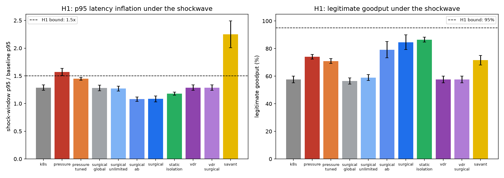

**H1 is refuted on two of four clauses.** The surgical arm holds a 1.08 p95
latency ratio where the global pressure controller degrades to 1.57, and recovers
11 percentage points of legitimate goodput (84.6 % versus 74.1 %). But legitimate
goodput does not exceed 95 %, and the global controller does not starve the fabric
to 2.2x.

**The confound control decides the interpretation.** Per-flow fair queueing
installed for every flow, with no sensing and no trigger at all, reaches 86.5 %
goodput and a 1.18 ratio. Almost all of the quality-of-service recovery is
therefore attributable to queue isolation -- a deployment practice predating this
work -- not to the kinematic trigger. What the trigger buys is **state economy**:
45 edits and 12 isolated classes against 215 edits and 215 permanently installed
classes. A causal claim that acceleration sensing produces the resilience would be
wrong on this evidence.

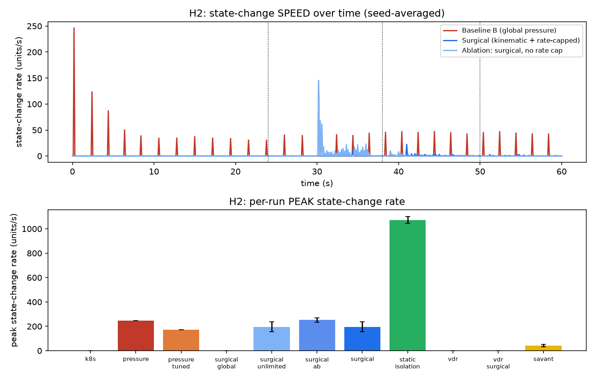

**H2 is supported in part.** The sustained state-change rate falls to 21 % of the
global controller's with 68x fewer edits, and responsiveness improves rather than
degrades. The seismograph prediction is confirmed for sustained activity: a flat
line interrupted by one short spike per edit. It is refuted for peak magnitude,
0.80x rather than below half. The reason is structural: a coordinated mitigation
edits roughly twelve routers inside one control tick, so the fleet-wide burst is
large even though each node's budget is small. A per-node limiter bounds how
often a node changes state; it cannot bound a synchronous burst across nodes
without a global limiter -- which would reintroduce the centralised controller the
design avoids.

**H3 is refuted, and the mechanism is instructive.** At a fiber-to-satellite
boundary the reassembly window saturates in every arm: 70.3 % of the run above
80 % occupancy for the surgical arm against 70.2 % for the static baseline, a
difference well inside the confidence interval. Two findings follow. First, the
reorder window is consumed by the number of in-flight fragmented objects over a
deep satellite buffer, and a queue-class edit at the ingress does not shorten that
buffer; legitimate objects alone can fill it. Second, the acceleration trigger is
*masked* in this regime: the two-second satellite buffer produces a periodic
pressure sawtooth (0.04 to 0.81), inflating the adaptive threshold to roughly 8
units/s^2 while the flood's residual is only about 3.1, so the detector goes blind
exactly where the vision paper expects it to act. An adaptive noise floor derived
from residual magnitude adapts to the pathology it is meant to detect.

**H4 (compensatory hyper-specialisation) is supported as stated, with a
measured threshold.** It is swept over its gain and reported in section 17;
in brief, asymmetric hyper-allocation beats symmetric load balancing and
smooth gradient actuation on affected-name delivery, peaks at `alpha -> 0.85`,
and collapses into cascading starvation beyond it.

**The spatial/temporal composability pairing is untested.** With single-uplink
origins there is no admissible loop-free alternative to the origin uplink, so a
pressure-weighted potential gradient never differs from the static forwarding
table and both composability arms are numerically identical to the static
baseline. A temporal control layer cannot rate-limit a target that does not
exist; the pairing must be re-run on a topology with genuine path diversity.

### 16.5 What this changes in the thesis

The measurement sharpens the contribution. Kinematic sensing is not the novelty:
the previous iteration's controller already consumed velocity and acceleration,
and its failure is one of *actuation*, not observation. The defensible claim is
that **where** state is edited and **how often** it may move are what separate a
resilient fabric from a reactive one -- localised, rate-capped edits achieve most
of the available quality-of-service recovery at an order of magnitude less
control-plane churn, while global proportional scaling on the same signal
destroys it. Presented as a claim about the trigger's causal power, the paradigm
is refuted by its own control arm.

Full detail, including five degenerate calibration configurations that were found
and corrected, is in [`surgical-rate-controlled.md`](surgical-rate-controlled.md)
and [`surgical-results.md`](surgical-results.md).

## 17. Compensatory hyper-specialisation (the "savant" mechanism)

Standard self-scaling networks (Kubernetes, MEC) employ symmetric, proportional
scaling in response to load. This section proposes and tests an alternative
inspired by biological neuroplasticity: **compensatory hyper-specialisation**.
When a node detects a kinematic shockwave -- the "injury" -- it may intentionally
shed its general routing role and execute a severe, asymmetric shift in its role
fraction `alpha`, dedicating its local resources to the affected circuit. The
biological framing is an analogy, not evidence; translated into control terms the
mechanism is an asymmetric, extreme-compensation control law with a measurable
cost. The hypothesis is that it provides superior resilience for the affected
flow under attack, at the measurable cost of system-wide transit efficiency, and
that the trade-off has a threshold.

The mapping is deliberate and mechanical:

| biological concept | network equivalent |
|---|---|
| neural tissue | the multi-medium backhaul fabric |
| injury or deficit | DDoS shockwave, link failure, congestion spike |
| neuroplastic rewiring | role fluidity, `alpha` in `[0, 1]` |
| hyper-allocated circuit | one isolated `(name, source-region)` queue |
| savant skill | a node drops general transit to serve or scrub one circuit |
| cost of the gift | neighbours absorb shed transit; system-wide starvation |

The controller isolates the culprit class with full weight, drives `alpha` toward
a target through the same speed- and acceleration-capped governor described in
section 16, and holds until pressure recovers. The target is swept, because a
single value cannot locate a threshold.

### 17.1 Measurement

Five gains are compared against symmetric load balancing (Kubernetes-style
static roles), the global pressure controller, a smooth gradient flux field
(VDR-style), and the rate-controlled surgical arm, which is the *control*: it
attempts to balance general traffic and the spike rather than trading one for the
other. Thirty paired seeds; "affected" is the attacked name, "other" is every
other name, and "spillover" is the throughput change at the neighbours of every
`alpha`-edited node.

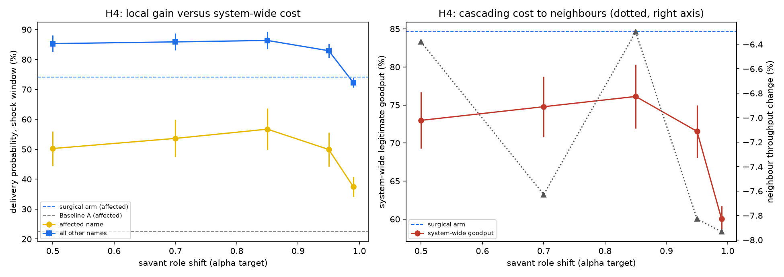

| arm | affected | other | system-wide | p95 ratio | spillover |
|---|---:|---:|---:|---:|---:|
| Baseline A (Kubernetes-style) | 22.4 % | 75.5 % | 57.6 % | 1.29 | - |
| Baseline B (global pressure) | 55.6 % | 83.4 % | 74.1 % | 1.57 | - |
| VDR (smooth gradient) | 22.4 % | 75.5 % | 57.6 % | 1.29 | - |
| Savant, `alpha -> 0.50` | 50.2 % | 85.3 % | 73.0 % | 1.18 | -6.4 % |
| Savant, `alpha -> 0.70` | 53.6 % | 85.9 % | 74.8 % | 1.19 | -7.6 % |
| Savant, `alpha -> 0.85` | **56.7 %** | 86.3 % | **76.1 %** | 1.29 | -6.3 % |
| Savant, `alpha -> 0.95` | 49.9 % | 82.9 % | 71.5 % | 2.25 | -7.8 % |
| Savant, `alpha -> 0.99` | 37.5 % | 72.3 % | 60.0 % | **4.09** | -7.9 % |
| Rate-controlled control | **74.1 %** | **90.1 %** | **84.6 %** | **1.08** | - |

### 17.2 Findings

**The hypothesis holds against its stated comparators.** Savant rewiring
delivers 56.7 % of the affected name against 22.4 % for both symmetric load
balancing and smooth gradient actuation, and it does so while keeping system-wide
delivery above Baseline A (76.1 % against 57.6 %). Extreme, asymmetric
compensation is not without value relative to symmetric scaling.

**The threshold is real and quantified.** Affected-name delivery is an inverted
U in the gain: it rises from 50.2 % at `alpha -> 0.50` to a maximum of 56.7 % at
`alpha -> 0.85`, then collapses to 49.9 % at 0.95 and 37.5 % at 0.99, where the
p95 ratio reaches 4.09 and system-wide throughput falls below Baseline A. The
crossing into cascading starvation lies between 0.85 and 0.95. A mechanism
described as "violent" is therefore only useful while it is not too violent.

**The predicted cost is larger than predicted, and it is shared.** Neighbour
spillover is negative at every gain, between -6.3 % and -7.9 %: when a node sheds
transit its neighbours do not absorb that load at higher throughput, they deliver
less than in the steady window. The cascade is not relocated, it is amplified.
The biological caveat -- that savants struggle with ordinary tasks -- maps onto a
measurable systemic penalty that appears even at the optimum gain.

**But the mechanism loses to smooth actuation.** The rate-controlled surgical arm
delivers 74.1 % of the affected name, 90.1 % of everything else and 84.6 %
system-wide at a 1.08 p95 ratio: better than the savant on all four axes at once,
using a fraction of the state churn. The reason is structural rather than
incidental. On this fabric the congested node is the last router before a
single-uplink origin, so shedding its forwarding capacity removes capacity from
the very path the affected traffic needs. Compensatory hyper-specialisation can
pay only where the specialised resource sits *downstream* of the constraint -- a
dedicated scrubber in front of the origin -- not where it consumes the transit
capacity that the affected flow depends on.

The paradigm is therefore not wrong so much as locally mis-scoped: the mechanism
does what it claims against symmetric scaling, has a real and locatable operating
limit, and is dominated by a cheaper smooth alternative in this topology.

## 18. OEF compensation and multidimensional baselining

Two extensions to the surgical controller are tested as pre-registered
hypotheses in [`oef-mkb.md`](oef-mkb.md); both are framed as control theory, with
the biological language kept strictly as analogy.

### 18.1 The Fick-principle mapping (OEF)

The brain holds metabolic rate `CMRO2` constant when cerebral blood flow `CBF`
falls by raising the oxygen extraction fraction `OEF`: `CMRO2 = CBF x OEF x Ca`.
Mapped to the fabric, CBF is delivered throughput, Ca the nominal capacity,
CMRO2 legitimate goodput, and OEF the weighted-fair-queueing weight of the
legitimate class. When a node's windowed CBF falls below 0.8 of its moving
average for three consecutive ticks, an OEF actuator raises the legitimate
class's weight `1 -> oef_max`, proportional to the measured CBF deficit and
bounded by a double integrator with explicit speed and acceleration caps.

**The hypothesis is refuted, and the zero-sum trap is confirmed.** Over 30
paired seeds the OEF arm is statistically indistinguishable from the surgical
arm it extends: legitimate goodput is 0.949 with or without OEF, at a 0.92 p95
ratio. The reason is structural rather than incidental. On this fabric the
congested node is the last router before a single-uplink origin and is a pure
forwarder (`alpha = 0`); once the attack is name-isolated, the legitimate class
already receives roughly 95 % of the link, so "extraction efficiency" has no
further degree of freedom to exercise. Unlike a capillary bed, a drop-tail
weighted-fair-queueing router cannot recruit additional service for one class
without removing it from another, and the other class is already throttled. The
OEF actuator is not inert — it reaches its full excursion and its speed limit is
hit — but the excursion purchases nothing. This is the "zero-sum" boundary the
concept was designed to find, and it is reported as a refutation, not hidden.

### 18.2 Multidimensional kinematic baselining (MKB)

The network state is a vector `S(t) = [utilisation, queue delay, loss, OEF]`.
Velocity and acceleration are the curvature of a short-window manifold of `S`,
and a surgical edit fires when the acceleration vector leaves its moving-average
baseline or the velocity vector turns away from its own trajectory. The intent
is to detect cross-correlated failure geometry that scalar thresholds miss.

The straightforward implementation over-triggers: it issues an order of
magnitude more edits than the scalar trigger, most of them before the shockwave,
and legitimate goodput degrades relative to the scalar controller. The cause is
instructive and is itself the finding: the state vector includes the OEF
actuator's own output, so the multidimensional trigger detects the controller's
own feedback as a spike — a self-referential loop that scalar thresholding
sidesteps by construction. A multidimensional baseline is only as good as the
choice of dimensions it watches; including an actuator's output in the baselined
vector couples the observer to its own action.

Neither extension is claimed as an improvement. Both are recorded because the
refutations bound the paradigm: extraction scaling is a real degree of freedom
only where a node meaningfully serves traffic locally, and multidimensional
triggering requires excluding self-inflicted state before it can outperform a
scalar baseline.

## 19. Conclusion

Cooperative multi-medium backhaul offers a way to connect content placement,
traffic engineering, and service continuity across terrestrial, aerial, and
potentially orbital resources. The proposed temporal topology model gives the
controller a shared representation of cross-layer services and constraints
while leaving packet encapsulation and protocol interoperability to established
standards and explicit adapters. The central proposal is a bounded,
active-active control loop that uses telemetry trends to shift traffic and
cache capacity before congestion becomes severe, while optimizing against
explicit service, cost, energy, and policy constraints. Orbital AI edge nodes
may be valuable for specific workloads, but their power, thermal, contact,
cost, and sustainability limits must be treated as architecture inputs rather
than future details.

This paper frames the idea as a research program, not a claim of a finished
“7G” system. The path forward is measurement, and the first steps are now
taken rather than promised: the transport model has been cross-checked against
ns-3 for a bounded handover scenario, the queue defect that check exposed has
been fixed, and the predictive goodput claim has been tested with a controlled
ablation and withdrawn. What remains is harder and more valuable: validate the
model against wireless PHY behaviour and measured traces, test multipath
transport against protocol-compatible MPTCP baselines, quantify
content-placement tradeoffs, establish safe control boundaries, and evaluate
orbital scenarios against terrestrial alternatives. Progress on those
questions, not terminology alone, will determine whether this vision can
contribute to more resilient and widely accessible communication.

## References

1. M. Nikolic, *Gezora: A Self-Scalable Content Distribution Network*, master's
   thesis, University of Bern, 2010. [Repository copy](../Ni10.pdf);
   [University of Bern web archive](https://webarchive.inf.unibe.ch/cds/publications/files/Ni10.pdf).
2. ITU-R, “Framework and overall objectives of the future development of IMT
   for 2030 and beyond,” Recommendation ITU-R M.2160-0, Nov. 2023.
   [https://www.itu.int/rec/R-REC-M.2160-0-202311-I/en](https://www.itu.int/rec/R-REC-M.2160-0-202311-I/en).
3. S. Burleigh, K. Fall, and E. Birrane III, “Bundle Protocol Version 7,”
   Internet Standards Track, RFC 9171, Jan. 2022.
   [https://www.rfc-editor.org/rfc/rfc9171.html](https://www.rfc-editor.org/rfc/rfc9171.html).
4. United Nations Office for Outer Space Affairs, “Space Debris.”
   [https://www.unoosa.org/unoosa/en/ourwork/topics/space-debris/index.html](https://www.unoosa.org/unoosa/en/ourwork/topics/space-debris/index.html).
5. NASA, “State-of-the-Art of Small Spacecraft Technology, Chapter 7.0:
   Thermal Control.”
   [https://www.nasa.gov/smallsat-institute/sst-soa/thermal-control/](https://www.nasa.gov/smallsat-institute/sst-soa/thermal-control/).
6. NASA, “Deep Space Optical Communications (DSOC).”
   [https://www.nasa.gov/mission/deep-space-optical-communications-dsoc/](https://www.nasa.gov/mission/deep-space-optical-communications-dsoc/).
7. United Nations Committee on the Peaceful Uses of Outer Space, “Space Debris
   Mitigation Guidelines.”
   [https://www.unoosa.org/unoosa/oosadoc/data/documents/2010/stspace/stspace49_0.html](https://www.unoosa.org/unoosa/oosadoc/data/documents/2010/stspace/stspace49_0.html).
8. ITU-T, “Information technology: Open Systems Interconnection: Basic
   Reference Model: The basic model,” Recommendation X.200, 1994.
   [https://www.itu.int/rec/T-REC-X.200/en](https://www.itu.int/rec/T-REC-X.200/en).
9. R. Braden, ed., “Requirements for Internet Hosts: Communication Layers,”
   RFC 1122, IETF, Oct. 1989.
   [https://www.rfc-editor.org/rfc/rfc1122.html](https://www.rfc-editor.org/rfc/rfc1122.html).
10. M. Kivelä et al., “Multilayer networks,” *Journal of Complex Networks*,
    vol. 2, no. 3, pp. 203–271, 2014.
    [https://doi.org/10.1093/comnet/cnu016](https://doi.org/10.1093/comnet/cnu016).
11. A. Ford et al., “TCP Extensions for Multipath Operation with Multiple
    Addresses,” RFC 8684, IETF, Mar. 2020.
    [https://www.rfc-editor.org/rfc/rfc8684.html](https://www.rfc-editor.org/rfc/rfc8684.html).
12. 3GPP, “System architecture for the 5G System (5GS),” TS 23.501.
    [https://www.3gpp.org/dynareport/23501.htm](https://www.3gpp.org/dynareport/23501.htm).
13. 3GPP, “Common functional architecture to support mission critical
    services; Stage 2,” TS 23.280.
    [https://www.3gpp.org/dynareport/23280.htm](https://www.3gpp.org/dynareport/23280.htm).
14. 3GPP, “Release 20” and “Release 21,” 5G-Advanced and 6G work status,
    accessed 2 Nov. 2026.
    [Release 20](https://www.3gpp.org/specifications-technologies/releases/release-20);
    [Release 21](https://www.3gpp.org/specifications-technologies/releases/release-21).
15. D. A. Treffert, “The savant syndrome: an extraordinary condition. A
    synopsis: past, present, future,” *Philosophical Transactions of the Royal
    Society B*, vol. 364, no. 1522, pp. 1351–1357, 2009.
    [https://doi.org/10.1098/rstb.2008.0326](https://doi.org/10.1098/rstb.2008.0326).
16. W. Eddy, ed., “Transmission Control Protocol (TCP),” RFC 9293, IETF,
    Aug. 2022.
    [https://www.rfc-editor.org/rfc/rfc9293.html](https://www.rfc-editor.org/rfc/rfc9293.html).
17. M. Allman, V. Paxson, and E. Blanton, “TCP Congestion Control,” RFC 5681,
    IETF, Sep. 2009.
    [https://www.rfc-editor.org/rfc/rfc5681.html](https://www.rfc-editor.org/rfc/rfc5681.html).
18. L. Xu et al., “CUBIC for Fast and Long-Distance Networks,” RFC 9438, IETF,
    Aug. 2023.
    [https://www.rfc-editor.org/rfc/rfc9438.html](https://www.rfc-editor.org/rfc/rfc9438.html).
19. J. Wu, C. Yuen, B. Cheng, M. Wang, and J. Chen, “Streaming High-Quality
    Mobile Video with Multipath TCP in Heterogeneous Wireless Networks,”
    *IEEE Transactions on Mobile Computing*, vol. 15, no. 9, pp. 2345–2361,
    2016. [https://doi.org/10.1109/TMC.2015.2497238](https://doi.org/10.1109/TMC.2015.2497238).
20. X. Corbillon, R. Aparicio-Pardo, N. Kuhn, G. Texier, and G. Simon,
    “Cross-layer scheduler for video streaming over MPTCP,” in *Proceedings
    of the 7th ACM Multimedia Systems Conference*, 2016.
    [https://doi.org/10.1145/2910017.2910594](https://doi.org/10.1145/2910017.2910594).
21. Y. Lim, E. M. Nahum, D. Towsley, and R. J. Gibbens, “ECF: An MPTCP Path
    Scheduler to Manage Heterogeneous Paths,” in *Proceedings of ACM
    SIGMETRICS 2017*, pp. 33–34.
    [https://doi.org/10.1145/3078505.3078552](https://doi.org/10.1145/3078505.3078552).
22. Y. Qin, P. Dong, Y. Zhang, W. Qiao, and X. Zhang, “A Reinforcement
    Learning-Driven Scheduler for MPTCP in Heterogeneous Networks,” in
    *2024 IEEE 6th Advanced Information Management, Communicates, Electronic
    and Automation Control Conference*, pp. 346–351.
    [https://doi.org/10.1109/IMCEC59810.2024.10574992](https://doi.org/10.1109/IMCEC59810.2024.10574992).
23. B. Kreith and Á. Drozdy, “Multipath Rate Control for Real-Time Media,”
    *Infocommunications Journal*, vol. 17, no. 2, 2025.
    [https://doi.org/10.36244/ICJ.2025.2.6](https://doi.org/10.36244/ICJ.2025.2.6).
24. J. Farkas, P. Thubert, B. Varga, and A. Farkas, “Deterministic Networking
    Architecture,” RFC 8655, IETF, Oct. 2019.
    [https://www.rfc-editor.org/rfc/rfc8655.html](https://www.rfc-editor.org/rfc/rfc8655.html).
25. K. Poularakis, J. Llorca, A. M. Tulino, I. Taylor, and L. Tassiulas,
    “Joint Service Placement and Request Routing in Multi-cell Mobile Edge
    Computing Networks,” in *IEEE INFOCOM 2019*, pp. 10–18.
    [https://doi.org/10.1109/INFOCOM.2019.8737385](https://doi.org/10.1109/INFOCOM.2019.8737385).
26. A. García-Saavedra, X. Costa-Pérez, D. J. Leith, and G. Iosifidis,
    “FluidRAN: Optimized vRAN/MEC Orchestration,” in *IEEE INFOCOM 2018*,
    pp. 2366–2374.
    [https://doi.org/10.1109/INFOCOM.2018.8486243](https://doi.org/10.1109/INFOCOM.2018.8486243).
27. C. Raiciu, M. Handley, and D. Wischik, “Coupled Congestion Control for
    Multipath Transport Protocols,” RFC 6356, IETF, Oct. 2011.
    [https://www.rfc-editor.org/rfc/rfc6356.html](https://www.rfc-editor.org/rfc/rfc6356.html).
28. R. Khalili, N. Gast, M. Popovic, and J.-Y. Le Boudec, “MPTCP Is Not
    Pareto-Optimal: Performance Issues and a Possible Solution,”
    *IEEE/ACM Transactions on Networking*, vol. 21, no. 5, pp. 1651–1665,
    2013. [https://doi.org/10.1109/TNET.2013.2274462](https://doi.org/10.1109/TNET.2013.2274462).
29. The ns-3 Consortium, “About ns-3.”
    [https://www.nsnam.org/about/](https://www.nsnam.org/about/).
30. OMNeT++ Community, “What is OMNeT++?”
    [https://omnetpp.org/intro/](https://omnetpp.org/intro/).
31. NVIDIA, “Sionna Documentation.”
    [https://nvlabs.github.io/sionna/](https://nvlabs.github.io/sionna/).
