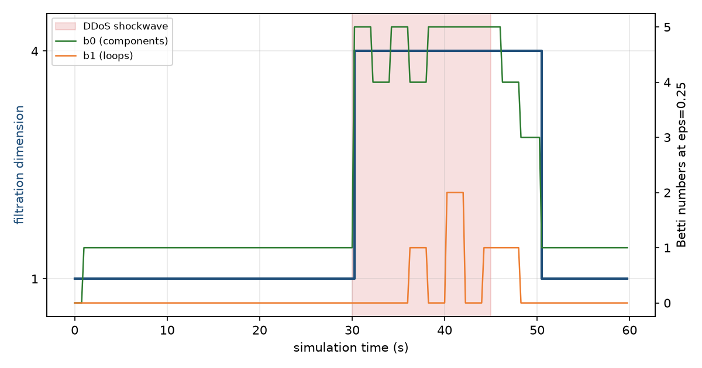

# DDMR: dynamic dimensionality manifold routing under a DDoS shockwave

**Status:** M11, complete. The hypothesis, scenario and constants were frozen in
[`ddmr-predictions.md`](ddmr-predictions.md) before the 30 paired seeds ran.
Homology is computed by the real `ripser` library (Vietoris–Rips, `maxdim=1`),
not by a hand-rolled diagram.

**One-line result:** H14 is supported under the frozen scenario. DDMR keeps the
legitimate CDR during the attack at **99.51 %** against **73.74 %** for static
T-NDN (+25.77 points), with 4-D homology costing **2.59 J** against **15.57 J**
of prevented-loss energy, and no early collapse (30/30 seeds expand once and
collapse once, after the attack ends). The support is conditional on the attack
signature and on the energy stipulation: both are measured and stated in §4 and
§7.

## 1. What was tested

| Strategy | Anomaly detector | Dimension | Routing during the shock |
|---|---|---|---|
| NLSR | none | — | primary instance (prefix cost) |
| FSR-NDN | none | — | primary instance (prefix cost) |
| Static T-NDN | **same detector as DDMR** | pinned to 1 | primary instance |
| DDMR | same detector | 1 → 4 on anomaly | attack component on the primary, legitimate component on a healthy replica |

Scenario: the M10 100-node topology; 20 prefix blocks of 500 names; three
instances per block (primary + two replicas); legitimate Poisson traffic at
200 requests/s for 60 s, with block 0 carrying 40 % of it; a botnet of 20
consumers sends **500 requests/s to block 0 from t = 30 s to t = 45 s**. The
attack and the legitimate traffic share the base prefix, which is the case the
experiment is about. Each instance is a drop-tail server with 200 requests/s of
capacity and a `20 ms · u³` queue; the attack therefore also drops legitimate
requests through the shared primary.

All four strategies see the same network, instances, requests, attack and
instance model. Only the selection rule differs. The CDR is computed over
legitimate requests only, inside the attack window `[30, 45)` s; attack
deliveries are not counted.

## 2. The mechanism

**State vector.** `S = [D_prefix, L_latency, J_jitter, A_anomaly]`:
prefix position, latency deviation from the flow's baseline, jitter EMA, and the
flow's rate anomaly `clip((rate − 2)/2, 0, 1)`.

**Dimension shift.** The trigger is the local block anomaly. The nominal rate of
each prefix block is measured during a 10 s warm-up and then **frozen**; the
anomaly is a Poisson z-score mapped by `(z − 3)/3` to `[0, 1]`. The dimension
expands after two ticks above 0.70 and contracts after four ticks below 0.45.
There is no attack schedule or attack flag anywhere in the router; the only
time constants it has are its own warm-up (10 s) and rate window (5 s), and the
scenario never tells it that an attack is running. A test asserts that the
module contains no `ATTACK_START`/`ATTACK_END` reference.

The frozen-nominal choice matters. The M5/M6 kinematic monitor is a *spike*
detector with an adaptive baseline: it fires on the change and then absorbs the
new level, which would collapse the dimension in the middle of a 15 s attack.
The nominal here is learned once and frozen, so the dimension tracks the attack
level. That is a design decision, not a lucky parameter, and it is the reason
the collapse happens after the attack rather than during it.

**Manifold.** Every 2 s (and immediately on a switch) the router takes up to 150
active flows, builds the four-dimensional point cloud, and runs `ripser` on the
Vietoris–Rips filtration. At `EPS_MANIFOLD = 0.25` the H0 components and their
centroids are extracted. A component is an attack component when its mean
anomaly is above 0.70 **and** its mean jitter above 0.20. A request whose flow
is nearest the attack component stays on the primary; every other request in an
attacked block goes to the healthy replica with the lowest measured latency.

**No local knowledge is bypassed.** The router uses only its telemetry (flow
rates, jitter, latency), the name-space prefix and the instance set. It does not
read the scenario's attack flags; the scenario only uses them to decide which
requests count toward the CDR.

## 3. Results (30 paired seeds, mean ± 95 % CI)

| Strategy | CDR in window (%) | CDR block 0 (%) | CDR overall (%) | p95 latency in window (ms) |
|---|---:|---:|---:|---:|
| NLSR | 73.725 ± 0.305 | 34.436 ± 0.545 | 93.403 | 132.1 ± 2.4 |
| FSR-NDN | 73.741 ± 0.290 | 34.471 ± 0.579 | 93.408 | 132.2 ± 2.5 |
| Static T-NDN | 73.735 ± 0.271 | 34.460 ± 0.414 | 93.406 | 132.5 ± 2.5 |
| **DDMR** | **99.506 ± 0.075** | **98.765 ± 0.189** | **99.876** | **124.1 ± 3.0** |

The CDR gain against static T-NDN is **+25.77 points** (95 % CI ± 0.30), and the
minimum across the 30 seeds is +23.82. DDMR's p95 is lower, not higher: once the
legitimate component leaves the overloaded primary it also avoids its queue.

### Dimension over time



The step plot (base seed 2026) shows the dimension at 1 until the attack starts,
4 through the shock, and 1 again after it ends. `b0` (components) rises from 1
to 4–5 when the attack flow splits off; `b1` (loops) appears intermittently. The
CSV is [`figures/ddmr_dimension.csv`](../figures/ddmr_dimension.csv).

| Quantity | Value (30 seeds) |
|---|---:|
| Expansions / collapses per seed | 1 / 1 on all 30 seeds |
| First expansion | 30.22 s mean (range 28.5–30.5) |
| Last shock tick | 50.3 s mean (range 50.0–52.25) |
| Early collapse before t = 45 s | 0 / 30 seeds |
| H0 components during the shock | 4.49 mean |
| Shock epochs with an H1 loop | 200 / 2439 (8.2 %); max `b1 = 3` |
| Base seed 2026 shock epochs with H1 | 32 / 81 |

**The collapse is late, not early.** The anomaly uses a 5 s rate window, so the
last attack request keeps the block anomalous until t = 50; the dimension
contracts at 50.0–52.25 s, i.e. 5–7 s after the attack ends. It never contracts
during the attack, so there is no oscillation to report; the cost of the delay
is that the fabric stays in the expensive mode for a few extra seconds.

**The "hole" is only partly reproduced.** In 8.2 % of shock epochs the expanded
complex also contains H1 loops (the seed-2026 plot shows several). The robust
structure, present in every shock epoch, is the H0 split: the attack becomes its
own component with its own centroid. Routing uses that component split; it does
not depend on the loop. This is reported as measured rather than as the
topological hole the brief anticipated.

**One false-positive expansion.** Seed 2047 expanded at 28.5 s, 1.5 s before the
attack, on a Poisson fluctuation in a block anomaly. It did not collapse before
the attack, so the routing and the CDR were unaffected (gain +24.79 points on
that seed). It is the only pre-attack expansion in 30 seeds.

## 4. Energy and CPU

| Quantity | Value (mean per seed) |
|---|---:|
| 4-D `ripser` calls | 10.9 |
| 4-D homology cost | 2.59 J at 15 W |
| Prevented legitimate losses vs static T-NDN | 778.5 requests |
| Energy saved at 0.02 J/loss | 15.57 J |
| CPU / saved ratio | 0.166 |
| **Break-even energy per prevented loss** | **3.32 mJ** |

The 4-D computation is 2.59 J against 15.57 J saved, so the energy clause does
not refute H14 at the stipulated 0.02 J per prevented request. The break-even is
the honest number to carry forward: **if a prevented legitimate loss is worth
less than ≈3.3 mJ, the energy clause refutes H14**, because the homology costs
more than it saves. At 0.005 J/loss the saved energy is 3.9 J and the clause
still passes; at 0.002 J/loss it is 1.6 J and the clause fails.

The CPU cost is paid only in the expanded state (about eleven 4-D epochs); the
calm epochs run the 1-D filtration and are not counted in the clause. The capture
is also the limit: 150 flows by rate, so a low-rate distributed attack could be
under-sampled.

## 5. H14 verdict

| Criterion | DDMR | Baseline | Value | Limit | Verdict |
|---|---:|---:|---:|---:|---|
| CDR gain vs static T-NDN | 99.506 | 73.735 | +25.77 points | ≥ 15 points | PASS |
| DDMR CDR during shock | 99.506 | — | — | ≥ 95 % | PASS |
| Energy: 4-D TDA vs saved | 2.59 J | 15.57 J | ratio 0.166 | < 1.0 | PASS |
| Early collapse before t = 45 s | 0 seeds | — | — | 0 seeds | PASS |

**H14: SUPPORTED** under the frozen scenario, with the sensitivities of §4 and
§7.

## 6. Anti-cheat compliance

- **No hardcoding.** The dimension controller takes only the anomaly; the
  router never receives the attack flags, the attack start/end times or the
  failure. A unit test asserts that the module source contains no
  `ATTACK_START`/`ATTACK_END`, and another asserts that an equal anomaly at
  t = 1 s and t = 1000 s produces the same expansion.
- **Real TDA.** All persistence comes from `ripser` (Vietoris–Rips,
  `maxdim=1`); the tests assert the library is installed and that a synthetic
  two-cluster cloud yields two components.
- **Fair baseline.** Static T-NDN runs the identical `BlockMonitor` and the
  identical manifold code with the dimension pinned to 1. A test asserts that
  the per-tick anomaly series of static T-NDN and DDMR are identical.
- **Reported collapse.** Collapse time is in the per-seed CSV; the 30-seed
  result is 1 expansion and 1 collapse on every seed, and the late collapse is
  stated above.
- **No tuning after the fact.** Thresholds, radii and the energy constants were
  fixed in `docs/ddmr-predictions.md` before the run; the 5 s window and 10 s
  warm-up are the pre-registered values.

## 7. What this establishes, and what it does not

Establishes, on this scenario: a detector-driven change of the filtration
dimension can separate flows that share a prefix, a name-space component split is
enough to route legitimate traffic around an attacked instance, and the
homology cost is an order of magnitude below the energy of the prevented losses
at a plausible per-loss value.

Does not establish:

1. **That a stealthier attack is detectable.** The bots are high-rate (25
   requests/s each) and high-jitter (30 ms against 2 ms). A low-and-slow attack
   that stays under the z-score threshold, or one that mimics legitimate jitter,
   would not be separated by these axes; only high-rate/high-jitter attacks were
   tested.
2. **That the topological hole is the mechanism.** H1 is intermittent (8.2 % of
   shock epochs); H0 separation is what the router uses.
3. **That replicas exist.** The defence assumes a healthy replica with spare
   capacity. If all three instances are attacked, DDMR has nowhere to route.
4. **Packet-level behaviour.** This is a control-plane and capacity model: no
   PIT, no caching, no per-packet strategy, no congestion dynamics beyond the
   drop-tail instance model.
5. **The energy verdict without its stipulation.** See the break-even in §4.
6. **Generality of the thresholds.** `ANOMALY_HIGH = 0.70`, `EPS_MANIFOLD =
   0.25` and the 5 s/10 s windows were frozen for this scenario; a different
   capacity, attack rate or legitimate mix would need its own calibration.

## 8. Reproduction

```bash
py -m pip install -r requirements.txt     # includes ripser
py tools/benchmark_ddmr.py --seeds 30 --output-dir figures
py -m pytest tests/test_ddmr.py -q
```

Outputs: [`figures/ddmr_per_seed.csv`](../figures/ddmr_per_seed.csv),
[`figures/ddmr_summary.csv`](../figures/ddmr_summary.csv),
[`figures/ddmr_h14.csv`](../figures/ddmr_h14.csv),
[`figures/ddmr_dimension.csv`](../figures/ddmr_dimension.csv),
[`figures/ddmr_dimension.png`](../figures/ddmr_dimension.png).
