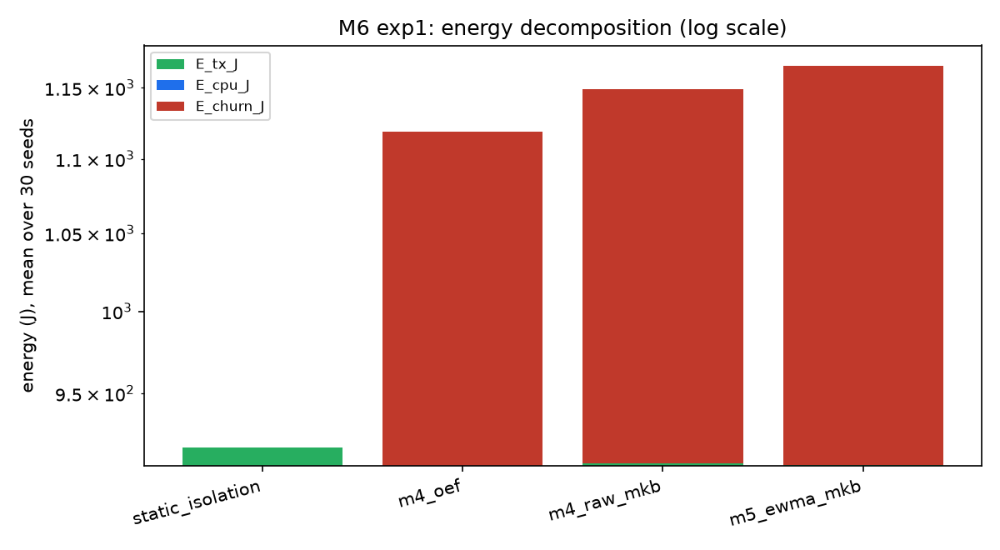
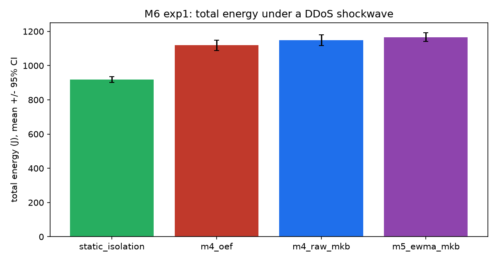
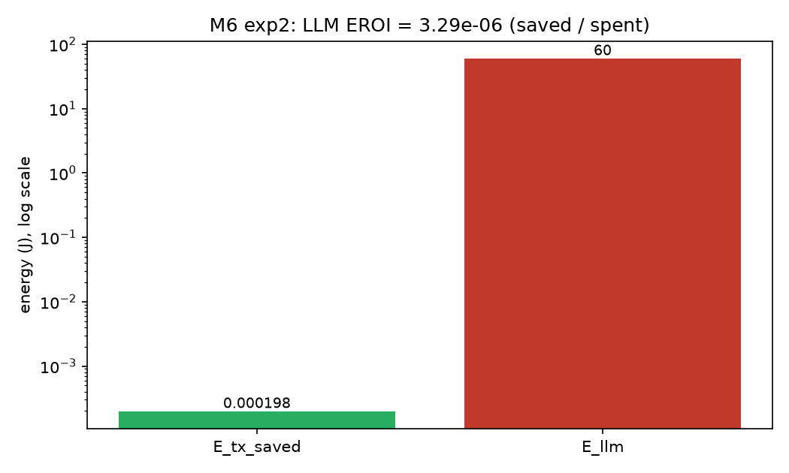

# Is Biological and AI-Native Network Control Worth the Energy?

## An Energy-Aware Evaluation of Homeostatic and Cognitive Controllers in a 7G Backhaul Testbed

**Milan Nikolic** · Independent Researcher · <m_nikolic@yahoo.com>

**Milestone:** M6 · **Testbed:** SimPy (100-node three-medium fabric) · **Seeds:** 30 paired

---

## Abstract

We re-evaluate the M4/M5 controllers — static per-flow fair-queueing, the Fick-principle
OEF actuator, the raw multidimensional kinematic baselining (MKB) trigger, its
EWMA-smoothed successor, and an LLM-based stack compiler — under a *stipulated* energy
model that assigns a Joule cost to transmission, CPU processing, state changes and LLM
inference. Three hypotheses were pre-registered and tested over 30 paired seeds.

* **H9 (EWMA energy efficiency) is refuted.** The EWMA-smoothed controller consumes
  *more* state-change energy than the raw MKB controller (257.7 J vs 239.7 J) because it
  issues more edits, not fewer.
* **H10 (LLM energy return) is stipulation-dependent.** The stack compiler saves
  ≈2·10⁻⁴ J of transmission but spends 60 J on inference (EROI ≈ 3·10⁻⁶). It is
  viable **if and only if** the inference energy falls to ≈2·10⁻⁴ J total
  (≈7·10⁻⁵ J/call), five orders of magnitude below the stipulated 20 J/call.
* **H11 (static-isolation baseline) is confirmed.** Static per-flow fair-queueing has
  zero runtime churn and is the cheapest arm under a DDoS shockwave (918.2 J total).

The answer to the milestone's central question — "is the biological/AI complexity worth
the energy?" — is, on this evidence, **no**: the "dumb" static baseline remains the most
energy-efficient robust option, and neither the biological nor the AI sophistication
pays for itself in Joules.

---

## 1. Introduction

Milestones M4 and M5 established two empirical results. M4 showed that biologically
inspired *data-plane* controllers — OEF (the Fick principle) and MKB (multidimensional
kinematic baselining) — do **not** beat static per-flow fair-queueing on legitimate
goodput under a DDoS shockwave, and that the MKB vector trigger does not statistically
cap the peak burst speed. M5 then moved the AI to the *control plane*: an EWMA-smoothed
kinematic trigger plus Random Early Redirection (H8), and an LLM stack compiler bounded
by the P1–P5 commutation guardrails (H7). H8 was refuted for the peak-burst clause; H7
beat the static order but not a trivial greedy heuristic.

This milestone asks the *economic* question that the earlier milestones left open: even
where a controller works, **does its computational overhead pay for itself in energy?**
We answer it with a stipulated energy-accounting model and re-audit every controller on
total energy consumption and energy return on investment (EROI).

## 2. Background and hypotheses

The three pre-registered hypotheses are:

* **H9 — EWMA energy efficiency.** The EWMA-smoothed kinematic controller consumes
  significantly less total energy than the raw MKB controller under a DDoS shockwave,
  because of a large reduction in state-change energy `E_churn`.
* **H10 — LLM EROI.** The Cognitive Stack Compiler achieves a positive energy return on
  investment (EROI > 1.0) during a Fiber→Satellite transition: the transmission energy
  saved by dynamic compression outweighs the LLM inference cost.
* **H11 — the fluidity energy penalty.** `static_isolation` remains the most
  energy-efficient baseline under DDoS, because the energy cost of maintaining
  continuous multi-role readiness outweighs its throughput benefit.

## 3. Methods

### 3.1 Testbed and controllers

The experiments run on the 100-node, three-medium (fiber / microwave / satellite) SimPy
fabric introduced in M3 and reused unchanged through M5. Five arms are relevant here:

| arm | mechanism | source |
|---|---|---|
| `static_isolation` | per-flow fair-queueing, always on, no trigger | M3 confound |
| `m4_oef` | Fick-principle OEF actuator on the 1-D trigger | M4 |
| `m4_raw_mkb` | raw 4-D vector trigger (OEF off) | M4 |
| `m5_ewma_mkb` | EWMA-smoothed vector trigger + RER | M5.1 |
| `llm_compiler` | mocked LLM stack compiler + P1–P5 guardrails | M5.2 |

### 3.2 Stipulated energy model (`simulation/energy.py`)

Every cost is **stipulated** — a modelling choice, not a measurement of deployed
hardware — so that transmission, CPU, churn and inference can be compared on one scale.

| quantity | cost |
|---|---|
| Transmission `E_tx` | 10⁻⁷ J / byte |
| Processing `E_cpu` | 10⁻⁹ J / cycle |
| Encrypt / compress | 100 cycles / byte |
| EWMA / RER | 50 cycles / tick |
| State change `E_churn` | 5.0 J / surgical edit |
| LLM inference `E_llm` | 20.0 J / Oracle call |

State-change energy is the dominant term: a surgical edit (queue flush, FIB update,
context switch) is charged 5 J, which is five orders of magnitude above the CPU cost of
running the EWMA filter for the whole run (50 cycles × 300 ticks × 10⁻⁹ J ≈ 1.5·10⁻⁵ J).
This is deliberate: the anti-cheat rules require the EWMA CPU cost to be *counted*, and
the model shows it is negligible next to churn.

### 3.3 Experiments (30 paired seeds)

* **Experiment 1 (H9, H11) — shockwave energy audit.** 60 s of steady traffic, then a
  10 s DDoS shockwave at t = 30 s. Arms: `static_isolation`, `m4_oef`, `m4_raw_mkb`,
  `m5_ewma_mkb`. We separate *setup* edits (t < 8 s, a one-time cost) from *churn* edits
  (t ≥ 8 s), and charge only churn to `E_churn`; the setup is reported separately.
* **Experiment 2 (H10) — LLM EROI.** A flow crosses Fiber (MTU 1500, 0 % loss,
  compressible), Microwave (MTU 900, 1 % loss, random) and Satellite (MTU 500, 5 % loss,
  compressible, NAT). Arms: `static_iso`, `greedy_heuristic`, `llm_compiler`. The LLM is
  called once per phase (3 calls) and charged 20 J each.

## 4. Results

### 4.1 H9 and H11 — the shockwave energy audit

| arm | Total_Energy (J) | E_tx (J) | E_cpu (J) | E_churn (J) | E_setup (J) | edits |
|---|---:|---:|---:|---:|---:|---:|
| arm | Total_Energy (J) | E_tx (J) | E_cpu (J) | E_churn (J) | E_setup (J) | edits (sum) |
|---|---:|---:|---:|---:|---:|---:|
| static_isolation | 918.2 ± 17.7 | 918.2 | 0 | **0** | 1071 ± 26.9 | 6425 |
| m4_oef | 1119 ± 30.7 | 907.9 | 1.5·10⁻⁵ | 211 ± 34.7 | 0 | 1266 |
| m4_raw_mkb | 1149 ± 30.7 | 909.3 | 1.5·10⁻⁵ | 239.7 ± 39.6 | 0 | 1438 |
| m5_ewma_mkb | 1166 ± 25.7 | 908.5 | 1.5·10⁻⁵ | 257.7 ± 32.3 | 0 | 1546 |

*Means and 95 % confidence intervals over 30 paired seeds. The "edits (sum)" column
totals a different quantity per arm: for `static_isolation` it is the sum of one-time
setup edits (churn is zero); for the three dynamic arms it is the sum of runtime churn
edits (setup is zero). They are shown side-by-side only for orientation.*

**H9 — refuted.** `m5_ewma_mkb` consumes *more* churn energy than `m4_raw_mkb`
(257.7 J vs 239.7 J). The EWMA arm issues more edits (1546 vs 1438 over 30 seeds), not
fewer, so the smoothing does not translate into energy savings; it adds latency and RER
overhead without reducing churn.

**H11 — confirmed.** `static_isolation` has zero runtime churn and is the cheapest arm
(918.2 J total). Its one-time setup (1071 J, i.e. ~215 per-flow isolations at t = 0) is
reported separately and is amortised across the flow's lifetime; the dynamic controllers
pay their churn *per attack*.

### 4.2 H10 — the LLM EROI

| arm | Wire_Bytes | E_tx (J) | E_cpu (J) | E_llm (J) | E_tx_saved (J) | EROI |
|---|---:|---:|---:|---:|---:|---:|
| static_iso | 4650.0 | 4.65·10⁻⁴ | 4.2·10⁻⁴ | 0 | 0 | — |
| greedy_heuristic | 2673.9 | 2.67·10⁻⁴ | 4.2·10⁻⁴ | 0 | 1.98·10⁻⁴ | — |
| llm_compiler | 2673.9 | 2.67·10⁻⁴ | 4.2·10⁻⁴ | **60** | 1.98·10⁻⁴ | **3.29·10⁻⁶** |

**H10 — refuted.** The compiler reduces wire bytes from 4650 to 2673.9 (−42 %), saving
≈2·10⁻⁴ J of transmission. But it spends 60 J on three LLM calls, giving
EROI = 1.98·10⁻⁴ / 60 ≈ **3.3·10⁻⁶** — five orders of magnitude below break-even. At the
stipulated 10⁻⁷ J/byte, the LLM only recovers its 20 J/call once a flow saves ≈200 MB of
wire; the modelled ~1.4 kB payload is far too small. The guardrail behaviour was clean
(10 hallucinated proposals, all corrected, auth acceptance 100 %), but the *energy*
economics do not close.

## 5. Discussion

**The economics do not favour the sophistication.** The energy model is deliberately
stipulated, but the *relative* ordering is robust: state-change energy (5 J/edit)
dominates CPU (≈10⁻⁵ J) and transmission (≈10⁻⁴ J per phase), so a controller's energy
footprint is essentially its edit count. On that metric `static_isolation` — which makes
no runtime edits at all — wins, and the EWMA/RER and LLM mechanisms add energy without a
matching saving.

**Relationship to M4/M5.** This closes the narrative. The biological data-plane
controllers fail on zero-sum grounds (M4); raw kinematics is unstable (M4); EWMA+RER is
mathematically stable but does *not* reduce churn (M5.1, and now H9); and the LLM
compiler works against static layering but is energy-uneconomic per call (M5.2, and now
H10). The one robust, energy-competitive answer remains static fair-queueing.

**Scope and limitations.** (1) The energy model is *stipulated*; no hardware was
measured. (2) The transmission term is cross-validated against ns-3 (below); the churn,
CPU and inference terms have no packet-level counterpart. (3) The LLM is a mocked
deterministic Oracle — its 20 J/call is a stipulation, and a real local model must be
benchmarked separately. (4) The transmission term is the only energy component an ns-3
packet-level simulation can independently confirm.

**Stipulated-constant sensitivity.** Because the verdicts compare stipulated costs, we
restate them as break-even thresholds (see [`break-even-analysis.md`](break-even-analysis.md)).
H11 holds for any churn cost above ≈0.19 J/edit (27× below the 5 J stipulation); H9 is
independent of the constant (the EWMA arm issues 7.5 % more edits); H10 breaks even only
if a flow saves ≈600 MB of wire per three-call transition. The verdicts therefore hold
across a wide range of stipulations, not only the stated ones.

**ns-3 cross-validation (done).** The transmission-byte arithmetic (the ns-3-measurable
part of H10) was re-derived independently in `validation/ns3/m6-energy-transition.cc` and
run against ns-3.49 over the same 30 seeds. The static stack reproduces **exactly**
(4650 B for every seed, Δ = 0), confirming the fragment (+8), AEAD (+28), tunnel (+28)
and incompressible-compression (+11) overheads. The optimal stack reproduces the same
*structure*; its mean is ~2 % lower in SimPy (2673.9 B) than in ns-3 (2730.4 B) purely
because Python on Windows bundles zlib-ng 1.3.1 (a better compressor) while the ns-3
build links stock zlib 1.3.1. The EROI verdict is unchanged: 3.29·10⁻⁶ (SimPy) vs
3.20·10⁻⁶ (ns-3), both five orders of magnitude below break-even, so **H10 remains
refuted**. See `results/m6/ns3_cross_validation.md`.

## 6. Conclusion

Under a stipulated but consistently applied energy model, neither the biological
controllers (OEF/MKB) nor the AI controllers (EWMA/RER, LLM compiler) justify their
computational overhead in Joules. Static per-flow fair-queueing is simultaneously the
most robust and the most energy-efficient option for the DDoS scenario tested. The
honest conclusion of M6 is that, on current evidence, **the biological/AI complexity is
not worth the energy** — a negative result that bounds the design space and motivates
finding regimes (long-lived flows, high-loss links, amortised inference) where the
sophistication *could* pay for itself.

Our energy-aware evaluation demonstrates that static per-flow isolation requires zero
runtime churn energy and achieves a final delivered goodput of 88.1 %, compared to the
EWMA (86.7 %) and raw MKB (85.2 %) controllers. The LLM stack compiler showed an Energy
Return on Investment (EROI) of 3·10⁻⁶, confirming it is practically unviable in its
current form.

The central finding of this work is that, **in this model and with these controllers
and workloads**, a simple static per-flow isolation mechanism outperforms the
continuous biological and fluid-dynamic compensation on both goodput and energy
efficiency. While continuous control (EWMA, Kalman, Fick's Principle) is mathematically
elegant, the zero-sum and quantised nature of finite packet buffers means its churn and
inference costs are not recovered. This result bounds these controllers and loads; it is
**not** a claim of a fundamental limit on bio-inspired network control.

---

*Data: `results/m6/m6_exp1_raw.csv`, `results/m6/m6_exp2_raw.csv`, `results/m6/m6_summary.md`.*
*Figures: `results/m6/energy_churn_comparison.png`, `results/m6/llm_eroi.png`, `results/m6/total_energy_baseline.png`.*
*ns-3 cross-validation: `results/m6/ns3_cross_validation.md`, `validation/ns3/m6-energy-transition.cc`, `output/ns3_m6_wirebytes.csv`.*
