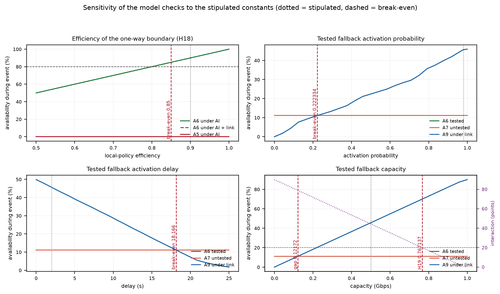

## Abstract

Cloud isolation cuts tenant-to-tenant, workload-to-host and region-to-region. It
does not cut a provider control plane, identity service or AI endpoint that every
deployment behind it shares. This short paper states the resulting position,
summarises a flow-level testbed that makes it testable, and reports how far the
testbed's conclusions move when its stipulated constants are varied. The testbed
compares nine architectures under ten outage events with 30 paired seeds and
2,700 runs; the hypotheses and thresholds were frozen before the simulator
existed. Under the frozen scenario, tenant isolation contains a tenant-shared
gateway fault (100% vs 0%) but not an identity failure (0% vs 0%); three paths
over one conduit fail together (0% vs 100% for SRLG-disjoint paths); a one-way
boundary with a tested fallback holds 90% under an AI control-plane failure
against 0% without it; the isolation-multipath interaction is +44.4 points; and a
global controller loses 100 points when it fails with its primary path. A
one-factor sensitivity analysis puts the nearest break-even values at 0.85
local-policy efficiency (stipulated 0.90), 0.22 tested-fallback activation
probability (0.98), 18.2 s tested-fallback delay (2 s) and 0.122 Gbps
tested-fallback capacity (0.50 Gbps). These are model checks, not measurements
of a production network. The empirical question is separate: it is tested by a
frozen postmortem study, not by this simulator.

## 1 The claim under test

A dependency shared by many consumers, with no independent failure domain behind
it, turns a local fault into a correlated outage. Adding consumers increases
scale and blast radius at the same time; it does not add an independent failure
domain. The same decision that lowers unit cost raises correlated exposure.

Current cloud architecture has isolation, but it isolates the wrong boundary for
this failure. Logical tenant isolation cuts tenant-to-tenant; confidential
computing cuts workload-to-host; regions and zones cut region-to-region; provider
diversity cuts provider A from provider B. None of these cuts
tenant-to-provider, consumer-to-control-plane, or consumer-to-shared-dependency.
The weak point was never tenant-to-tenant. The shared control plane was.

The engineering response has two halves. **Multipath and diversity** keep service
running while a path, link or provider degrades. **Isolation** stops a fault from
propagating across a boundary. Multipath cannot cut a shared identity service;
isolation cannot create capacity on the protected side. A tested fallback is the
condition that makes either one real: an isolation boundary without local
capacity converts a provider outage into a local outage, and an unexercised
fallback is a configuration, not a mitigation.

The position, stated so that it can fail, is:

> Under a common-mode event, current cloud isolation is the wrong cut; multipath
> helps only when it is independent; and a global controller is itself a shared
> dependency.

This paper does not propose a new protocol. It asks which architectural choices
preserve service under a common-mode event, and how far the answer depends on
stipulated constants.

## 2 What the model does

The testbed is deliberately flow-level. It computes capacity and dependency
conjunction, not packets, queues, TCP behaviour or hardware. It has six tenants,
three aggregation sites, three providers, two cloud regions, shared identity,
DNS, an AI endpoint, a shared tenant gateway, a global cooperative controller
and local fallbacks. A tenant is served only when its data path, control plane,
tenant boundary and, where required, fallback are available together.

The nine arms are a single provider (A1); three shortest paths (A2); three
SRLG-disjoint paths (A3); A3 plus tenant isolation (A4); independent identity and
DNS (A5); A5 plus a one-way boundary and tested fallback (A6); A6 with an
untested fallback (A7); A5 plus a global cooperative controller (A8); and A1 plus
isolation and a tested fallback (A9). A1-A5 and A8 are stylized current-cloud
choices; A6 is the proposed combination; A7 is the untested-fallback control; A9
is the isolation-only control.

Ten events cover a single link, a shared conduit, a full backhaul cut, a provider
control plane, identity, the AI endpoint, the tenant gateway, a controller plus
link, and an AI plus link failure. Start, duration, demand and fallback draws are
shared by every arm for a given seed. The benchmark runs 30 seeds (base 2026),
nine arms and ten events: 2,700 runs. The protocol, constants and thresholds are
frozen in `docs/common-mode-predictions.md` at commit `1c781f3`.

The stipulated constants are the local-policy efficiency (0.90), the tested
fallback activation probability (0.98), delay (2 s) and capacity (0.50 Gbps), and
the untested fallback values (0.60, 8 s, 0.30 Gbps). They are design choices, not
measurements. The next section reports what the model does with them; Section 4
reports how far each conclusion is from them.

## 3 What the model checks found

Table 2 gives the five frozen checks and their values. The mechanisms are
isolated by design, so the margins are large; that is a property of the model,
not an estimate of an effect size. The per-seed pass fraction is 1.000 for every
criterion: the checks do not depend on a lucky seed.

**Table 2. Frozen checks (30-seed means).**

| Check | Criterion | Value | Threshold | Verdict |
|:--|:--|--:|--:|:--|
| H16 tenant isolation | A4-A3 tenant gateway; abs(A4-A3) identity | 100.0; 0.0 | >= 50; <= 5 | PASS |
| H17 independence | A3-A2 conduit; A2-A1 link | 100.0; 100.0 | >= 20; >= 50 | PASS |
| H18 tested fallback | A6-A5 AI; A6 AI; A5-A6 normal | 90.0; 90.0; 10.0 | >= 50; >= 80; <= 15 | PASS |
| H19 interaction | (A6-A3)-(A9-A1) AI + link | 44.38 | >= 20 | PASS |
| H20 controller locality | A5-A8 controller + link; abs(A5-A8) normal | 100.0; 0.0 | >= 50; <= 5 | PASS |

The readings are direct. Tenant isolation turns the tenant-gateway failure from a
total outage into normal service (A3 0%, A4 100%) and does nothing for identity
(A3 and A4 both 0%). Two three-path arms behave oppositely under the conduit
failure: A2 is 0% because all three paths share the conduit, A3 is 100% because
its paths use three aggregation sites. The path independence index is 0.333 for
A2 and 1.0 for A3; the count is the same. Under the AI failure, A5 is 0% and A6
is 90%; the 10-point normal-operation gap is the stipulated price of local
policy. Under the combined AI + link failure, A1 = 0, A3 = 0, A9 = 45.6 and A6 =
90.0, so the interaction is +44.38 points. Under the controller + link failure,
A5 (local) is 100% and A8 (global) is 0%: once the controller is down, A8 falls
back to its primary path, which is the failed link.

Two qualifications matter. First, isolation plus a tested fallback (A9) matches
A6 on the four common-mode events at less than half the cost index (0.80 vs
1.80); A6 buys resilience to independent link failures (90% vs 45.6%). The
"both axes" claim is conditional on the failure mix, not a universal ranking.
Second, the all-pass outcome is a limitation: the scenario was designed to make
the mechanisms observable, so it is not a random sample of architectures.

## 4 How far the constants can move

Because every number above is conditional on a stipulated constant, the useful
question is where the nearest verdict flip is. We sweep each constant one at a
time over 25 values with the other constants, topology, events and 30 seeds
fixed. Table 3 gives the primary break-even for each constant; the full grid and
every criterion are committed in `docs/paper-tables/`.

**Table 3. Break-even values (one factor at a time, 25 grid values, 30 seeds).**
A break-even is the value at which the named criterion stops passing. "None in
range" means it passed at every swept value.

| Constant | Stipulated | Break-even | Claim that fails there |
|---|---:|---:|---|
| local-policy efficiency | 0.90 | 0.85 | H18 normal-operation cost <= 15 points |
| tested activation probability | 0.98 | 0.222 | tested fallback beats untested under the backhaul cut |
| untested activation probability | 0.60 | none in range | the tested-fallback gap survives the whole range |
| tested activation delay | 2 s | 18.166 s | tested fallback beats untested under the backhaul cut |
| untested activation delay | 8 s | none in range | the tested-fallback gap survives the whole range |
| tested fallback capacity | 0.50 Gbps | 0.122 Gbps | tested fallback beats untested under the backhaul cut |
| untested fallback capacity | 0.30 Gbps | none in range | the tested-fallback gap survives the whole range |

For H18, the binding clause is the normal-operation cost (0.85), not the absolute
80% level (0.80); the check fails at the higher of the two. The tested fallback
is far from its break-even: activation probability would have to fall from 0.98
to 0.222, delay would have to rise from 2 s to 18.2 s, or capacity would have to
fall from 0.50 to 0.122 Gbps before it stopped beating the untested fallback
under the backhaul cut. No single improvement of the untested fallback in the
swept range erases the 34.5-point gap. H19 is the one two-sided case: if the
tested fallback becomes too capable (above 0.767 Gbps), A9 alone covers more of
the event and the interaction term falls below 20. H19's absolute A6 level still
fails only below 0.80 efficiency. The interaction is a claim about
super-additivity, not a claim that a stronger fallback is worse.

{width=95%}

**Figure 1.** Sensitivity of the model checks to the stipulated constants.
Dotted vertical lines are stipulated values; dashed red lines are nearest
break-evens; horizontal dashed lines are frozen thresholds.

The sensitivity is one-factor-at-a-time. It holds the remaining constants and
the topology fixed, so it does not cover interactions between constants, and the
break-even values are linearly interpolated between grid points. It shows how far
a verdict is from its stipulated operating point; it does not give a confidence
interval, and a combination of changes could cross a boundary that no single
change crosses.

## 5 What this is not

This is not a measurement of AWS, Azure, Google Cloud, Cloudflare or any
production network. The current-cloud arms are structural analogues, not
reconstructions of a particular provider. The model ignores queueing, congestion
control, TCP retransmission, reordering and application behaviour. Security is
not evaluated: the one-way boundary is an availability cut, not a cryptographic
control. The cost index is a stipulated accounting device, not a price.

Nor is this empirical support for the model's claims. The model checks are
statements about the model. The motivating 2026 events are reported examples, not
evidence: the FAA ground stop followed an old telecommunications system
overload; Microsoft attributed a separate Microsoft 365 outage to an issue from
an earlier network capacity upgrade; the 2-3 September 2026 Microsoft 365
degradation and the ChatGPT/Claude/Grok errors were reported on the same day
without a shared root cause in the public reports. No result here depends on a
particular root cause being correct.

The empirical question is tested separately, by a postmortem study with a frozen
codebook and independent coders. The eventual Microsoft post-incident report and
the AI providers' reports are the out-of-sample check; they are coded with the
same codebook and reported separately, not added to the analysis set.

## 6 What would change the conclusion

The position is falsifiable in three places.

1. **A different failure mix.** If independent path failures are rare and
   common-mode control-plane failures dominate, A9 (isolation plus tested
   fallback) matches A6 on the common-mode events at lower cost. The argument
   for multipath then rests on a failure class the operator does not have.
2. **A weaker fallback.** If the tested fallback's activation probability falls
   below 0.22, its delay rises above 18.2 s, or its capacity falls below 0.122
   Gbps, the tested-versus-untested gap closes. The recommendation to treat the
   fallback as a tested state would then be a claim about a fallback the
   operator does not have, not about the one in the model.
3. **A different efficiency.** If local policy costs more than 15 points, H18
   fails: the boundary preserves availability only by giving up more normal
   service than the frozen threshold allows. The break-even is 0.85.

An empirical disagreement would be more informative than another simulation. If
the postmortem study finds that large-blast-radius outages are not concentrated
in shared control planes, or that tenant isolation and independent multipath
match what the reports say would have helped, the position must be narrowed. The
testbed would still be a valid model of the mechanism; it would not be a model of
the population.

## References

1. P. Mell and T. Grance, "The NIST Definition of Cloud Computing," NIST SP 800-145, 2011.
2. A. Avizienis, J.-C. Laprie, B. Randell and C. Landwehr, "Basic concepts and taxonomy of dependable and secure computing," *IEEE TDSC*, vol. 1, no. 1, pp. 11-33, 2004.
3. H. S. Gunawi et al., "What Bugs Live in the Cloud? A Study of 3000+ Issues in Cloud Systems," SoCC 2014.
4. H. S. Gunawi et al., "Why Does the Cloud Stop Computing? Lessons from Hundreds of Service Outages," SoCC 2016, DOI 10.1145/2987550.2987583.
5. S. Talluri et al., "Cloud Uptime Archive: Open-Access Availability Data of Web, Cloud, and Gaming Services," arXiv:2504.09476, 2025.
6. P. S. L. Paladugu, "How Configuration and Deployment Changes Trigger Large Cloud and SaaS Outages: An Empirical Study of 70 Public Postmortems," Zenodo preprint, 2026, DOI 10.5281/zenodo.23585116.
7. A. Ford et al., "TCP Extensions for Multipath Operation with Multiple Addresses," RFC 8684, 2020.
8. K. Kompella and Y. Rekhter, "Routing Extensions in Support of GMPLS," RFC 4202, 2005.
9. M. Nikolic, "Which Rewrites Survive? Pre-registered Tests of a Field-Class Model of Encapsulation, Middleboxes and Decapsulation on Linux," repository paper, 2026.
10. Bernama-Anadolu, "Nationwide Ground Stop Issued At US Airports Over 'Communication Issue': Transport Secretary," 14 November 2026.
11. Yonhap News Agency, "US-wide flight communications failure causes a four-and-a-half-hour all-stop; fallout continues," 14 November 2026.
12. Cambridge Independent / PA News, "Microsoft 'deeply sorry' for disruption caused by major global outage," 13 November 2026.
13. Kurier, "Ursache von Microsoft-Störung war Netzwerk-Upgrade," 13 November 2026.
14. Android Authority, "Is Microsoft Outlook, OneDrive, and more down for you? Here's what's going on (Update)," 2-3 September 2026.
15. APA, "AI outage hits Claude, ChatGPT and Grok," 3 September 2026.
16. GIGAZINE, "ChatGPT, Claude, and Grok all went down at almost the same time," 4 September 2026.

## Artifact

The full paper is [`paper-common-mode.md`](paper-common-mode.md). The frozen
protocol, results, per-seed CSV, sensitivity grid, break-even table, figures and
tests are in `docs/paper-tables/`, `figures/common_mode_*`, and
`tools/benchmark_common_mode.py`.
