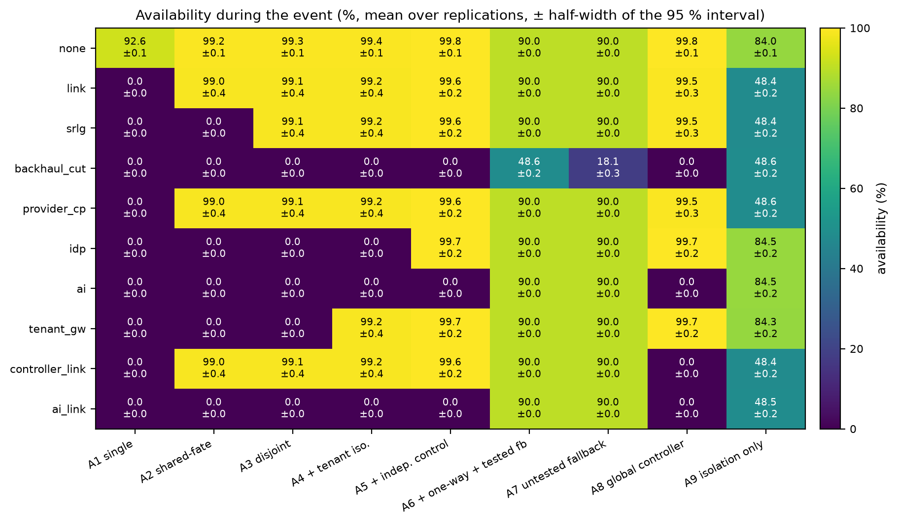
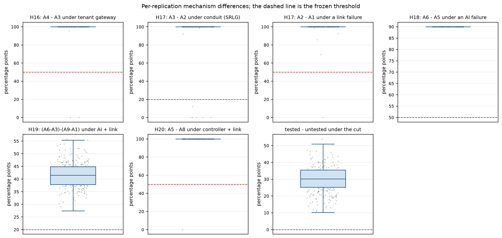
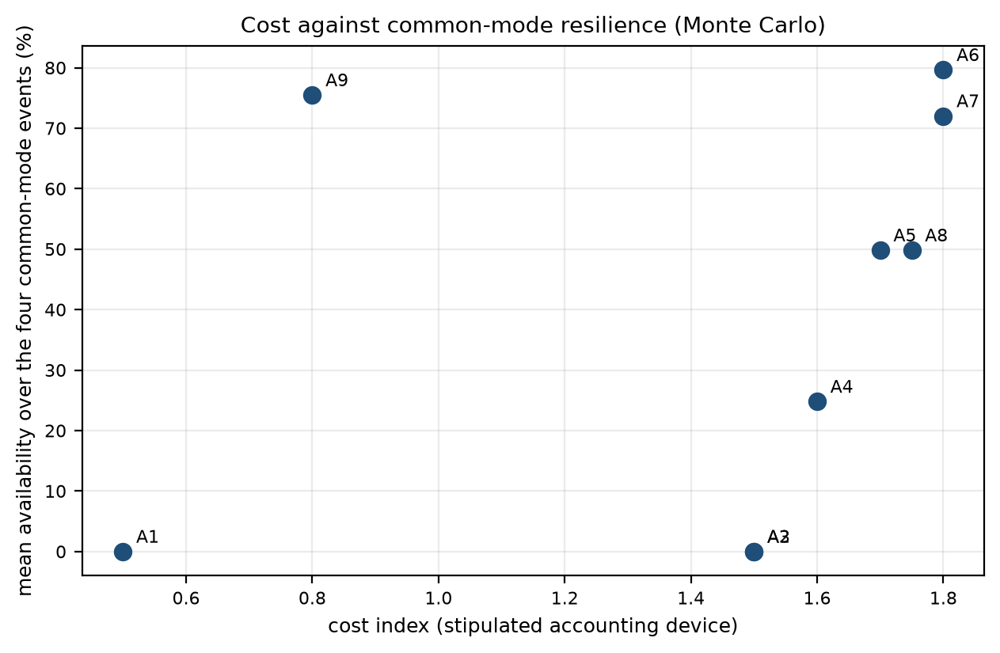
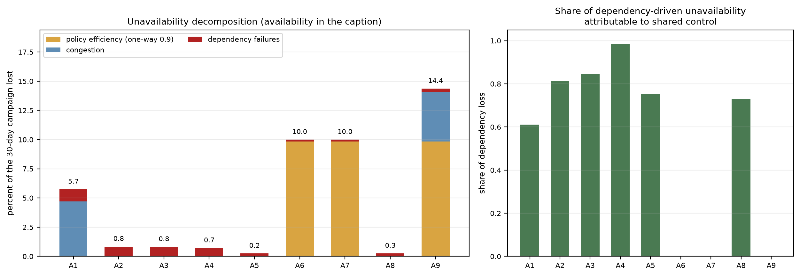
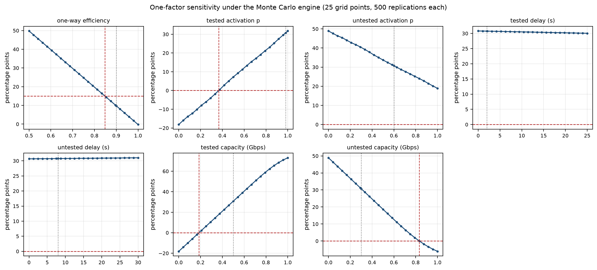
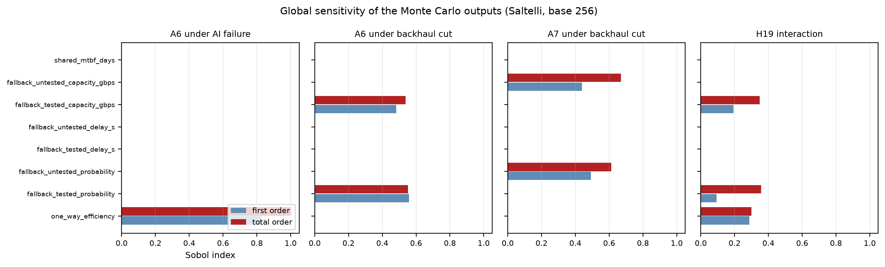
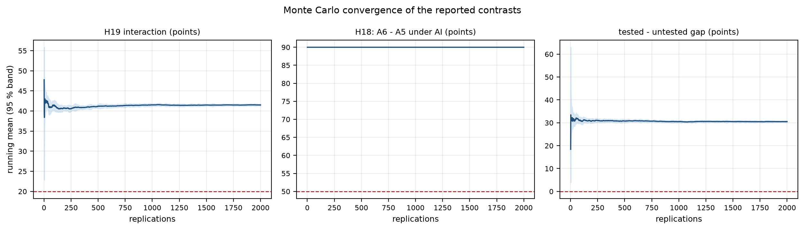

## Abstract

Cloud outages rarely respect tenant boundaries. A provider control plane, identity
service or AI endpoint fails once and every deployment behind it fails together.
Current cloud isolation --- logical tenants, confidential virtual machines,
regions and provider diversity --- cuts tenant-to-tenant, workload-to-host and
region-to-region, but not the shared provider control plane. Multipath is often
proposed as the complement, but paths that share a conduit or a control plane are
one path with extra steps. We present a continuous-time Monte Carlo simulation of
nine architectures under ten incident classes: 2,000 replications per cell
(180,000 arm-runs) and 500 thirty-day campaigns, with common random numbers and
with the hypotheses, thresholds, stochastic processes and decision rule frozen in
version control before the engine existed. Every reported number is a simulated
sample mean with a 95 % interval rather than a stipulated arithmetic identity;
where the model defines a contrast exactly, the interval is zero and the paper
says so.

Under the frozen model the five checks hold, nominal and Bonferroni. Tenant
isolation contains a tenant-shared gateway fault (99.20 points, interval
[98.82, 99.54]) and nothing for an identity failure (0.00); three paths over one
conduit fail together (0.00) where SRLG-disjoint paths hold 99.08; a one-way
boundary with a tested fallback holds 90.00 under an AI control-plane failure
against 0.00 without it; the isolation-multipath interaction is +41.51 points
[41.27, 41.75]; and a global cooperative controller loses 99.64 points
[99.38, 99.86] when it fails with its primary path. A tested fallback is worth
30.52 points over an untested one on the same failure.

In a 30-day campaign the shared control plane accounts for 61-98 % of
dependency-driven unavailability for the arms that require it and 0 % for the arms
with a one-way boundary. Congestion --- which the deterministic reference model did
not contain --- accounts for most of the remaining loss on the single-path arms
(4.70 points for a single provider, 4.23 for isolation without multipath). Break-even
analysis locates each verdict's nearest boundary: the normal-operation cost of the
one-way boundary fails below 0.848 efficiency; the tested-fallback gap closes below
0.368 activation probability or below 0.186 Gbps capacity, and is erased by an
untested fallback above 0.833 Gbps; H19's interaction fails below 0.688 efficiency
or above 0.719 Gbps fallback capacity. A Sobol decomposition attributes essentially
all of the variance in A6's AI-failure level to the one-way efficiency, and most of
the variance in the fallback outputs to the expected capacity of the fallback.

The simulation is not a measurement of any production network. Its rates are
stipulated priors consistent with the order of magnitude of the public failure
corpora, and its contrasts are structural; the paper states what would count as a
refutation and reports the deterministic reference values beside the simulated
ones.

**Keywords:** common-mode failure; cloud resilience; network isolation;
multipath; data diode; tested fallback; SRLG; Monte Carlo simulation; cooperative
backhaul; Sobol sensitivity.

## 1. Introduction

In the same week of November 2026 two unrelated disruptions were reported. On
13 November the FAA issued a nationwide ground stop after an old
telecommunications system used by air-traffic control was overloaded; the stop
lasted about four hours and twenty minutes, and the FAA and the Department of
Homeland Security reported no evidence of a cyber or AI attack [15,16].
Separately, Microsoft reported a Microsoft 365 outage that it attributed to an
issue introduced during an earlier network capacity upgrade; Outlook, Teams,
Copilot and other services were affected, and Microsoft said a full
post-incident report would follow [17,18]. AI services including ChatGPT and
Claude also reported disruption during the same period [18]. These are separate
events with separate triggers; the public reports do not establish a common
cause.

The same kind of coincidence appears earlier. On 2-3 September 2026 Microsoft
365 reported degradation affecting Outlook, Teams, SharePoint and Copilot [19],
while on the evening of 3 September ChatGPT, Claude and Grok reported elevated
errors [20,21]. The AI providers described infrastructure and compute-center
problems; the public reports do not establish that the Microsoft 365 degradation
and the AI outages shared a root cause. The coincidence is a reason to ask the
structural question, not evidence for the answer.

The structural cause is concentration. A dependency shared by many consumers,
with no independent failure domain behind it, turns a local fault into a
correlated outage. Let a service depend on a shared node $d$ and an independent
part $i$. Its availability is bounded by

$$A_{\mathrm{service}} \;\leq\; A_d \cdot A_i .$$

Adding consumers to $d$ increases scale, utilization and blast radius at the same
time. It does not add an independent failure domain; it widens the one that
already exists. This is why concentration is economically rational and
structurally dangerous: the same decision that lowers unit cost raises
correlated exposure.

Cloud architecture does have isolation, but it isolates the wrong boundary for
this failure. Logical tenant isolation (VPCs, IAM, hypervisors) cuts
tenant-to-tenant; confidential computing and TEEs cut workload-to-host [30];
regions and availability zones cut region-to-region; provider diversity cuts
provider A from provider B [1-4]. None of these cuts tenant-to-provider,
consumer-to-control-plane, or consumer-to-shared-dependency. The weak point was
never tenant-to-tenant. The shared control plane was.

The engineering response has two halves, and they are not substitutes.
**Multipath and diversity** keep service running while a path, link or provider
degrades. **Isolation** stops a fault from propagating across a boundary at all.
Multipath cannot cut a shared identity service; isolation cannot create capacity
on the protected side. A tested fallback is the condition that makes either one
real: an isolation boundary that leaves the protected side without capacity
converts a provider outage into a local outage, and an unexercised fallback is a
control arm, not a mitigation.

This paper turns that argument into a simulation and a comparison. We do not
propose a new routing protocol. We ask a narrower, falsifiable question: under a
common-mode event, which architectural choices actually preserve service, and how
do they compare with the isolation categories current cloud architecture already
provides?

An earlier version of this study answered that question with a deterministic
flow-level model: availability was a capacity/dependency conjunction evaluated at
one-second ticks, with one random draw per seed. That model was transparent and
its checks were exact, but exactness cut both ways. The 100 % and 0 % entries were
membership tests in a dependency list, the 90 % was the stipulated 0.9 efficiency,
and the reported numbers had no interval because there was nothing to sample. The
model could not say how much of an availability level was caused by congestion,
what a year of operation would cost, or which of its stipulated constants actually
mattered. This paper replaces the arithmetic with a simulation: every dependency
fails and recovers as a stochastic process, the incident is injected at a sampled
time with a sampled duration, demand and effective capacity are stochastic
processes, and the fallback activates with a sampled probability, delay and
capacity. The same nine arms, the same ten incident classes and the same
thresholds are used, so the comparison with the deterministic reference is
controlled.

**Contributions.**

1. A continuous-time Monte Carlo simulation of nine architectures and ten
   incident classes: 180,000 arm-runs, plus 4,500 arm-campaigns over thirty
   simulated days, with common random numbers across arms and a pre-registered
   decision rule.
2. A controlled comparison between stylized current-cloud architectures --- single
   provider, multi-zone and multi-region paths, tenant isolation, independent
   control planes and a global orchestrator --- and the two-axis principles of
   isolation plus independent multipath plus a tested fallback, in which every
   hypothesis is decided by a 95 % interval rather than by a point estimate.
3. Five model checks that hold under the interval rule, nominal and Bonferroni,
   with the per-replication pass fractions reported: tenant isolation is the wrong
   cut for a shared control plane; multipath gain tracks path independence, not
   path count; a one-way boundary without local capacity is a partition; the
   isolation-multipath interaction is positive; and a global cooperative
   controller is a new common-mode carrier.
4. A 30-day campaign that turns the event table into an availability budget: the
   share of dependency-driven unavailability attributable to the shared control
   plane, the share attributable to congestion, and the fraction of tenant-days
   that breach a 99 % target.
5. An open artifact: frozen protocol, engine, benchmark, tests, a one-factor
   break-even analysis, a Sobol variance decomposition, a two-factor interaction
   grid, figures and raw CSV outputs. A rerun of the benchmark reproduces the
   published tables byte for byte.

**What we do not claim.** This is not a measurement of AWS, Azure, Google Cloud,
Cloudflare or any production network. The current-cloud architectures in Table 1
are structural analogues, not reconstructions of a particular provider. The model
is flow-level: it computes capacity, congestion and dependency conjunction, not
packets, queues, TCP behaviour or hardware. The failure rates and durations are
stipulated priors consistent with the order of magnitude of the cited corpora,
not fits to an operator; Section 5.11 and Section 7 say what that costs. Four of
the twelve criteria are deterministic contrasts in the model and therefore have
zero-width intervals; the simulation cannot add variance to a quantity the model
defines exactly. Security is not evaluated. The motivating outages are reported
events; their root causes are not independently verified here, and no result
depends on a particular root cause being correct. No result is empirical support
for the model's claims; the model checks are statements about the model, and the
postmortem study is the separate empirical test.

## 2. Related Work

### 2.1 Failure domains and isolation

Cloud computing is defined by on-demand, pooled resources and rapid elasticity
[1], and the major providers expose isolation through regions and availability
zones [2-4]. Tenant isolation is the default boundary: a tenant's virtual network,
identity policy and hypervisor namespace are separate from another tenant's.
Confidential computing extends this to the host, placing a workload in a
hardware-enforced trusted execution environment. These mechanisms are effective
for the threat they address. They do not address a provider control-plane fault,
because the control plane is outside the tenant boundary by construction.

Dependability taxonomy separates faults, errors and failures, and distinguishes
independent from common-cause failures [5]. Cloud measurement studies document
that many cloud incidents are configuration and software faults rather than
hardware faults [6]. Chaos engineering formalises the practice of testing failure
paths before they are needed [7]. Operational technology security guidance
recommends segmentation at the IT/OT boundary [8], and data diodes provide
hardware-enforced one-way transfer at that boundary [9]. Rail signalling
provides a vendor-described existence proof of a data diode paired with
commercial off-the-shelf servers [9]. We treat the data diode as an availability
and attack-surface boundary, not as a cryptographic control.

### 2.2 Multipath and independence

Multipath transport is standardised in MPTCP [10], and equal-cost multipath
routing is standard in datacentre fabrics [11]. Shared-risk link groups (SRLGs)
are the conventional way to express that two links are not independent [12]. The
multipath literature usually evaluates throughput, latency and failover; it less
often asks whether the path set is independent of the *control* plane that
selects it. A three-path set that reconverges on one identity service or one
controller is a single failure domain with three next hops.

Cooperative backhaul adds a second form of concentration. Self-scaling pools
capacity across links and tenants, which raises utilization, but a global
cooperative controller is itself a shared dependency. The controller can become
the common-mode carrier that the multipath was meant to remove. We make
controller locality an explicit design variable rather than an implementation
detail.

### 2.3 Simulation methods for structural resilience questions

The question in this paper spans many architectures and failure classes, and it is
about the dependency structure rather than about a protocol state machine. Three
instruments are available, and they answer different questions.

**Packet-level simulation and real-stack testbeds** are the right instrument for
protocol behaviour: ns-3 [32] and Linux network namespaces reproduce queueing,
transport dynamics and hardware-like effects with high fidelity, and our earlier
layering study used a model, a discrete-event simulation and a namespace harness to
separate structural from implementation effects [13]. The repository already
maintains ns-3.49 reference programs for its two-path handover, role-transition
and transmission-energy scenarios, so the tooling and the cross-validation pattern
exist; what is missing is a common-mode instantiation, and we do not claim one
here. Their cost is that each architecture must be built and instrumented, and the
result is still tied to one topology and one kernel. They are also poor at the
rare-event statistics that a 30-day availability budget needs: a 30-day campaign at
packet granularity is expensive, and the interesting events are rare.

**Trace-driven discrete-event simulation** replays an observed failure trace. It
inherits the trace's bias and cannot produce architectures the trace did not
exercise. The Cloud Uptime Archive [23] is the closest public source; we use its
order of magnitude to bound the rates, not its point values.

**Monte Carlo simulation of a structural model** samples the failure processes
directly. It is the right instrument when the object of interest is the dependency
structure and the question is comparative, because architectures share the same
draws, the cost per replication is small, and rare events can be sampled in
proportion to their modelled probability. Its weakness is exactly its strength: the
rates are stipulated, so the answer is a statement about the model. We therefore
pre-register the stochastic model, report the deterministic limit beside the
simulated estimate, and make the rates an explicit sensitivity axis. This is the
instrument used here.

### 2.4 Testbeds and pre-registration

Our earlier layering testbed followed the model-first route, using a model, a
discrete-event simulation and a Linux namespace harness to separate structural
from implementation effects [13]. The present study is deliberately flow-level: it
isolates the dependency structure and the path-independence condition, and leaves
packet-level behaviour to a later fidelity. Paper B in the same repository is a
caution against assuming that a biologically inspired controller will beat a
simpler structural mechanism [14]; the biological parallel in this paper is a
hypothesis generator, not evidence.

### 2.5 Empirical outage studies and provider postmortems

The empirical literature on cloud outages is thinner than the operational
literature, but it is not absent. Gunawi et al. coded more than 3,000 issues in
cloud systems [6] and later asked why the cloud stops computing in a study of
hundreds of service outages [22]. Talluri et al. release the Cloud Uptime
Archive, a multi-vantage availability dataset, and report mean time between
failures, recovery times and operator-stated root causes; in their one-year
operator subset, configuration errors dominate multi-regional outages [23].
Paladugu coded 70 official postmortems from 22 providers (2019-2026): changes
started 52 of the 70 incidents (74.3%), configuration changes alone accounted
for 28 of the 52 change-triggered incidents (53.8%), and 10 of 11 globally pushed
changes produced wide impact [24]. That study is a preprint, not peer-reviewed,
and its frame is published postmortems, not all outages.

The provider corpora are the primary material: AWS Post-Event Summaries [25],
Azure post-incident reviews [26], Google Cloud Service Health [27] and
Cloudflare's postmortem archive [28]. Their disclosure depth and cadence differ,
so they cannot be treated as a random sample. Two Cloudflare examples show the
class this paper models: a December 2025 configuration-change outage lasted about
25 minutes, and a November 2025 bug in a Bot Management feature file affected
many services [28]. We do not code those incidents here; the companion
postmortem study does that under a frozen codebook, and its results are reported
separately. The median outage duration and the days-to-weeks spacing of failures
in those corpora are the order of magnitude that Section 3.3 adopts.

### 2.6 Positioning

Prior work treats isolation and multipath as separate remedies: isolation is a
tenancy or segmentation property, multipath is a transport or routing property.
The claim tested here is that they are independent mitigations of the same
failure, and that neither substitutes for the other. The comparison is against
stylized current-cloud architectures, not against a new protocol. The
contribution is the joint test, the frozen protocol and the measured interaction,
not a claim of priority over the individual mechanisms.

## 3. Model and Simulation

### 3.1 Six principles

The simulation encodes six principles. They are stated before the results because
they determine what the simulation measures.

1. **Availability is a conjunction.** A tenant is served only if its data path,
   its control plane, its tenant boundary and, where required, its fallback are
   available at the same time.
2. **Multipath counts only across independent failure domains.** Paths that share
   a conduit, a provider control plane or a shared control service are one path
   with extra steps.
3. **Isolation trades capability for containment.** A cut that removes a shared
   dependency can also remove the capability that dependency provided. A boundary
   without local capacity is a partition, not a mitigation.
4. **A fallback is a tested state.** It has an activation probability, a delay
   and a capacity fraction. An untested fallback is a control arm.
5. **The controller is a dependency.** Self-scaling through a global cooperative
   controller concentrates the service it is meant to diversify.
6. **Common-mode events are sampled once per event, not per tenant.** A shared
   node fails for everyone at once; that is what makes it common-mode.

### 3.2 Structural model

A deployment is a dependency graph $G=(V,E)$. A path set $P$ serves a tenant,
with path capacity $c_p$, latency and an SRLG set. Two paths are independent when
their SRLG sets are disjoint and their providers differ. The **path independence
index** is

$$I(P) \;=\; \frac{\max\{|S| : S \subseteq P,\; S \text{ pairwise independent}\}}{|P|}.$$

A tenant is served at a time $t$ only if its data path, its control plane, its
tenant boundary and, where required, its fallback are simultaneously available.
An isolation boundary is a cut $C$ in $G$. When the cut removes a required
dependency, the tenant can serve at most its local fallback capacity, so a
boundary without local capacity reduces to a partition:

$$A_{\mathrm{iso}} \;\leq\; \min\left(1, \frac{c_{fb}}{D}\right),$$

where $D$ is demand. A global controller that fails reduces the usable path set to
the primary path; a local controller does not.

### 3.3 Stochastic processes

The model is simulated in continuous time. The service state is piecewise constant
between the sampled breakpoints, and there is no fixed tick. The protocol,
including every constant below, is frozen in
[`common-mode-mc-predictions.md`](common-mode-mc-predictions.md) at commit
`6c8d320`.

**Failure and recovery.** Each dependency is an alternating renewal process:
exponential time to failure with mean MTBF, lognormal duration with median $m$ and
log dispersion $\sigma_{\ln}$,

$$D \;=\; m \cdot \exp(\sigma_{\ln} Z), \qquad Z \sim \mathcal{N}(0,1).$$

Table 8 in the appendix lists the rate and duration parameters for the shared
identity, DNS and AI services, the tenant gateway, the cooperative controller, the
provider control planes, the provider nodes, the edge links, the aggregation
conduits and the provider-cloud links. A conduit failure takes every link in its
SRLG; a provider-node failure takes every link incident to that provider; a
provider control-plane failure removes every path through that provider.

**Incident injection.** For an incident class the failure set of the reference
protocol is injected at a sampled start and with a sampled duration, superimposed
on the background process rather than replacing it. The start is
$U(6~\mathrm{h}, 18~\mathrm{h})$ in the 24-hour horizon; the duration is
lognormal with class-specific median (25-45 minutes) and $\sigma_{\ln} = 0.8$,
truncated at six hours. If a background failure hits the same target, the union is
down.

**Demand.** Per tenant, offered demand in Gbps is a diurnal process with
Ornstein-Uhlenbeck noise,

$$d_i(t) \;=\; 1.00 \cdot \left(1 + 0.10 \sin\frac{2\pi(t-2\,\mathrm{h})}{24\,\mathrm{h}}\right) \cdot e^{x_i(t)},$$

where $x_i$ is an Ornstein-Uhlenbeck process with stationary standard deviation
0.05 and correlation time 30 minutes, independent per tenant. The diurnal factor
peaks at 14:00 and troughs at 02:00.

**Capacity.** The effective capacity of a link is

$$c_l(t) \;=\; c_l^{\mathrm{nominal}} \cdot \eta \cdot m_l(t), \qquad \eta = 0.95,$$

where $\eta$ is the protocol efficiency and $m_l$ is an adaptive-modulation
factor: Ornstein-Uhlenbeck with mean 0.98, stationary standard deviation 0.03,
correlation time 2 minutes, clipped to $[0.60, 1.00]$. Adaptive modulation is a
property of the radio edge link, so it is applied to the $e_i \rightarrow a_j$
links; the aggregation and provider-cloud links are fibre and are modelled as
stable. A path's effective capacity is the minimum over its links.

**Fallback.** A fallback profile has an activation probability, a delay and a
capacity. The tested profile activates with probability 0.98 after a median 2 s
delay ($\sigma_{\ln}=0.5$) and serves a median 0.50 Gbps ($\sigma_{\ln}=0.15$);
the untested profile activates with probability 0.60 after a median 8 s
($\sigma_{\ln}=0.6$) and serves a median 0.30 Gbps ($\sigma_{\ln}=0.20$). The
activation uniform is drawn once per tenant and per dependency-outage episode and
is shared by every arm with a fallback, so the fallback comparison is paired.

**Common random numbers.** Every random input of a replication --- the background
timelines, the incident start and duration, the demand and modulation processes,
the fallback draws --- is generated once and shared by all nine arms. Arms differ
only in mechanism, so a per-replication paired difference cannot be explained by a
seed.

### 3.4 Service and metrics

At any time, a path is available if none of its links is down, its provider node
is up and its provider control plane is up; under a failed global controller only
the primary path may be used. If the control plane is available, the tenant is
served up to the sum of its available path capacities; if it is not, or if no path
is available, the tenant needs the fallback, which activates per its profile and
serves up to its capacity. A one-way boundary multiplies path service by the
local-policy efficiency, 0.90, and removes the AI endpoint from the availability
path.

For each arm, incident class and replication the simulation records:

- **availability during the event**: the time-weighted covered fraction of
  offered demand, averaged over tenants and over the incident window;
- **overall availability**: the same over the 24-hour horizon;
- **recovery**: time from incident start until a tenant first reaches 90 % for
  three consecutive seconds, or the incident duration if it never does;
- **blast radius**: fraction of tenants below 50 % during the event;
- **fallback rate**: fraction of tenants whose fallback activated;
- **path independence** and **cost index**: as in Section 3.2 and Table 1.

For the 30-day campaign the simulation additionally decomposes the lost time into
a **policy** term (the one-way efficiency), a **congestion** term (demand above
the available capacity while every dependency is up) and a **dependency** term
(loss while a dependency is down). The decomposition is exact: for every interval
the served fraction is $e \cdot \min(1, c/d)$ with $e$ the one-way efficiency, so
$1 - e \cdot \min(1,c/d) = (1-e) + e \cdot \max(0, 1-c/d)$. The **shared share**
is the fraction of the dependency term that disappears when the shared control
plane is made perfect, by ablation on the same replication.

The **cost index** is 0.5 per path, plus 0.1 each for tenant isolation, independent
control and one-way, plus 0.05 for a global controller. It is a stipulated
accounting device, not a price, and is not used to rank architectures.

### 3.5 Architectures

Table 1 lists the nine arms. The first five and A8 are stylized versions of
current-cloud choices; A6 instantiates the proposed combination; A7 is a
fallback-quality control; A9 is the isolation-only control.

**Table 1. Architectures.**

| Arm | Paths | Tenant iso. | Control | One-way | Fallback | Controller |
|---|---|---|---|---|---|---|
| A1 | 1 shortest | no | shared | no | none | none |
| A2 | 3 shortest | no | shared | no | none | local |
| A3 | 3 disjoint | no | shared | no | none | local |
| A4 | 3 disjoint | yes | shared | no | none | local |
| A5 | 3 disjoint | yes | independent | no | none | local |
| A6 | 3 disjoint | yes | independent | yes | tested | local |
| A7 | 3 disjoint | yes | independent | yes | untested | local |
| A8 | 3 disjoint | yes | independent | no | none | global |
| A9 | 1 shortest | yes | independent | yes | tested | none |

**Shared control** means the tenant requires global identity, DNS and the AI
endpoint. **Independent control** means identity and DNS are local; the AI
endpoint is still required unless the arm is one-way. **One-way** removes the AI
endpoint from the availability path and serves path traffic at 0.9 efficiency (the
stipulated cost of local policy). **Global controller** uses only the primary path
when the controller is down; **local** reallocates across all surviving paths.

### 3.6 Incidents

**Table 2. Incident classes.** Each class is injected at a sampled time with a
sampled duration (median in parentheses) and is superimposed on the background
process.

| Event | Failure | Median duration | What it tests |
|---|---|---:|---|
| `none` | no injection | — | normal operation |
| `link` | `a1-p1` down | 25 min | one path, independent failure |
| `srlg` | all `a1-p*` links down | 25 min | shared conduit |
| `backhaul_cut` | all agg-to-provider links down | 40 min | total path loss, fallback |
| `provider_cp` | `p1-cp` down | 45 min | provider control plane |
| `idp` | global identity down | 45 min | shared identity |
| `ai` | AI endpoint down | 45 min | shared AI control plane |
| `tenant_gw` | shared tenant gateway down | 30 min | tenant-shared fault |
| `controller_link` | controller and `a1-p1` down | 25 min | controller locality |
| `ai_link` | AI endpoint and `a1-p1` down | 30 min | combined control and path failure |

### 3.7 Mapping to current cloud architecture

The mapping is structural, not a claim about a specific provider.

**A1** is a single-region, single-provider deployment: one path, one control
plane, no fallback. **A2** is a multi-zone or multi-region path set that shares a
conduit and a global control plane: more next hops, one failure domain. **A3**
adds SRLG-disjoint paths, which is the strongest path diversity current cloud
offers, but keeps global identity, DNS and AI. **A4** adds tenant isolation, the
default cloud boundary. **A5** adds independent identity and DNS, the strongest
single-tenant control-plane design in the set, but the AI endpoint remains on the
availability path. **A8** is the global orchestrator: a single cooperative
controller that can reallocate across all paths and tenants.

**A6** is the proposed architecture: disjoint paths, tenant isolation,
independent control, a one-way boundary at the AI/control interface, a tested
local fallback and local reallocation. **A9** isolates without multipath: the
same boundary and fallback on a single path. A9 is the control that separates
"isolation works" from "isolation is sufficient".

## 4. Protocol

### 4.1 Pre-registration and the two engines

Two protocols are frozen in version control. The reference protocol
[`common-mode-predictions.md`](common-mode-predictions.md) at commit `1c781f3`
defines the deterministic flow-level model; it is reported as the zero-variance
limit and is not edited. The Monte Carlo protocol
[`common-mode-mc-predictions.md`](common-mode-mc-predictions.md) at commit
`6c8d320` defines the stochastic processes, the replication counts, the decision
rule and the expected outcomes of this paper; it was committed before
`simulation/common_mode_mc.py` existed. Both use the same topology, the same nine
arms and the same twelve thresholds, so a change of verdict is attributable to the
engine, not to the analyser.

### 4.2 Experiments and replication counts

| Experiment | Design | Replications | Arm-runs |
|---|---|---|---|
| E1 incident | 9 arms × 10 incident classes, 24 h horizon | 2 000 | 180 000 |
| E2 campaign | 9 arms × 30 days, every process active | 500 | 4 500 |
| E3 one-factor sensitivity | 7 constants × 25 values, E1 design | 500 per point | 962 500 |
| E4 global sensitivity | Saltelli/Sobol, base 256, 8 parameters | 20 per evaluation | 2 560 evaluations |
| E5 two-factor grid | 5 × 5 efficiency × fallback capacity | 500 per cell | 25 cells |

E1 and E2 replications are paired across arms: the same draws serve all nine
arms. The replication index is $r = 0 \ldots N-1$ and the base seed is 2026; a
replication's random streams are keyed by $(\text{seed}, r)$ and the stream
identifier, so the sampling order is independent of the arm.

### 4.3 Statistics

For each criterion the analysis forms the per-replication paired difference
between the two arms named in the criterion. Let $\hat\Delta$ be its mean,
$[\ell, h]$ the 95 % percentile bootstrap interval (10,000 resamples) and $p$ the
two-sided sign-flip permutation p-value against the threshold (10,000
permutations).

- **PASS** if the whole interval is inside the passing region:
  $\ell \ge t$ for a $\ge$ criterion, $h \le t$ for a $\le$ criterion, and
  $\ell \ge -t$ and $h \le t$ for an absolute-value criterion.
- **FAIL** if the whole interval is outside the passing region.
- **INCONCLUSIVE** otherwise.

A hypothesis passes only if every one of its criteria passes; it fails if any
criterion fails. The rule is deliberately conservative: a large but imprecise
effect is not support. The per-replication pass fraction is reported as a
descriptive statistic, not as the decision. Because twelve criteria are tested,
the analysis also reports every criterion at a Bonferroni level
$\alpha = 0.05/12$; a verdict that changes under Bonferroni would be reported as
nominal-only.

The interval width is informative in one respect that the paper reports rather
than hides. Four criteria have exactly zero-width intervals --- H16b, H18a, H18b
and H19c --- because both arms sit at a ceiling in every replication: A3 and A4
both serve exactly 0 under `idp`, A5 serves exactly 0 and A6 exactly 90 under
`ai`, and A3 exactly 0 under `ai_link`. The other mechanism contrasts are
deterministic in the absence of a coincident background failure, and their
0.1-0.4-point intervals measure how often such a coincidence occurs. The
simulation therefore adds variability to the levels, the recovery behaviour, the
fallback outputs, the campaign and the sensitivity; it does not add variability to
a contrast the model defines exactly.

### 4.4 Reproducibility

The engine is deterministic given a seed. Every reported number is a sample mean
over replications, and a rerun of the main benchmark reproduces
`common-mode-mc-differences.csv` and `common-mode-mc-verdicts.csv` byte for byte.
The reproduction commands are

```bash
py -3 tools/benchmark_common_mode_mc.py --replications 2000
py -3 tools/benchmark_common_mode_mc.py --sensitivity --sensitivity-points 25 --sensitivity-replications 500
py -3 tools/benchmark_common_mode_mc.py --sobol
py -3 tools/benchmark_common_mode_mc.py --two-factor
py -3 tools/make_common_mode_mc_figures.py
py -3 -m unittest tests.test_common_mode_mc -v
```

The benchmark writes per-replication rows under `output/common-mode-mc/` and the
compact tables under `docs/paper-tables/`; the figures are drawn from the
committed tables, not recomputed from the simulator. The artifact index is in the
appendix.

### 4.5 What the deterministic reference adds

The reference model is not superseded. It is the limit of the simulation as all
dispersion and all processes of variation go to zero, and it is useful for exactly
that reason: it isolates the dependency structure, and the difference between the
two engines is the quantitative content of stochastic realism. Section 5.9
reports the two side by side and attributes the differences to their causes.

## 5. Results

### 5.1 Overall picture

Figure 1 shows availability for every arm and incident class, with the half-width
of the interval in each cell. The first column is the clearest difference from the
deterministic reference: normal availability is no longer a row of 100s. A1
serves 92.58 [92.45, 92.71] because its single path runs into the diurnal peak;
A2-A4 serve 99.2-99.4 because their three paths are capacity-abundant but their
shared control plane is not; A5 and A8 serve 99.8 because independent identity and
DNS remove the shared-control loss; A6 and A7 serve exactly 90.00 because the
one-way boundary is the only thing between them and full service; A9 serves 84.05
because it combines the one-way boundary with a single, congested path.

Under the incident classes the pattern is the one the principles predict. A1 is
available only with no failure. A2 survives an independent link failure but not a
conduit failure. A3 survives both path events but not identity or AI. A4 adds
tenant isolation and survives the tenant gateway. A5 adds independent identity
and survives identity, but not AI. A6 survives AI, link, conduit, provider
control, identity and tenant faults, and serves 48.59 under a full backhaul cut.
A8 behaves like A5 until its controller fails, then falls to 0.00. A9 matches A6
under the backhaul cut and is much weaker under an independent link failure.

{width=95%}

**Figure 1.** Availability during the incident, nine architectures and ten
incident classes, mean over 2,000 replications; the second line of each cell is the
half-width of the 95 % interval. Data: `docs/paper-tables/common-mode-mc-summary.csv`,
regenerated by `tools/make_common_mode_mc_figures.py`.

### 5.2 H16: tenant isolation is the wrong cut

Tenant isolation turns the tenant-shared gateway failure from a total outage into
near-normal service: A3 is 0.00 and A4 is 99.20 [98.82, 99.54], a paired
difference of 99.20 points. It does nothing for the identity failure: A3 and A4
are both 0.00. The criterion `|A4 − A3| ≤ 5` passes with an interval of
[0.00, 0.00] — both arms lose everything, which is the point.

The result is not that tenant isolation is useless; it is that the cut is in the
right graph for tenant-to-tenant faults and in the wrong graph for the shared
control plane. The shared node lies outside the tenant boundary, so no amount of
tenant separation reaches it. This is the category error in its cleanest form:
current cloud isolation is designed to prevent one tenant from reaching another;
it is not designed to keep a tenant serving when the provider's identity or AI
service is down.

The campaign makes the same point as a budget rather than as an event table. A4
loses 0.71 points of its 30-day availability to dependency failures, and 98 % of
that loss is attributable to the shared control plane; A3 loses 0.82 points, 85 %
of it shared. For A1 the shared share is 61 % of 1.04 points of dependency loss.

### 5.3 H17: independence, not count

A2 and A3 both have three paths. Under the `agg-1` conduit failure A2 is 0.00,
because all three of its shortest paths share the conduit, while A3 is 99.08
[98.67, 99.44], because its paths use three aggregation sites. Under the
independent `a1-p1` link failure A2 is 99.04 [98.62, 99.41] and A1 is 0.00. Path
count alone would have predicted the opposite ordering for the conduit event.

The path independence index makes the difference explicit: A2 is 0.333 and A3 is
1.0. The same pattern appears for a provider control-plane failure: A1 is 0.00 and
A2 is 99.04, because A2 has paths via other providers. Multipath is a diversity
property, not a multiplicity property. A path set that shares an SRLG or a
control plane is a single failure domain with extra next hops.

### 5.4 H18: a boundary without capacity is a partition

Under the AI control-plane failure A5 is 0.00 and A6 is 90.00 [90.00, 90.00]: A5
has independent identity and DNS, but it still requires the AI endpoint; A6
removes that dependency with a one-way boundary and serves local policy at 0.9
efficiency. The normal-operation cost is 9.81 [9.75, 9.86] points (A5 99.81, A6
90.00). The cost is the price of local policy, not a failure of the boundary, and
it is worth 90 points of availability under the AI failure.

The fallback-quality result is sharper. Under the full backhaul cut A6 serves
48.59 with a 97.8 % activation rate; A7 serves 18.07 with a 60.2 % activation
rate. The tested fallback is worth 30.52 points on the same failure. A7's 18.07
is close to `0.60 × 0.30 / 1.00` Gbps: the untested fallback delivers roughly its
activation probability times its capacity fraction, which is why it behaves like a
control arm rather than a mitigation (Figure 2, last panel).

### 5.5 H19: the interaction is positive

Under the combined AI + link failure the four relevant arms are A1 = 0.00,
A3 = 0.00, A9 = 48.48 and A6 = 89.98. The interaction term is

$$(A6 - A3) - (A9 - A1) = (89.98 - 0.00) - (48.48 - 0.00) = 41.51 \text{ points},$$

with a 95 % interval of [41.27, 41.75]. The reading is direct. A3 has multipath
but not isolation, so the AI failure takes it to zero. A9 has isolation but not
multipath, so the link failure leaves it with fallback capacity only. A6 has both
and reaches 89.98. Isolation and multipath are not substitutes; under a mixed
failure they are complements.

The interaction is also the criterion with the largest sample variance in the
study, because A9's 48.48 is a function of demand and fallback draws. That is why
its interval is 0.48 points wide while the mechanism contrasts have intervals of
0.1-0.4 points, and why its running mean is the one that visibly converges
(Figure 7, first panel).

### 5.6 H20: the controller is a dependency

Under the controller + primary-link failure A5 (local reallocation) is 99.64 and
A8 (global controller) is 0.00, a paired difference of 99.64 points [99.38,
99.86]. With no failure both are 99.75, a difference of 0.01 [0.00, 0.01]. The
global controller buys nothing in normal operation and costs everything when it
fails: once it is down, A8 falls back to its primary path, which is the failed
link.

This is the cooperative-controller trap. Self-scaling through a global controller
raises utilization and recreates the concentration the multipath was meant to
remove. Local, partition-tolerant reallocation avoids it. The campaign shows the
same thing at the availability level: A8's shared share is 0.73, essentially the
same as A5's 0.75, so the controller adds a dependency without removing one.

{width=95%}

**Figure 2.** Per-replication mechanism comparisons. Each panel is one criterion;
the dashed line is the frozen threshold. The mechanism contrasts are flat on
99-100 points (and on zero), which is what a deterministic membership test looks
like when it is sampled; the interaction and the fallback gap carry the sample
variation. Data: `docs/paper-tables/common-mode-mc-differences.csv`.

### 5.7 Comparison with current cloud architectures

Table 3 compares the stylized current-cloud arms with the proposed combination on
the events that matter for common-mode failure, and adds the cost index. Arm
identifiers follow Table 1: A1-A5 and A8 are the current-cloud analogues, A6 is
the proposed combination, A7 is the untested-fallback control and A9 is the
isolation-only control.

**Table 3. Current-cloud analogues versus the proposed combination (availability
during the incident, %, 2,000 replications).**

| Arm | Normal | Tenant gw. | Identity | AI | AI + link | Cut | Cost |
|:--|------:|--------:|--------:|----:|-------:|---:|------:|
| A1 | 92.58 | 0.00 | 0.00 | 0.00 | 0.00 | 0.00 | 0.50 |
| A2 | 99.24 | 0.00 | 0.00 | 0.00 | 0.00 | 0.00 | 1.50 |
| A3 | 99.25 | 0.00 | 0.00 | 0.00 | 0.00 | 0.00 | 1.50 |
| A4 | 99.36 | 99.20 | 0.00 | 0.00 | 0.00 | 0.00 | 1.60 |
| A5 | 99.81 | 99.66 | 99.66 | 0.00 | 0.00 | 0.00 | 1.70 |
| A6 | 90.00 | 90.00 | 90.00 | 90.00 | 89.98 | 48.59 | 1.80 |
| A7 | 90.00 | 90.00 | 90.00 | 90.00 | 89.98 | 18.07 | 1.80 |
| A8 | 99.80 | 99.65 | 99.65 | 0.00 | 0.00 | 0.00 | 1.75 |
| A9 | 84.05 | 84.34 | 84.49 | 84.49 | 48.48 | 48.59 | 0.80 |

Current cloud improves along one axis at a time. Tenant isolation (A4) fixes the
tenant gateway but not identity or AI. Disjoint multipath (A3) fixes the conduit
failure but not the control plane. Independent control (A5) fixes identity but
not AI. The global controller (A8) does not fix any common-mode event on its own,
and it adds a new one. No current-cloud arm reaches 90 % under AI + link; A6
does.

The comparison also exposes a trade that a single ranking would hide. Over the
four common-mode events (identity, AI, tenant gateway, backhaul cut) A6 averages
79.65 and A9 averages 75.48, so A6 is 4.17 points better at 2.25 times the cost.
A9 is the cheaper design, and it captures 94.7 % of A6's common-mode
availability, but it is not equal to A6: its single path is capacity-limited at
the diurnal peak, so it pays the policy cost on top of congestion. In the
deterministic model the two matched at 78.91; the simulation separates them. The
"both axes" claim is therefore conditional on the failure mix and on the capacity
budget, not a claim that the most expensive arm dominates everywhere.

{width=75%}

**Figure 3.** Cost index against mean availability over the four common-mode
events. A9 is far cheaper and close; A6 buys the remaining 4.2 points and
independent-link resilience (Section 5.7). The cost index is stipulated and is not
a price.

### 5.8 Verdicts

**Table 4. Frozen hypotheses and model checks (2,000 paired replications).**

| Crit. | Quantity | Estimate | 95 % interval | Pass | Verdict |
|:------|:--------------------------|--------:|:-----------------|-----:|:--------|
| H16a | A4−A3, `tenant_gw` | 99.20 | [98.82, 99.54] | 0.991 | PASS |
| H16b | abs(A4−A3), `idp` | 0.00 | [0.00, 0.00] | 1.000 | PASS |
| H17a | A3−A2, `srlg` | 99.08 | [98.67, 99.44] | 0.993 | PASS |
| H17b | A2−A1, `link` | 99.04 | [98.62, 99.41] | 0.990 | PASS |
| H18a | A6−A5, `ai` | 90.00 | [90.00, 90.00] | 1.000 | PASS |
| H18b | A6 level, `ai` | 90.00 | [90.00, 90.00] | 1.000 | PASS |
| H18c | A5−A6, `none` | 9.81 | [9.75, 9.86] | 1.000 | PASS |
| H19a | interaction, `ai_link` | 41.51 | [41.27, 41.75] | 1.000 | PASS |
| H19b | A6 level, `ai_link` | 89.98 | [89.97, 89.99] | 1.000 | PASS |
| H19c | A3 level, `ai_link` | 0.00 | [0.00, 0.00] | 1.000 | PASS |
| H20a | A5−A8, `controller_link` | 99.64 | [99.38, 99.86] | 0.997 | PASS |
| H20b | abs(A5−A8), `none` | 0.01 | [0.00, 0.01] | 1.000 | PASS |

The two-sided permutation p-value is below 0.0001 for every criterion, and every
verdict is unchanged at the Bonferroni level `0.05/12`; the full table, with both
interval levels, is in `docs/paper-tables/common-mode-mc-verdicts.csv`.

H16, H17, H18, H19 and H20 all pass, and the verdicts do not depend on the
multiplicity adjustment. The pass fractions are 0.990-1.000; the criteria below
1.000 are those where a background failure can coincide with the incident window
and move a difference across the threshold on that replication. The full table,
with every column and the five hypothesis roll-ups, is
`docs/paper-tables/common-mode-mc-verdicts.csv`.

The all-pass outcome is a property of the structural model: the mechanisms are
isolated by design, so the margins are large. The simulation does not change that
fact, and it does not turn the model checks into evidence about a production
deployment.

### 5.9 Deterministic reference versus simulation

The two engines share the topology, arms and thresholds. Table 5 puts them side by
side for the quantities a reader is most likely to compare.

**Table 5. The deterministic reference and the Monte Carlo simulation.**

| Quantity | Ref. | MC | Diff. | Cause |
|:-------------------------|------:|-----:|------:|:--------------------------------|
| A1 normal availability | 100.00 | 92.58 | −7.42 | diurnal peak exceeds one path |
| A2 normal availability | 100.00 | 99.24 | −0.76 | background shared-control failures |
| A5 normal availability | 100.00 | 99.81 | −0.19 | background AI/identity failures |
| A6 normal availability | 90.00 | 90.00 | 0.00 | three paths are capacity-abundant |
| A9 normal availability | 90.00 | 84.05 | −5.95 | one path limited before the 0.9 boundary |
| A3 under `srlg` | 100.00 | 99.08 | −0.92 | background failures in the window |
| A6 under `ai` | 90.00 | 90.00 | 0.00 | the boundary is the binding mechanism |
| A6 under `backhaul_cut` | 45.62 | 48.59 | +2.96 | reference averaged the delay over the window |
| A7 under `backhaul_cut` | 11.11 | 18.07 | +6.96 | same, plus the demand-weighted fraction |
| H19 interaction | 44.38 | 41.51 | −2.87 | A9's level rises from 45.62 to 48.48 |
| tested − untested gap | 34.51 | 30.52 | −3.99 | A7's level rises more than A6's |

`Ref.` is the deterministic reference model and `MC` is the simulation.

The differences are not noise. They are four structural effects that the
deterministic model could not represent:

1. **Congestion.** The reference had no demand or capacity process, so a single
   path served 100 % by assumption. In the simulation a 1.05 Gbps path with 0.95
   protocol efficiency and 0.98 modulation serves about 0.978 Gbps against a
   diurnal demand that peaks at 1.10, so a single-path arm loses 5-7 points to
   congestion before any failure. The loss falls entirely on the single-path arms,
   because three disjoint paths triple the available capacity.
2. **Capacity abundance.** The same fact in reverse: the multi-path arms are not
   capacity-limited at all, so their availability is set by dependency failures
   alone. The deterministic table's 100 % happened to be right for them, but for
   the wrong reason.
3. **The fallback window.** The reference applied the fallback delay as an
   average over the whole event, and its fallback fraction was a capacity
   fraction of demand. The simulation weights service by the demand actually
   offered in each interval, so the 0.50 Gbps fallback serves 48.59 of a demand
   near 1.0, not 45.62.
4. **Coincident background failures.** The reference had a single event per seed.
   The simulation has a background process, so an incident window sometimes
   contains a second failure. That is why several cells sit slightly below their
   ceiling and why almost every criterion has a small but non-zero interval.

The qualitative readings survive all four. The mechanism comparisons keep their
signs and orderings, the five hypotheses keep their verdicts, and the interaction
keeps its sign, its magnitude class and its two-sided capacity boundary.

### 5.10 The thirty-day campaign

Table 6 turns the event table into an availability budget: the availability of
each arm over a simulated 30-day campaign with every background process active,
the decomposition of the lost time, the share attributable to the shared control
plane, and the number of tenant-days below 99 %.

**Table 6. Steady-state availability over a 30-day campaign (500 replications).**

| Arm | Availability (%) | Policy | Congestion | Dependency | Shared share | Days < 99 % |
|:--|:-------------|------:|----------:|----------:|------------:|-----------:|
| A1 | 94.26 [94.14, 94.38] | 0.00 | 4.70 | 1.04 | 0.61 | 21.5 |
| A2 | 99.16 [99.11, 99.21] | 0.00 | 0.00 | 0.84 | 0.81 | 4.6 |
| A3 | 99.18 [99.13, 99.23] | 0.00 | 0.00 | 0.82 | 0.85 | 4.4 |
| A4 | 99.29 [99.25, 99.33] | 0.00 | 0.00 | 0.71 | 0.98 | 3.7 |
| A5 | 99.75 [99.72, 99.78] | 0.00 | 0.00 | 0.25 | 0.75 | 1.3 |
| A6 | 90.00 [90.00, 90.00] | 9.84 | 0.00 | 0.16 | 0.00 | 30.0 |
| A7 | 90.00 [90.00, 90.00] | 9.84 | 0.00 | 0.16 | 0.00 | 30.0 |
| A8 | 99.75 [99.72, 99.78] | 0.00 | 0.00 | 0.25 | 0.73 | 1.3 |
| A9 | 85.64 [85.54, 85.74] | 9.84 | 4.23 | 0.29 | 0.00 | 30.0 |

Columns 3-5 decompose the lost campaign time in percentage points; `shared share`
is the fraction of the dependency term that the shared control plane accounts
for; the last column is the mean number of tenant-days below 99 % out of 30. The
campaign contains a mean of 4.26 shared-control incidents per replication.

The campaign supports three readings that the event table cannot.

First, **the shared control plane dominates dependency-driven unavailability** for
every arm that requires it: 0.61 for A1, 0.81 for A2, 0.85 for A3, 0.98 for A4,
0.75 for A5 and A8, and 0.00 for the one-way arms. This is the paper's central
claim expressed as an availability budget. A4's shared share is higher than A3's
because tenant isolation removes the gateway but leaves identity and the AI
endpoint, so what remains is almost entirely shared; A5's is 0.75 because its
remaining dependency is the AI endpoint.

Second, **congestion is the largest single loss for the single-path arms.** A1
loses 4.70 points of its 5.74 to congestion; A9 loses 4.23 of 14.36. The
three-path arms lose none. The deterministic model, which had no capacity process,
could not show this, and it is the reason A9 trails A6 by 4.17 points rather than
matching it.

Third, **a 99 % daily target is unreachable for the one-way arms by
construction.** Their ceiling is 90 %, so all 30 tenant-days breach; an operator
deploying A6 or A7 should write a 90 % SLO, not a 99 % one, and this is a property
of the design, not of the simulation noise. The arms that require the shared
control plane breach between 1.3 and 21.5 days out of 30.

{width=95%}

**Figure 4.** The 30-day campaign. Left: the lost campaign time decomposed into
policy, congestion and dependency terms, with the total loss above each bar (the
availability and its interval are in Table 6). Right: the share of dependency loss
attributable to the shared control plane. Data:
`docs/paper-tables/common-mode-mc-campaign.csv`.

### 5.11 Sensitivity, break-even and global sensitivity

Every number above depends on stipulated rates and constants, so the interesting
question is not only whether a check passes at the stipulated value but how far the
value could move. The one-factor sweep is the analysis of the reference study,
re-run on the Monte Carlo engine: each constant is swept over 25 values with 500
replications per point, the other constants and the incident design fixed, and the
nearest break-even is located by linear interpolation. The full grid is in
`docs/paper-tables/common-mode-mc-sensitivity.csv`.

**Table 7. Break-even values under the Monte Carlo engine.**

| Constant | Stipulated | Sweep | Primary break-even | Claim that fails there |
|:------------------------------|----------:|:----------|------------------:|:--------------------------|
| one-way local-policy efficiency | 0.90 | 0.50-1.00 | 0.848 | H18: normal cost ≤ 15 points |
| tested fallback activation probability | 0.98 | 0-1 | 0.368 | tested beats untested |
| untested fallback activation probability | 0.60 | 0-1 | none in range | survives the whole range |
| tested fallback activation delay | 2 s | 0-25 s | none in range | survives the whole range |
| untested fallback activation delay | 8 s | 0-30 s | none in range | survives the whole range |
| tested fallback capacity | 0.50 Gbps | 0-1 | 0.186 | tested beats untested |
| untested fallback capacity | 0.30 Gbps | 0-1 | 0.833 | tested beats untested |

For H18 the binding clause is the normal-operation cost (0.848), not the absolute
80 % level (0.800); the model check fails at the higher of the two values, as in
the reference study. The tested fallback is far from its break-even on
probability and capacity: the stipulated 0.98 activation probability would have to
fall to 0.368, or the 0.50 Gbps capacity to 0.186 Gbps, before it stopped beating
the untested fallback under the backhaul cut.

Two results differ from the reference study in substance, not in rounding.

First, the **activation-delay break-even disappears**. In the reference model a
25 s tested delay was enough to erase the gap; in the simulation the median
incident window is about 39 minutes, so even a 25 s delay costs only about one
point. This is a property of the window, not of the fallback: a short incident
cannot be dominated by a short delay.

Second, the **untested fallback now has a capacity break-even** at 0.833 Gbps.
The tested fallback wins by expected capacity (0.98 × 0.50 against 0.60 × 0.30);
an untested fallback that is sufficiently capable erases the gap without any
testing. "Tested" is a proxy for capacity, not a substitute for it, and the
break-even makes that quantitative.

H19's interaction keeps the two-sided boundary of the reference study and moves
it. It falls below 20 points when the one-way efficiency drops below 0.688
(because the interaction is a difference of levels, and both levels move), and
above 0.719 Gbps tested-fallback capacity, because a stronger fallback helps A9,
which has no multipath, more than it helps A6. The paper reports both boundaries
rather than the flattering one.

{width=95%}

**Figure 5.** One-factor sensitivity under the Monte Carlo engine. Each panel
varies one constant; the dotted vertical line is the stipulated value, the dashed
red line is the nearest break-even, and the horizontal dashed line is the frozen
threshold. Data: `docs/paper-tables/common-mode-mc-sensitivity.csv` and
`common-mode-mc-break-even.csv`.

The one-factor sweep cannot see interactions, which is why the paper adds a
variance decomposition. Saltelli/Sobol total-order indices (base 256, 20
replications per evaluation) are reported in
`docs/paper-tables/common-mode-mc-sobol.csv` and Figure 6. The reading is clean:

- **A6 under `ai`** is driven by the one-way efficiency alone (total order
  1.00); every fallback parameter and the shared-control MTBF have total order
  0.00. The mechanism isolates the constant.
- **A6 under `backhaul_cut`** is driven by the tested activation probability
  (0.55) and the tested capacity (0.54); the efficiency is irrelevant.
- **A7 under `backhaul_cut`** is driven by the untested capacity (0.67) and the
  untested activation probability (0.61) — the same structure on the other
  profile.
- **The H19 interaction** is driven by efficiency (0.30), tested activation
  probability (0.36) and tested capacity (0.35). The total-order indices sum to
  more than one and exceed the first-order sum, which means the parameters
  interact: a one-factor sweep cannot attribute the interaction's variance
  additively.

{width=95%}

**Figure 6.** Sobol first- and total-order indices for the four outputs. Data:
`docs/paper-tables/common-mode-mc-sobol.csv`.

The two-factor grid makes the interaction explicit. At the stipulated
(0.90, 0.50) the H19 interaction is 41.62 points and the normal cost 9.72; at
(0.85, 0.75) the interaction is 12.71 and the normal cost 14.72, so each criterion
still passes but the interaction is close to its threshold; at (0.90, 1.00) the
interaction is −0.64. A one-factor analysis would have declared both criteria
robust at each of those operating points. The grid is in
`docs/paper-tables/common-mode-mc-two-factor.csv`.

Finally, convergence. Figure 7 shows the running mean and a 95 % band for the
three contrasts with real sample variation. The interaction stabilises within
about 0.5 points after a few hundred replications and stays there; the fallback
gap stabilises within about 1 point. The mechanism contrasts would be flat lines
at their deterministic values, which is the point of the interval discussion in
Section 4.3.

{width=95%}

**Figure 7.** Running means of three contrasts with the 95 % band. The flat
contrasts are omitted because their band has zero width. Data:
`docs/paper-tables/common-mode-mc-differences.csv`.

## 6. Discussion

### 6.1 What the comparison shows

Under the stipulated model, the comparison is consistent with three claims.

First, **current cloud isolation is the wrong cut for common-mode failure.**
Tenant isolation, confidential computing, regions and provider diversity each
remove a real failure mode, and the model check reproduces that they do: A4 fixes
the tenant gateway, A3 fixes the conduit, A5 fixes identity. But none of them
cuts the shared AI/control-plane dependency. The campaign quantifies what that
costs: for the arms that require the shared control plane, 61-98 % of
dependency-driven unavailability is attributable to it, and A5, the strongest
single-tenant control-plane design in the set, still loses 0.25 points of its 30
days to dependency failures, three quarters of it at the AI endpoint alone. The
result is not an argument against tenant
isolation; it is an argument against treating tenant isolation as sufficient for a
provider-level dependency.

Second, **multipath must be independent, not merely multiple.** A2 and A3 have
the same path count and opposite outcomes under the conduit failure. The path
independence index is a better predictor than the number of paths. A path set
that shares a control plane can even amplify a correlated failure, because every
path depends on the same identity or AI endpoint.

Third, **the controller is a dependency.** A8 behaves like A5 until its
controller fails, then loses the multipath advantage exactly when it is needed. A
global cooperative controller is a new common-mode carrier; locality is a design
variable. This is the cooperative-backhaul form of the concentration problem: the
mechanism that makes self-scaling possible is also the mechanism that can
centralize it.

### 6.2 What the simulation adds

Three things, and they are the reason for the rewrite.

**It separates mechanisms from levels.** The deterministic model could say that
A6 serves 90 % under an AI failure because the boundary removes the dependency.
The simulation says that the 90 % is exactly the stipulated efficiency, that the
three paths are capacity-abundant, and that the same arm's availability under a
backhaul cut (48.59) is set by the fallback capacity against demand. Each number
is now attributable to a modelled process.

**It makes congestion visible.** In normal operation the availability of a
single-provider deployment is 92.58, not 100, and the loss is congestion at the
diurnal peak. Over 30 days that is 4.70 points of the 5.74 lost, and it is why
isolation without multipath (85.64) trails the combined architecture (90.00). A
design review that only counts dependency failures will understate the cost of
losing path capacity.

**It measures the sensitivity of a conclusion, not just its sign.** The Sobol
decomposition shows that the AI-failure level depends on one constant and nothing
else, while the fallback results depend on two constants that interact; the
two-factor grid shows a pair of values at which both criteria pass while the
interaction is fragile. That is the kind of statement an operator can act on:
testing the fallback is worth more than shortening its delay, and capacity is
worth more than both.

### 6.3 Design implications

The model checks translate into five design rules, conditional on the scenario.

1. **Inventory shared dependencies, then cut the control plane, not only the
   tenant boundary.** A tenant-isolation review that does not include identity,
   DNS, the AI endpoint and the orchestrator is incomplete. In the campaign the
   shared control plane accounts for most of the remaining dependency loss even
   after tenant isolation.
2. **Measure path independence, not path count.** Report SRLG membership,
   provider control-plane membership and shared control-service membership for
   every path set. A path set with one SRLG is one path.
3. **Treat the fallback as a tested state, and size it.** Record activation
   probability, delay and capacity. An untested fallback is a configuration, not
   a mitigation; in the model it was worth 30.52 points less than a tested one,
   and the break-even shows that its expected capacity is what closes the gap.
4. **Keep cooperative control local or partition-tolerant.** A global controller
   can be part of the data plane's efficiency story, but it must not be on the
   availability path. If it is, the controller is a single point of failure with
   a scheduling interface.
5. **Budget the normal-operation cost of isolation, including congestion.** The
   one-way boundary costs 9.84 points of campaign availability; on a single path
   it also removes the capacity headroom that keeps congestion away, which costs
   another 4.23 points. That is the price of local policy; it should be stated,
   not hidden, and the SLO should be written at 90 %, not 99 %.

### 6.4 The A9/A6 trade and the meaning of "both"

The cost-resilience comparison is deliberately not a single ranking. A9
(isolation only) averages 75.48 over the four common-mode events against A6's
79.65, at 0.80 against 1.80 cost. A9 is a defensible architecture when the
failure model is common-mode only and the path set is over-provisioned; A6 is
better when an independent link failure is in scope (89.98 against 48.41 under
`ai_link`) and when the path is the bottleneck. This is a useful negative result
for the strongest form of the "both axes" thesis: isolation plus a tested fallback
can be close to sufficient for a common-mode-only failure model. The paper's claim
is therefore narrower and more defensible: the two axes are independent
mitigations, and the right mix depends on the failure mix and the capacity
budget, not on a universal ranking.

### 6.5 Relation to the motivating outages

The 13 November 2026 events are used as motivating examples, not as evidence,
and they are kept separate. The FAA reported a nationwide ground stop after an
old telecommunications system carrying air-traffic control communications was
overloaded; the stop lasted about four hours and twenty minutes, and the FAA and
the Department of Homeland Security reported no evidence of a cyber or AI attack
[15,16]. Microsoft reported a Microsoft 365 outage attributed to an issue
introduced during an earlier network capacity upgrade, affecting Outlook, Teams,
Copilot and other services, and said a full post-incident report would follow
[17,18]. ChatGPT and Claude also reported disruption during the same period
[18], but the public reports do not establish a common cause with the Microsoft
outage. The 2-3 September 2026 events are a second, separate coincidence:
Microsoft 365 degradation [19] and elevated errors at ChatGPT, Claude and Grok
[20,21] on the same day, without a shared root cause in the public reports.

The structural comparison does not depend on either root cause, and the paper
does not claim that the simulation explains these events. What the simulation
adds is a controlled demonstration of the mechanism: a shared dependency, a
boundary that does not cut it, and a path set that does not survive it. The
empirical test is the separate postmortem study; the out-of-sample check is to
code the eventual Microsoft post-incident report and the AI providers' reports
with the same codebook, without adding them to the analysis set.

## 7. Threats to Validity

**Calibration.** This is the primary threat and it is new to this version. The
failure-process rates and durations are stipulated priors, chosen to be consistent
with the order of magnitude reported by the public corpora (median time between
failures of days to weeks, median durations of tens of minutes, heavy-tailed
durations [23,24,28]); they are not fitted to an operator. The break-even and
Sobol analyses describe the sensitivity to them; they do not remove the
dependence. A reader who believes the true shared-control MTBF is ten times larger
should read the availability levels as lower bounds on the failure contribution
and the shared shares as unchanged, because the shares are ratios of losses from
the same process.

**Deterministic contrasts.** Four criteria have zero-width intervals and four more
are deterministic in the absence of a coincident background failure. The
simulation cannot add variance to them, and their intervals should not be read as
evidence of statistical robustness. What the simulation does establish is that the
levels around them are produced by simulated processes rather than asserted, and
that the stochastic criteria (the interaction and the fallback gap) are stable.

**Construct validity.** Availability is a capacity, congestion and dependency
calculation, not a packet-level measurement. It ignores queueing, congestion
control, TCP retransmission, reordering and application behaviour. The congestion
term is a capacity shortfall, not a queue: a tenant whose demand exceeds capacity
loses the excess immediately, which is optimistic for a real transport. The 0.9
local-policy efficiency, the activation probabilities, the delays and the fallback
capacities are stipulated. The cost index is an accounting device, not a price.
The path independence index treats SRLG and provider identity as the only
independence dimensions; a real deployment may have more.

**Internal validity.** The model is deterministic given a seed, and the arms share
every draw, which rules out a seed confound. It does not rule out a scenario
confound: the arms differ only in mechanism, and the scenario was designed to make
the mechanisms observable. The 2,000 replications reduce Monte Carlo error but do
not turn a designed scenario into a random sample of architectures.

**External validity.** The scenario has six tenants, three aggregation sites,
three providers and two clouds. It is not a model of a specific cloud, and the
current-cloud mapping in Table 1 is a structural analogy. Different SRLG
groupings, control-plane layouts, demand levels or capacity budgets could change
the levels; the congestion result in particular is sensitive to the ratio of demand
to capacity. The qualitative ordering is the claim; the exact percentages are
scenario-specific.

**No empirical calibration.** The model is not fitted to the postmortems. The
empirical question is tested separately, by the companion postmortem study with
its own frozen codebook and coders. An agreement between the two would be
support for the model's relevance, not for its mechanism; a disagreement would
be a finding about the model, not a reason to retune it.

**Conclusion validity.** The hypotheses were frozen before the engine existed,
the decision rule was frozen with them, and the verdict rules are in the
benchmark. A refutation would have been reported. The all-pass outcome is a
limitation as well as a result: the scenario was designed to make the mechanisms
observable, so it is not a random sample of architectures. The checks are proofs
about the model, not about the world; the paper's claims are conditional on the
stipulated scenario. The real-stack extension is the next fidelity and is not
claimed here.

**Security.** The data diode is modelled as an availability cut, not as a
cryptographic control. No key management, authentication strength or side-channel
behaviour is evaluated. The one-way boundary's security properties are out of
scope.

## 8. Conclusion

Concentration is the risk. A shared dependency with no independent failure domain
behind it turns a local fault into a correlated outage, and the modern cloud
stack is as capable of this as the legacy stack. Isolation and multipath are the
two independent mitigations. Isolation stops a fault at a boundary; multipath
keeps service running across independent failure domains. Neither substitutes
for the other, and a tested fallback is the condition that makes either one real.

This version of the study replaces stipulated arithmetic with a continuous-time
Monte Carlo simulation: 180,000 arm-runs and 4,500 arm-campaigns, with common
random numbers and a pre-registered interval rule. Under the frozen model
the five checks pass, nominal and Bonferroni. Tenant isolation fixes the tenant
gateway but not identity or AI; three paths over one conduit fail together; a
one-way boundary with a tested fallback holds 90.00 under an AI failure; the
isolation-multipath interaction is +41.51 points; and a global cooperative
controller loses 99.64 points when it fails. Over 30 days, the shared control
plane accounts for 61-98 % of dependency-driven unavailability for the arms that
require it and 0 % for the one-way arms, and congestion accounts for most of the
remaining loss on the single-path arms.

The comparison with stylized current-cloud architectures shows the gap: current
cloud improves along one axis at a time, while no current-cloud arm reaches 90 %
under a combined AI and link failure. The qualification is equally important:
isolation plus a tested fallback can come within 4.2 points of the combined
architecture on common-mode events at less than half the cost, so multipath is
justified by independent path failures and capacity headroom, not by common-mode
failure alone.

The sensitivity analysis is part of the result, not an appendix. It says that H18
would fail only below 0.848 efficiency, that the tested-fallback gap is far from
its break-even on probability and capacity and is erased by an untested fallback
above 0.833 Gbps, and that H19's super-additivity has two-sided boundaries at
0.688 efficiency and 0.719 Gbps. The Sobol decomposition says which constants
carry the variance and which do not. Those are statements about the model's
stipulated operating point. The empirical question is separate and is not
answered here: the companion postmortem study codes provider reports under its own
frozen codebook, and the eventual Microsoft and AI-provider post-incident reports
are the out-of-sample check.

The next fidelity for the model is a real-stack variant: two disjoint paths, ECMP,
link-down and `tc` outages, and an nftables control-plane cut on Linux network
namespaces, or an ns-3 [32] instantiation of the same topology, compared against
this Monte Carlo reference. The structural result is a map of which cuts and
which paths matter, and the simulation says how much of each availability level
belongs to which process; the real-stack test is how to find out what the map
costs in packets.

## References

1. P. Mell and T. Grance, "The NIST Definition of Cloud Computing," NIST Special Publication 800-145, 2011.
2. Amazon Web Services, "Regions and Availability Zones," AWS Documentation. [Online]. Available: [AWS documentation](https://docs.aws.amazon.com/AWSEC2/latest/UserGuide/using-regions-availability-zones.html)
3. Microsoft, "Availability zones overview," Azure Reliability Documentation. [Online]. Available: [Azure documentation](https://learn.microsoft.com/en-us/azure/reliability/availability-zones-overview)
4. Google Cloud, "Regions and zones," Compute Engine Documentation. [Online]. Available: [Google Cloud documentation](https://cloud.google.com/compute/docs/regions-zones)
5. A. Avizienis, J.-C. Laprie, B. Randell and C. Landwehr, "Basic concepts and taxonomy of dependable and secure computing," *IEEE Transactions on Dependable and Secure Computing*, vol. 1, no. 1, pp. 11-33, 2004.
6. H. S. Gunawi, M. Hao, T. Leesatapornwongsa, T. Patana-anake, T. Do, J. Adityatama, K. J. Eliazar, A. Laksono, J. F. Lukman, V. Martin and A. D. Satria, "What Bugs Live in the Cloud? A Study of 3000+ Issues in Cloud Systems," in *Proceedings of the ACM Symposium on Cloud Computing (SoCC)*, 2014.
7. A. Basiri, N. Behnam, R. de Rooij, L. Hochstein, L. Kosewski, J. Reynolds and C. Rosenthal, "Chaos Engineering," *IEEE Software*, vol. 33, no. 3, pp. 35-41, 2016.
8. National Institute of Standards and Technology, "Guide to Operational Technology (OT) Security," NIST Special Publication 800-82 Revision 3, 2023.
9. Siemens Mobility, "Protection of OT systems," and "CoreShield Data Capture Unit." [Online]. Available: [Siemens Mobility](https://www.mobility.siemens.com/global/en/portfolio/digital-solutions-software/cybersecurity/cybersecurity-rail-infrastructure/protection-of-ot-systems.html) and [CoreShield DCU](https://www.dex.siemens.com/industrial-iot/step-4-book-apps-and-extras/coreshield-data-capture-unit)
10. A. Ford, C. Raiciu, M. Handley, O. Bonaventure and C. Paasch, "TCP Extensions for Multipath Operation with Multiple Addresses," RFC 8684, 2020.
11. C. Hopps, "Analysis of an Equal-Cost Multi-Path Algorithm," RFC 2992, 2000.
12. K. Kompella and Y. Rekhter, "Routing Extensions in Support of Generalized Multi-Protocol Label Switching (GMPLS)," RFC 4202, 2005.
13. M. Nikolic, "When Do Protocol Layers Commute? An Empirical Study Across Model, Simulator, and Kernel," repository paper, 2026. [Online]. Available: [Paper A](paper-layering-testbed.md)
14. M. Nikolic, "Why Fair-Queueing Beats the Fick Principle," repository paper, 2026. [Online]. Available: [Paper B](paper-bio-control-limits.md)
15. Bernama-Anadolu, "Nationwide Ground Stop Issued At US Airports Over 'Communication Issue': Transport Secretary," 14 November 2026. [Online]. Available: [Bernama](https://bernama.com/en/region/news.php?id=2634099)
16. Yonhap News Agency, "US-wide flight communications failure causes a four-and-a-half-hour all-stop; fallout continues" (in Korean; English title supplied for readability), 14 November 2026. [Online]. Available: [Yonhap](https://www.yna.co.kr/view/AKR20261114010353071)
17. Cambridge Independent / PA News, "Microsoft 'deeply sorry' for disruption caused by major global outage," 13 November 2026. [Online]. Available: [Cambridge Independent](https://premium.cambridgeindependent.co.uk/national/microsoft-deeply-sorry-for-disruption-caused-by-major-global-outage-174272/)
18. Kurier, "Ursache von Microsoft-Störung war Netzwerk-Upgrade," 13 November 2026. [Online]. Available: [Kurier](https://kurier.at/wirtschaft/microsoft-stoerung-netzwerk-upgrade-ursache/403205361)
19. Android Authority, "Is Microsoft Outlook, OneDrive, and more down for you? Here's what's going on (Update)," 2-3 September 2026. [Online]. Available: [Android Authority](https://www.androidauthority.com/microsoft-365-sept-outage-3706312/)
20. APA, "AI outage hits Claude, ChatGPT and Grok," 3 September 2026. [Online]. Available: [APA](https://en.apa.az/america/ai-outage-hits-claude-chatgpt-and-grok-522768)
21. GIGAZINE, "ChatGPT, Claude, and Grok all went down at almost the same time," 4 September 2026. [Online]. Available: [GIGAZINE](https://gigazine.net/gsc_news/en/20260904-openai-anthropic-spacexai-down/)
22. H. S. Gunawi, M. Hao, R. O. Suminto, A. Laksono, A. D. Satria, J. Adityatama and K. J. Eliazar, "Why Does the Cloud Stop Computing? Lessons from Hundreds of Service Outages," in *Proceedings of the ACM Symposium on Cloud Computing (SoCC)*, 2016, DOI 10.1145/2987550.2987583.
23. S. Talluri, D. Niewenhuis, X. Chu, J. Kyselica, M. Cetin, A. Balgavy and A. Iosup, "Cloud Uptime Archive: Open-Access Availability Data of Web, Cloud, and Gaming Services," arXiv:2504.09476, 2025. [Online]. Available: [arXiv](https://arxiv.org/abs/2504.09476)
24. P. S. L. Paladugu, "How Configuration and Deployment Changes Trigger Large Cloud and SaaS Outages: An Empirical Study of 70 Public Postmortems," Zenodo preprint, 22 October 2026, DOI 10.5281/zenodo.23585116. [Online]. Available: [Zenodo](https://zenodo.org/records/23585116)
25. Amazon Web Services, "Post-Event Summaries." [Online]. Available: [AWS](https://aws.amazon.com/premiumsupport/technology/pes/)
26. Microsoft, "Azure status history: Post Incident Reviews." [Online]. Available: [Azure](https://azure.status.microsoft/en-us/status/history/)
27. Google Cloud, "Service Health." [Online]. Available: [Google Cloud](https://status.cloud.google.com/)
28. Cloudflare, "Post Mortem" blog archive. [Online]. Available: [Cloudflare](https://blog.cloudflare.com/tag/post-mortem/)
29. L. A. Barroso, J. Clidaras and U. Hölzle, *The Datacenter as a Computer: Designing Warehouse-Scale Machines*, 3rd ed. Morgan and Claypool, 2018.
30. National Institute of Standards and Technology, "Hardware-Enabled Security for Server Platforms: Security Architecture and Design," NIST IR 8320, 2021.
31. A. Saltelli, P. Annoni, I. Azzini, F. Campolongo, M. Ratto and S. Tarantola, "Variance based sensitivity analysis of model output. Design and estimator for the total sensitivity index," *Computer Physics Communications*, vol. 181, no. 2, pp. 259-270, 2010.
32. G. F. Riley and T. R. Henderson, "The ns-3 Network Simulator," in *Modeling and Tools for Network Simulation*, Springer, 2010, pp. 15-34.

## Appendix: Artifact Index

| Artifact | Path |
|---|---|
| Frozen Monte Carlo protocol | [`docs/common-mode-mc-predictions.md`](common-mode-mc-predictions.md) |
| Frozen reference protocol | [`docs/common-mode-predictions.md`](common-mode-predictions.md) |
| Monte Carlo results and deviations | [`docs/common-mode-mc-results.md`](common-mode-mc-results.md) |
| Reference results | [`docs/common-mode-results.md`](common-mode-results.md) |
| Testbed guide | [`docs/common-mode-testbed.md`](common-mode-testbed.md) |
| Monte Carlo engine | [`simulation/common_mode_mc.py`](../simulation/common_mode_mc.py) |
| Reference engine | [`simulation/common_mode.py`](../simulation/common_mode.py) |
| Benchmark (E1-E5) | [`tools/benchmark_common_mode_mc.py`](../tools/benchmark_common_mode_mc.py) |
| Statistics | [`tools/mc_stats.py`](../tools/mc_stats.py) |
| Figures | [`tools/make_common_mode_mc_figures.py`](../tools/make_common_mode_mc_figures.py) |
| Tests | [`tests/test_common_mode_mc.py`](../tests/test_common_mode_mc.py), [`tests/test_common_mode.py`](../tests/test_common_mode.py) |
| Summary, verdicts, campaign | [`docs/paper-tables/common-mode-mc-summary.csv`](paper-tables/common-mode-mc-summary.csv), [`common-mode-mc-verdicts.csv`](paper-tables/common-mode-mc-verdicts.csv), [`common-mode-mc-campaign.csv`](paper-tables/common-mode-mc-campaign.csv) |
| Per-replication differences | [`common-mode-mc-differences.csv`](paper-tables/common-mode-mc-differences.csv) |
| Deterministic comparison | [`common-mode-mc-comparison.csv`](paper-tables/common-mode-mc-comparison.csv) |
| Sensitivity, break-even, Sobol, two-factor | [`common-mode-mc-sensitivity.csv`](paper-tables/common-mode-mc-sensitivity.csv), [`common-mode-mc-break-even.csv`](paper-tables/common-mode-mc-break-even.csv), [`common-mode-mc-sobol.csv`](paper-tables/common-mode-mc-sobol.csv), [`common-mode-mc-two-factor.csv`](paper-tables/common-mode-mc-two-factor.csv) |

**Table 8. Failure-process parameters of the frozen scenario** (used in Section
3.3; `σ_ln` is the lognormal dispersion of the duration).

| Class | Members | MTBF | Median duration | σ_ln |
|---|---|---:|---:|---:|
| shared control | `idp`, `dns`, `ai` | 21 d | 45 min | 1.00 |
| tenant gateway | `mt-gw` | 30 d | 30 min | 0.80 |
| cooperative controller | `coop` | 30 d | 30 min | 0.80 |
| provider control plane | `p1-cp`, `p2-cp`, `p3-cp` | 14 d | 20 min | 1.00 |
| provider node | `p1`, `p2`, `p3` | 120 d | 10 min | 0.80 |
| edge link | `e_i → a_j` (18) | 60 d | 3 min | 0.60 |
| aggregation conduit | SRLG `agg-1..3` (3) | 45 d | 8 min | 0.80 |
| provider-cloud link | 3 links | 90 d | 6 min | 0.70 |
