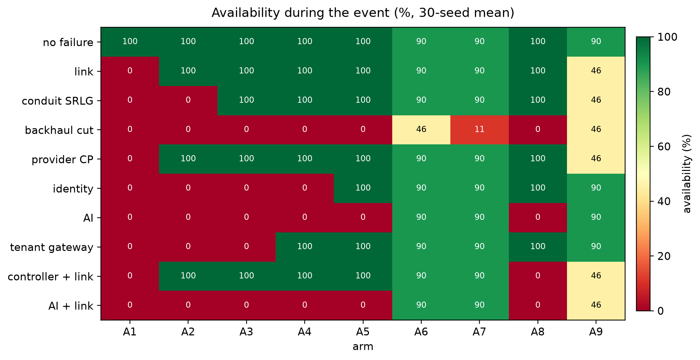
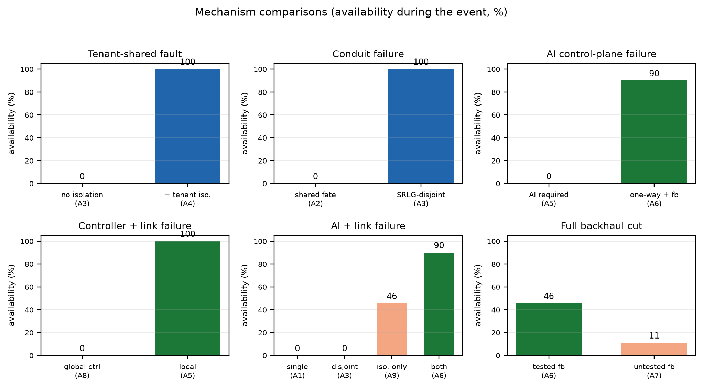
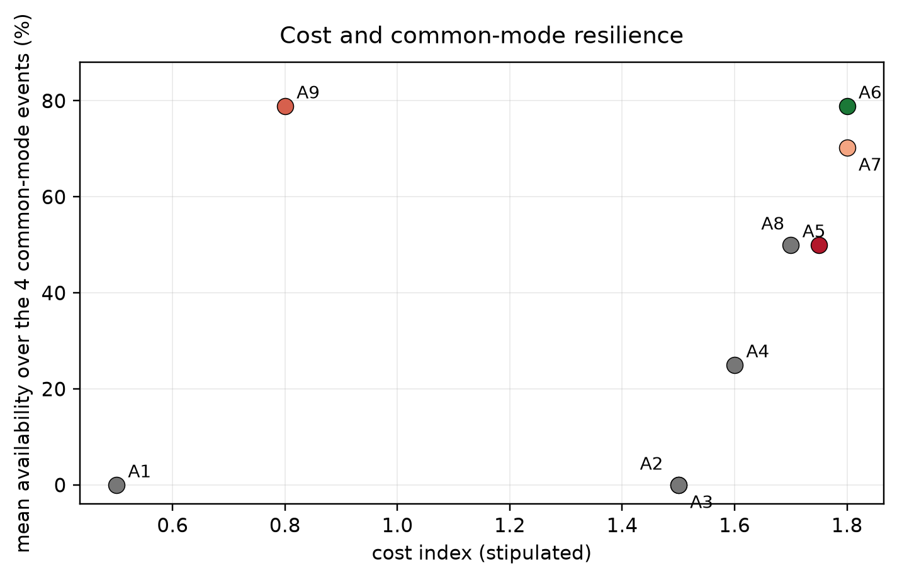

## Abstract

Cloud outages rarely respect tenant boundaries. A provider control plane, identity
service or AI endpoint fails once and every deployment behind it fails together.
Current cloud isolation --- logical tenants, confidential virtual machines,
regions and provider diversity --- cuts tenant-to-tenant, workload-to-host and
region-to-region, but not the shared provider control plane. Multipath is often
proposed as the complement, but paths that share a conduit or a control plane are
one path with extra steps. We present a flow-level testbed that compares nine
architectures under ten outage events with 30 paired seeds and 2,700 runs, with
the hypotheses and thresholds frozen in version control before the simulator
existed. The architectures range from a single provider to tenant isolation,
SRLG-disjoint multipath, independent control planes, a one-way boundary with a
tested fallback, an untested fallback and a global cooperative controller.
Tenant isolation contains a tenant-shared gateway fault (100% vs 0%) but not an
identity failure (0% vs 0%); three paths over one conduit fail together (0% vs
100% for SRLG-disjoint paths); a one-way boundary with a tested fallback holds
90% under an AI control-plane failure against 0% without it; the
isolation-multipath interaction is +44.4 points; and a global controller loses
100 points when it fails with its primary path. A tested fallback is worth 34.5
points over an untested one on the same failure. Under the stipulated model the
checks bear on three claims: current cloud isolation is the wrong cut for common-mode failure;
multipath must be independent, not merely multiple; and a controller is a
dependency, not an abstraction above dependencies. Evidence is a stipulated
flow-level scenario, not a production measurement.

**Keywords:** common-mode failure; cloud resilience; network isolation;
multipath; data diode; tested fallback; SRLG; cooperative backhaul.

## 1. Introduction

In November 2026 two disruptions in the same week had different triggers and the
same propagation signature. A national aviation ground stop followed a
telecommunications outage [15,16]; a Microsoft cloud outage, reported as a failed
network capacity upgrade, coincided with disruptions to AI services including
Claude, ChatGPT and Grok [17,18]. One event sits in a legacy-adjacent
telecommunications chain; the other in a modern cloud control plane. The
contrast defeats the comfortable explanation that legacy technology is the
problem. The modern stack reproduced the same category without the legacy: a
shared node failed, and every consumer behind it failed together.

The structural cause is concentration. A dependency shared by many consumers,
with no independent failure domain behind it, turns a local fault into a
correlated outage. Let a service depend on a shared node $d$ and an independent
part $i$. Its availability is bounded by

$$A_{\mathrm{service}} \;\leq\; A_d \cdot A_i .$$

Adding consumers to $d$ increases scale, utilization and blast radius at the same
time. It does not add an independent failure domain; it widens the one that
already exists. This is why concentration is economically rational and
structurally dangerous: the same decision that lowers unit cost raises
correlated exposure.

Cloud architecture does have isolation, but it isolates the wrong boundary for
this failure. Logical tenant isolation (VPCs, IAM, hypervisors) cuts
tenant-to-tenant; confidential computing and TEEs cut workload-to-host [20];
regions and availability zones cut region-to-region; provider diversity cuts
provider A from provider B [1-4]. None of these cuts tenant-to-provider,
consumer-to-control-plane, or consumer-to-shared-dependency. The weak point was
never tenant-to-tenant. The shared control plane was.

The engineering response has two halves, and they are not substitutes.
**Multipath and diversity** keep service running while a path, link or provider
degrades. **Isolation** stops a fault from propagating across a boundary at all.
Multipath cannot cut a shared identity service; isolation cannot create capacity
on the protected side. A tested fallback is the condition that makes either one
real: an isolation boundary that leaves the protected side without capacity
converts a provider outage into a local outage, and an unexercised fallback is a
control arm, not a mitigation.

This paper turns that argument into a testbed and a comparison. We do not propose
a new routing protocol. We ask a narrower, falsifiable question: under a
common-mode event, which architectural choices actually preserve service, and how
do they compare with the isolation categories current cloud architecture already
provides?

**Contributions.**

1. A flow-level testbed with nine architectures, ten outage events, 30 paired
   seeds and 2,700 runs, with the hypotheses and thresholds frozen at commit
   `1c781f3` before the simulator existed.
2. A comparison between stylized current-cloud architectures --- single
   provider, multi-zone and multi-region paths, tenant isolation, independent
   control planes and a global orchestrator --- and the two-axis principles of
   isolation plus independent multipath plus a tested fallback.
3. Five model checks with thresholds frozen before the simulator existed: tenant isolation is the wrong cut for a shared
   control plane; multipath gain tracks path independence, not path count; a
   one-way boundary without local capacity is a partition; the isolation-
   multipath interaction is positive; and a global cooperative controller is a
   new common-mode carrier.
4. An open artifact: frozen protocol, simulator, benchmark, figures, raw CSV
   outputs and tests.

**What we do not claim.** This is not a measurement of AWS, Azure, Google Cloud
or any production network. The current-cloud architectures in Table 1 are
structural analogues, not reconstructions of a particular provider. The model is
flow-level: it computes capacity and dependency conjunction, not packets, queues,
TCP behaviour or hardware. Security is not evaluated. The two motivating
outages are reported events; their root causes are not independently verified
here, and no result depends on a particular root cause being correct.

## 2. Related Work

### 2.1 Failure domains and isolation

Cloud computing is defined by on-demand, pooled resources and rapid elasticity
[1], and the major providers expose isolation through regions and availability
zones [2-4]. Tenant isolation is the default boundary: a tenant's virtual network,
identity policy and hypervisor namespace are separate from another tenant's.
Confidential computing extends this to the host, placing a workload in a
hardware-enforced trusted execution environment. These mechanisms are effective
for the threat they address. They do not address a provider control-plane fault,
because the control plane is outside the tenant boundary by construction.

Dependability taxonomy separates faults, errors and failures, and distinguishes
independent from common-cause failures [5]. Cloud measurement studies document
that many cloud incidents are configuration and software faults rather than
hardware faults [6]. Chaos engineering formalises the practice of testing failure
paths before they are needed [7]. Operational technology security guidance
recommends segmentation at the IT/OT boundary [8], and data diodes provide
hardware-enforced one-way transfer at that boundary [9]. Rail signalling
provides a vendor-described existence proof of a data diode paired with
commercial off-the-shelf servers [9]. We treat the data diode as an availability
and attack-surface boundary, not as a cryptographic control.

### 2.2 Multipath and independence

Multipath transport is standardised in MPTCP [10], and equal-cost multipath
routing is standard in datacentre fabrics [11]. Shared-risk link groups (SRLGs)
are the conventional way to express that two links are not independent [12]. The
multipath literature usually evaluates throughput, latency and failover; it less
often asks whether the path set is independent of the *control* plane that
selects it. A three-path set that reconverges on one identity service or one
controller is a single failure domain with three next hops.

Cooperative backhaul adds a second form of concentration. Self-scaling pools
capacity across links and tenants, which raises utilization, but a global
cooperative controller is itself a shared dependency. The controller can become
the common-mode carrier that the multipath was meant to remove. We make
controller locality an explicit design variable rather than an implementation
detail.

### 2.3 Testbeds and pre-registration

Packet-level testbeds are the right instrument for protocol behaviour. They are
a poor instrument for a structural question that spans many architectures and
outage types: the cost of building each architecture in a kernel is high, and the
result is still tied to one kernel and one topology. Our earlier layering
testbed followed the opposite route, using a model, a discrete-event simulation
and a Linux namespace harness to separate structural from implementation effects
[13]. The present study is deliberately flow-level: it isolates the dependency
structure and the path-independence condition, and leaves packet-level behaviour
to a later fidelity. Paper B in the same repository is a caution against
assuming that a biologically inspired controller will beat a simpler structural
mechanism [14]; the biological parallel in this paper is a hypothesis generator,
not evidence.

### 2.4 Positioning

Prior work treats isolation and multipath as separate remedies: isolation is a
tenancy or segmentation property, multipath is a transport or routing property.
The claim tested here is that they are independent mitigations of the same
failure, and that neither substitutes for the other. The comparison is against
stylized current-cloud architectures, not against a new protocol. The
contribution is the joint test, the frozen protocol and the measured interaction,
not a claim of priority over the individual mechanisms.

## 3. Principles and Model

### 3.1 Six principles

The testbed encodes six principles. They are stated before the results because
they determine what the model measures.

1. **Availability is a conjunction.** A tenant is served only if its data path,
   its control plane, its tenant boundary and, where required, its fallback are
   available at the same time.
2. **Multipath counts only across independent failure domains.** Paths that share
   a conduit, a provider control plane or a shared control service are one path
   with extra steps.
3. **Isolation trades capability for containment.** A cut that removes a shared
   dependency can also remove the capability that dependency provided. A boundary
   without local capacity is a partition, not a mitigation.
4. **A fallback is a tested state.** It has an activation probability, a delay
   and a capacity fraction. An untested fallback is a control arm.
5. **The controller is a dependency.** Self-scaling through a global cooperative
   controller concentrates the service it is meant to diversify.
6. **Common-mode events are sampled once per event, not per tenant.** A shared
   node fails for everyone at once; that is what makes it common-mode.

### 3.2 Availability model

A deployment is a dependency graph $G=(V,E)$. A path set $P$ serves a tenant,
with path capacity $c_p$, latency and an SRLG set. Two paths are independent when
their SRLG sets are disjoint and their providers differ. The **path independence
index** is

$$I(P) \;=\; \frac{\max\{|S| : S \subseteq P,\; S \text{ pairwise independent}\}}{|P|}.$$

Under independent path failures with availabilities $a_p$, the path-set
availability is

$$A(P) \;=\; 1 - \prod_{p \in P}(1-a_p),$$

but under a common-mode event the same expression is capped by the shared
dependency's availability. The cap, not the product, is the object of interest
here.

A tenant also requires its control plane. If the shared identity or DNS service
is down, the path set is unusable even when every link is up; if the AI endpoint
is on the availability path, an AI failure is a service failure. An isolation
boundary is a cut $C$ in $G$. When the cut removes a required dependency, the
tenant serves at most its local fallback capacity $c_{fb}$:

$$A_{\mathrm{iso}} \;=\; \min\left(1, \frac{c_{fb}}{D}\right),$$

where $D$ is demand. A fallback with activation probability $q$ and delay $d$
contributes $q \cdot \min(1, c_{fb}/D)$ only after $d$; the delay is averaged into
the event window. A global controller that fails reduces the usable path set to
the primary path; a local controller does not.

### 3.3 Architectures

Table 1 lists the nine arms. The first five and A8 are stylized versions of
current-cloud choices; A6 instantiates the proposed combination; A7 is a
fallback-quality control; A9 is the isolation-only control.

**Table 1. Architectures.**

| Arm | Paths | Tenant iso. | Control | One-way | Fallback | Controller |
|---|---|---|---|---|---|---|
| A1 | 1 shortest | no | shared | no | none | none |
| A2 | 3 shortest | no | shared | no | none | local |
| A3 | 3 disjoint | no | shared | no | none | local |
| A4 | 3 disjoint | yes | shared | no | none | local |
| A5 | 3 disjoint | yes | independent | no | none | local |
| A6 | 3 disjoint | yes | independent | yes | tested | local |
| A7 | 3 disjoint | yes | independent | yes | untested | local |
| A8 | 3 disjoint | yes | independent | no | none | global |
| A9 | 1 shortest | yes | independent | yes | tested | none |

**Shared control** means the tenant requires global identity, DNS and the AI
endpoint. **Independent control** means identity and DNS are local; the AI
endpoint is still required unless the arm is one-way. **One-way** removes the AI
endpoint from the availability path and serves path traffic at 0.9 efficiency
(the stipulated cost of local policy). **Tested fallback** activates with
probability 0.98 after 2 s at 0.50 Gbps; **untested** activates with probability
0.60 after 8 s at 0.30 Gbps. **Global controller** uses only the primary path
when the controller is down; **local** reallocates across all surviving paths.

### 3.4 Events

**Table 2. Outage events.**

| Event | Failure | What it tests |
|---|---|---|
| `none` | no failure | normal operation |
| `link` | `a1-p1` down | one path, independent failure |
| `srlg` | all `a1-p*` links down | shared conduit |
| `backhaul_cut` | all agg-to-provider links down | total path loss, fallback |
| `provider_cp` | `p1-cp` down | provider control plane |
| `idp` | global identity down | shared identity |
| `ai` | AI endpoint down | shared AI control plane |
| `tenant_gw` | shared tenant gateway down | tenant-shared fault |
| `controller_link` | controller and `a1-p1` down | controller locality |
| `ai_link` | AI endpoint and `a1-p1` down | combined control and path failure |

All events start at $15 + U(0,10)$ seconds and last $20 + U(0,10)$ seconds in a
60 s run. The start and duration are drawn once per seed and shared by all arms.

### 3.5 Mapping to current cloud architecture

The mapping is structural, not a claim about a specific provider.

**A1** is a single-region, single-provider deployment: one path, one control
plane, no fallback. **A2** is a multi-zone or multi-region path set that shares a
conduit and a global control plane: more next hops, one failure domain. **A3**
adds SRLG-disjoint paths, which is the strongest path diversity current cloud
offers, but keeps global identity, DNS and AI. **A4** adds tenant isolation, the
default cloud boundary. **A5** adds independent identity and DNS, the strongest
single-tenant control-plane design in the set, but the AI endpoint remains on the
availability path. **A8** is the global orchestrator: a single cooperative
controller that can reallocate across all paths and tenants.

**A6** is the proposed architecture: disjoint paths, tenant isolation,
independent control, a one-way boundary at the AI/control interface, a tested
local fallback and local reallocation. **A9** isolates without multipath: the
same boundary and fallback on a single path. A9 is the control that separates
"isolation works" from "isolation is sufficient".

## 4. Testbed and Protocol

### 4.1 Scenario

Six tenants connect through three aggregation sites to three providers and two
cloud regions. Each tenant has three edge-to-aggregation links (1.05 Gbps,
1.0-1.5 ms), each aggregation site has three provider links (1.20 Gbps, 4.0-7.0
ms), and provider-to-cloud links run at 1.50 Gbps (8.0-9.0 ms). All provider
links from one aggregation site share an SRLG (agg-$j$), so one conduit failure
takes all of that site's provider links. The path bottleneck is 1.05 Gbps; mean
demand is 1.0 Gbps with a per-seed 5% jitter. A path is
edge $\rightarrow$ aggregation $\rightarrow$ provider $\rightarrow$ cloud; its
capacity is the minimum link capacity and its SRLG set is the union of link SRLGs.

Shared dependencies are global identity (`idp`), DNS (`dns`), the AI endpoint
(`ai`), the tenant gateway (`mt-gw`) and the cooperative controller (`coop`).
Each tenant has a local fallback. The scenario is a testbed for the structural
hypotheses, not a model of a specific operator.

### 4.2 Metrics

For each arm, event and seed we record:

- **availability during the event**: mean served/offered over tenants and event
  ticks;
- **overall availability**: mean over the 60 s run;
- **recovery**: time from event start until a tenant first reaches 90% for three
  consecutive ticks, or the event duration if it never does;
- **blast radius**: fraction of tenants below 50% during the event;
- **path independence**: the index of Section 3.2;
- **fallback rate**: fraction of tenants whose fallback activated;
- **cost index**: 0.5 per path, plus 0.1 each for tenant isolation, independent
  control and one-way, plus 0.05 for a global controller.

The cost index is a stipulated accounting device, not a price. It makes the
trade-off visible; it is not used to rank architectures.

### 4.3 Protocol and reproducibility

The hypotheses and thresholds are frozen in
[`common-mode-predictions.md`](common-mode-predictions.md) at commit `1c781f3`.
The benchmark runs 30 seeds (base 2026), nine arms and ten events: 2,700 runs.
Each seed draws one event, one demand vector and one fallback vector; every arm
sees the same draws. The simulator is deterministic given a seed. The benchmark
writes per-seed, summary and verdict CSVs under `output/common-mode/`. The full
reproduction command is

```bash
py -3 tools/benchmark_common_mode.py --seeds 30
py -3 -m unittest tests.test_common_mode -v
py -3 tools/make_common_mode_figures.py
```

The 22 new tests pass, and the repository's full suite (433 tests, one skipped)
passes at the time of writing. The figures in this paper are generated by
`tools/make_common_mode_figures.py` from the summary CSV.

## 5. Results

### 5.1 Overall picture

Figure 1 shows availability for every arm and event. The pattern is not a single
ranking. A1 is available only with no failure. A2 survives an independent link
failure but not a conduit failure. A3 survives both path events but not identity
or AI. A4 adds tenant isolation and survives the tenant gateway. A5 adds
independent identity and survives identity, but not AI. A6 survives AI, link,
conduit, provider control, identity and tenant faults, and serves 45.6% under a
full backhaul cut. A8 behaves like A5 until its controller fails, then falls to
0%. A9 matches A6 on the common-mode events but is much weaker under an
independent link failure.

{width=95%}

**Figure 1.** Availability during the event for the nine architectures and ten
outage events (30-seed mean). Values are percentages; the color scale is shared.
Data: `output/common-mode/common_mode_summary.csv`, regenerated by
`tools/make_common_mode_figures.py`.

### 5.2 H16: tenant isolation is the wrong cut

Tenant isolation turns the tenant-shared gateway failure from a total outage into
normal service: A3 is 0% and A4 is 100%. It does nothing for the identity
failure: A3 and A4 are both 0%. The result is not that tenant isolation is
useless; it is that the cut is in the right graph for tenant-to-tenant faults and
in the wrong graph for the shared control plane. The shared node lies outside the
tenant boundary, so no amount of tenant separation reaches it.

This is the category error in its cleanest form. Current cloud isolation is
designed to prevent one tenant from reaching another; it is not designed to keep
a tenant serving when the provider's identity or AI service is down. The fault
that matters here crosses the boundary that tenant isolation does not cut.

### 5.3 H17: independence, not count

A2 and A3 both have three paths. Under the `agg-1` conduit failure A2 is 0%,
because all three of its shortest paths share the conduit, while A3 is 100%,
because its paths use three aggregation sites. Under the independent `a1-p1` link
failure A2 is 100% and A1 is 0%. Path count alone would have predicted the
opposite ordering for the conduit event.

The path independence index makes the difference explicit: A2 is 0.333 and A3 is
1.0. The same pattern appears for a provider control-plane failure: A1 is 0% and
A2 is 100%, because A2 has paths via other providers. Multipath is a diversity
property, not a multiplicity property. A path set that shares an SRLG or a
control plane is a single failure domain with extra next hops.

### 5.4 H18: a boundary without capacity is a partition

Under the AI control-plane failure A5 is 0% and A6 is 90%. A5 has independent
identity and DNS, but it still requires the AI endpoint; A6 removes that
dependency with a one-way boundary and serves local policy at 0.9 efficiency.
The normal-operation cost is 10 points: A5 is 100% and A6 is 90% with no failure.
The cost is the price of local policy, not a failure of the boundary.

The fallback quality result is sharper. Under the full backhaul cut A6 serves
45.6% with a 99.4% activation rate; A7 serves 11.1% with a 56.1% activation rate.
The tested fallback is worth 34.5 points on the same failure. An untested
fallback is not a mitigation; it is a control arm that measures how often the
organisation happened to configure the fallback correctly.

### 5.5 H19: the interaction is positive

Under the combined AI + link failure the four relevant arms are A1 = 0, A3 = 0,
A9 = 45.6 and A6 = 90.0. The interaction term is

$$(A6 - A3) - (A9 - A1) = (90.0 - 0) - (45.6 - 0) = 44.38 \text{ points}.$$

The reading is direct. A3 has multipath but not isolation, so the AI failure
takes it to 0. A9 has isolation but not multipath, so the link failure leaves it
with fallback capacity only. A6 has both, and reaches 90. Isolation and
multipath are not substitutes; under a mixed failure they are complements.

### 5.6 H20: the controller is a dependency

Under the controller + primary-link failure A5 (local reallocation) is 100% and
A8 (global controller) is 0%. With no failure both are 100%, so the global
controller buys nothing in normal operation and costs everything when it fails:
once it is down, A8 falls back to its primary path, which is the failed link.
This is the cooperative-controller trap. Self-scaling through a global controller
raises utilization and recreates the concentration the multipath was meant to
remove. Local, partition-tolerant reallocation avoids it.

{width=95%}

**Figure 2.** Mechanism comparisons. Each panel isolates one architectural
choice: tenant isolation, path independence, the one-way boundary with fallback,
controller locality, the combined interaction and fallback quality. Values are
availability during the event (%); data as in Figure 1.

### 5.7 Comparison with current cloud architectures

Table 3 compares the stylized current-cloud arms with the proposed combination on
the events that matter for common-mode failure. The table is the paper's central
comparison. Arm identifiers follow Table 1: A1-A5 and A8 are the current-cloud
analogues, A6 is the proposed combination, A7 is the untested-fallback control and
A9 is the isolation-only control.

**Table 3. Current-cloud analogues versus the proposed combination (availability
during the event, %).**

| Arm | Normal | Tenant gw. | Identity | AI | AI + link | Cut | Cost |
|---|---:|---:|---:|---:|---:|---:|---:|
| A1 | 100.0 | 0.0 | 0.0 | 0.0 | 0.0 | 0.0 | 0.50 |
| A2 | 100.0 | 0.0 | 0.0 | 0.0 | 0.0 | 0.0 | 1.50 |
| A3 | 100.0 | 0.0 | 0.0 | 0.0 | 0.0 | 0.0 | 1.50 |
| A4 | 100.0 | 100.0 | 0.0 | 0.0 | 0.0 | 0.0 | 1.60 |
| A5 | 100.0 | 100.0 | 100.0 | 0.0 | 0.0 | 0.0 | 1.70 |
| A6 | 90.0 | 90.0 | 90.0 | 90.0 | 90.0 | 45.6 | 1.80 |
| A7 | 90.0 | 90.0 | 90.0 | 90.0 | 90.0 | 11.1 | 1.80 |
| A8 | 100.0 | 100.0 | 100.0 | 0.0 | 0.0 | 0.0 | 1.75 |
| A9 | 90.0 | 90.0 | 90.0 | 90.0 | 45.6 | 45.6 | 0.80 |

Current cloud improves along one axis at a time. Tenant isolation (A4) fixes the
tenant gateway but not identity or AI. Disjoint multipath (A3) fixes the conduit
failure but not the control plane. Independent control (A5) fixes identity but
not AI. The global controller (A8) does not fix any common-mode event on its
own, and it adds a new one. No current-cloud arm reaches 90% under AI + link;
A6 does.

The comparison also exposes a trade that a single ranking would hide. A9 matches
A6 on the four common-mode events and costs less (0.80 vs 1.80), because both use
the same one-way boundary and tested fallback. A6's extra cost buys resilience to
the independent link failure (90% vs 45.6%). If the operator's failure model is
common-mode only, isolation plus a tested fallback is a defensible architecture;
if independent path failures are in scope, multipath is still required. The
"both axes" claim is therefore conditional on the failure mix, not a claim that
the most expensive arm dominates everywhere.

{width=75%}

**Figure 3.** Cost index against mean availability over the four common-mode
events (identity, AI, tenant gateway, backhaul cut). A9 matches A6 on this
metric at a lower cost; A6 buys independent-link resilience (Section 5.7). The
cost index is stipulated and is not a price.

### 5.8 Verdicts

**Table 4. Pre-registered hypotheses (30-seed means).**

| Hypothesis and criterion | Value | Threshold | Verdict |
|:--------------------------|--:|--:|:--|
| H16 tenant isolation: A4-A3 tenant gateway; abs(A4-A3) identity | 100.0; 0.0 | >= 50; <= 5 | PASS |
| H17 independence: A3-A2 SRLG; A2-A1 link | 100.0; 100.0 | >= 20; >= 50 | PASS |
| H18 tested fallback: A6-A5 AI; A6 AI; A5-A6 normal | 90.0; 90.0; 10.0 | >= 50; >= 80; <= 15 | PASS |
| H19 interaction: (A6-A3)-(A9-A1) AI + link | 44.38 | >= 20 | PASS |
| H20 controller locality: A5-A8 controller + link; abs(A5-A8) normal | 100.0; 0.0 | >= 50; <= 5 | PASS |

Every criterion passes on the 30-seed mean and on every individual seed (pass
fraction 1.000). The per-seed pass fractions and all twelve sub-criteria are in
`output/common-mode/common_mode_verdicts.csv`. The all-pass result is a property
of the structural model: the mechanisms are isolated by design, so the margins
are large. It is not evidence that a production deployment will see the same
numbers.

## 6. Discussion

### 6.1 What the comparison shows

The comparison supports three claims.

First, **current cloud isolation is the wrong cut for common-mode failure.**
Tenant isolation, confidential computing, regions and provider diversity each
remove a real failure mode, and the experiment confirms that they do: A4 fixes
the tenant gateway, A3 fixes the conduit, A5 fixes identity. But none of them
cuts the shared AI/control-plane dependency. The result is not an argument
against tenant isolation; it is an argument against treating tenant isolation as
sufficient for a provider-level dependency.

Second, **multipath must be independent, not merely multiple.** A2 and A3 have
the same path count and opposite outcomes under the conduit failure. The path
independence index is a better predictor than the number of paths. A path set
that shares a control plane can even amplify a correlated failure, because every
path depends on the same identity or AI endpoint.

Third, **the controller is a dependency.** A8 behaves like A5 until its
controller fails, then loses the multipath advantage exactly when it is needed.
A global cooperative controller is a new common-mode carrier; locality is a
design variable. This is the cooperative-backhaul form of the concentration
problem: the mechanism that makes self-scaling possible is also the mechanism
that can centralize it.

### 6.2 Design implications

The results translate into five design rules.

1. **Inventory shared dependencies, then cut the control plane, not only the
   tenant boundary.** A tenant-isolation review that does not include identity,
   DNS, the AI endpoint and the orchestrator is incomplete.
2. **Measure path independence, not path count.** Report SRLG membership,
   provider control-plane membership and shared control-service membership for
   every path set. A path set with one SRLG is one path.
3. **Treat the fallback as a tested state.** Record activation probability,
   delay and capacity. An untested fallback is a configuration, not a
   mitigation; in the model it was worth 34.5 points less than a tested one.
4. **Keep cooperative control local or partition-tolerant.** A global controller
   can be part of the data plane's efficiency story, but it must not be on the
   availability path. If it is, the controller is a single point of failure with
   a scheduling interface.
5. **Budget the normal-operation cost of isolation.** The one-way boundary cost
   10 points in this model. That is the price of local policy; it should be
   stated, not hidden.

### 6.3 The A9/A6 trade and the meaning of "both"

The cost-resilience comparison is deliberately not a single ranking. A9
(isolation only) matches A6 on the common-mode mean at less than half the cost,
because both use the same boundary and fallback. A6 is better only when an
independent link failure is also in scope (90% vs 45.6%). This is a useful
negative result for the strongest form of the "both axes" thesis: isolation plus
a tested fallback can be sufficient for a common-mode-only failure model. The
argument for multipath is conditional on independent path failures being part of
the threat model. The paper's claim is therefore narrower and more defensible:
the two axes are independent mitigations, and the right mix depends on the
failure mix, not on a universal ranking.

### 6.4 Relation to the motivating outages

The two outages are used as motivating examples, not as evidence. The FAA event
is reported as a telecommunications capacity failure; the Microsoft event as a
failed network capacity upgrade that coincided with AI service disruptions. The
structural comparison does not depend on either root cause. What the testbed adds
is a controlled demonstration of the mechanism: a shared dependency, a boundary
that does not cut it, and a path set that does not survive it.

## 7. Threats to Validity

**Construct validity.** Availability is a capacity/dependency calculation, not a
packet-level measurement. It ignores queueing, congestion control, TCP
retransmission, reordering and application behaviour. The 0.9 local-policy
efficiency and the 0.5/0.3 fallback capacities are stipulated. The cost index is
an accounting device, not a price. The path independence index treats SRLG and
provider identity as the only independence dimensions; a real deployment may have
more.

**Internal validity.** The model is deterministic given a seed, and the 30 seeds
vary event timing, demand and fallback draws, not the topology. All five
hypotheses pass with large margins because the arms isolate the mechanisms by
design. This is a demonstration under a frozen scenario, not a statistical
estimate of an effect size. The arms differ only in mechanism and share the same
draws, which rules out a seed confound; it does not rule out a scenario confound.
No constant was changed after the freeze.

**External validity.** The scenario has six tenants, three aggregation sites,
three providers and two clouds. It is not a model of a specific cloud, and the
current-cloud mapping in Table 1 is a structural analogy. Different SRLG
groupings, control-plane layouts or demand levels could change the levels. The
qualitative ordering is the claim; the exact percentages are scenario-specific.

**Conclusion validity.** The hypotheses were frozen before the simulator existed,
and the verdict rules are in the benchmark. A refutation would have been
reported. The all-pass outcome is a limitation as well as a result: the scenario
was designed to make the mechanisms observable, so it is not a random sample of
architectures. The real-stack extension is the next fidelity and is not claimed
here.

**Security.** The data diode is modelled as an availability cut, not as a
cryptographic control. No key management, authentication strength or side-channel
behaviour is evaluated. The one-way boundary's security properties are out of
scope.

## 8. Conclusion

Concentration is the risk. A shared dependency with no independent failure domain
behind it turns a local fault into a correlated outage, and the modern cloud
stack is as capable of this as the legacy stack. Isolation and multipath are the
two independent mitigations. Isolation stops a fault at a boundary; multipath
keeps service running across independent failure domains. Neither substitutes
for the other, and a tested fallback is the condition that makes either one real.

The testbed supports the structural claims under its frozen scenario. Tenant
isolation fixes the tenant gateway but not identity or AI; three paths over one
conduit fail together; a one-way boundary with a tested fallback holds 90% under
an AI failure; the isolation-multipath interaction is +44.4 points; and a global
cooperative controller loses 100 points when it fails. The comparison with
stylized current-cloud architectures shows the gap: current cloud improves along
one axis at a time, while no current-cloud arm reaches 90% under a combined AI
and link failure. The qualification is equally important: isolation plus a
tested fallback can match the combined architecture on common-mode events at
lower cost, so multipath is justified by independent path failures, not by
common-mode failure alone.

The next step is a real-stack variant on Linux network namespaces: two disjoint
paths, ECMP, link-down and `tc` outages, and an nftables control-plane cut,
compared against this flow-level reference. The structural result is a map of
which cuts and which paths matter; the real-stack test is how to find out what
the map costs in packets.

## References

1. P. Mell and T. Grance, "The NIST Definition of Cloud Computing," NIST Special Publication 800-145, 2011.
2. Amazon Web Services, "Regions and Availability Zones," AWS Documentation. [Online]. Available: [AWS documentation](https://docs.aws.amazon.com/AWSEC2/latest/UserGuide/using-regions-availability-zones.html)
3. Microsoft, "Availability zones overview," Azure Reliability Documentation. [Online]. Available: [Azure documentation](https://learn.microsoft.com/en-us/azure/reliability/availability-zones-overview)
4. Google Cloud, "Regions and zones," Compute Engine Documentation. [Online]. Available: [Google Cloud documentation](https://cloud.google.com/compute/docs/regions-zones)
5. A. Avizienis, J.-C. Laprie, B. Randell and C. Landwehr, "Basic concepts and taxonomy of dependable and secure computing," *IEEE Transactions on Dependable and Secure Computing*, vol. 1, no. 1, pp. 11-33, 2004.
6. H. S. Gunawi, M. Hao, T. Leesatapornwongsa, T. Patana-anake, T. Do, J. Adityatama, K. J. Eliazar, A. Laksono, J. F. Lukman, V. Martin and A. D. Satria, "What Bugs Live in the Cloud? A Study of 3000+ Issues in Cloud Systems," in *Proceedings of the ACM Symposium on Cloud Computing (SoCC)*, 2014.
7. A. Basiri, N. Behnam, R. de Rooij, L. Hochstein, L. Kosewski, J. Reynolds and C. Rosenthal, "Chaos Engineering," *IEEE Software*, vol. 33, no. 3, pp. 35-41, 2016.
8. National Institute of Standards and Technology, "Guide to Operational Technology (OT) Security," NIST Special Publication 800-82 Revision 3, 2023.
9. Siemens Mobility, "Protection of OT systems," and "CoreShield Data Capture Unit." [Online]. Available: [Siemens Mobility](https://www.mobility.siemens.com/global/en/portfolio/digital-solutions-software/cybersecurity/cybersecurity-rail-infrastructure/protection-of-ot-systems.html) and [CoreShield DCU](https://www.dex.siemens.com/industrial-iot/step-4-book-apps-and-extras/coreshield-data-capture-unit)
10. A. Ford, C. Raiciu, M. Handley, O. Bonaventure and C. Paasch, "TCP Extensions for Multipath Operation with Multiple Addresses," RFC 8684, 2020.
11. C. Hopps, "Analysis of an Equal-Cost Multi-Path Algorithm," RFC 2992, 2000.
12. K. Kompella and Y. Rekhter, "Routing Extensions in Support of Generalized Multi-Protocol Label Switching (GMPLS)," RFC 4202, 2005.
13. M. Nikolic, "Which Rewrites Survive? Pre-registered Tests of a Field-Class Model of Encapsulation, Middleboxes and Decapsulation on Linux," repository paper, 2026. [Online]. Available: [Paper A](paper-layering-testbed.md)
14. M. Nikolic, "Why Fair-Queueing Beats the Fick Principle," repository paper, 2026. [Online]. Available: [Paper B](paper-bio-control-limits.md)
15. United Press International, "FAA lifts nationwide ground stop after telecommunications outage," 13 November 2026. [Online]. Available: [UPI](https://www.upi.com/Top_News/US/2026/11/13/faa-grounds-all-flights/9251794604658/)
16. Texas Public Radio, "Old tech blamed for the ground stop that caused flight chaos: 'It got overloaded'," 13 November 2026. [Online]. Available: [TPR](https://www.tpr.org/news/2026-11-13/old-tech-blamed-for-the-ground-stop-that-caused-flight-chaos-it-got-overloaded)
17. DigitalToday, "Microsoft massive service outage: no evidence of malicious activity, blamed on a network upgrade error," 14 November 2026, citing TechCrunch. [Online]. Available: [DigitalToday](https://www.digitaltoday.co.kr/cn/view/125685/microsoft-massive-service-outage-cause-still-unclear-no-evidence-of-malicious-activity)
18. Business Insider Spain, "ChatGPT y Claude caídos: el apagón masivo de Microsoft arrastra en cadena a la IA," November 2026. [Online]. Available: [Business Insider](https://www.businessinsider.es/big-tech/chatgpt-claude-caidos-apagon-microsoft-arrastra-ia_7060706_0.html)
19. L. A. Barroso, J. Clidaras and U. Hölzle, *The Datacenter as a Computer: Designing Warehouse-Scale Machines*, 3rd ed. Morgan and Claypool, 2018.
20. National Institute of Standards and Technology, "Hardware-Enabled Security for Server Platforms: Security Architecture and Design," NIST IR 8320, 2021.

## Appendix: Artifact Index

| Artifact | Path |
|---|---|
| Frozen protocol | [`docs/common-mode-predictions.md`](common-mode-predictions.md) |
| Results and deviations | [`docs/common-mode-results.md`](common-mode-results.md) |
| Testbed guide | [`docs/common-mode-testbed.md`](common-mode-testbed.md) |
| Simulator | [`simulation/common_mode.py`](../simulation/common_mode.py) |
| Benchmark | [`tools/benchmark_common_mode.py`](../tools/benchmark_common_mode.py) |
| Figures | [`tools/make_common_mode_figures.py`](../tools/make_common_mode_figures.py) |
| Tests | [`tests/test_common_mode.py`](../tests/test_common_mode.py) |
