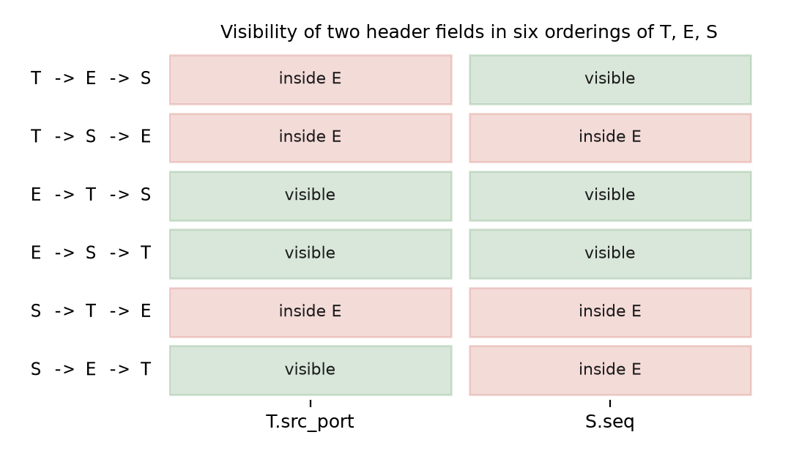
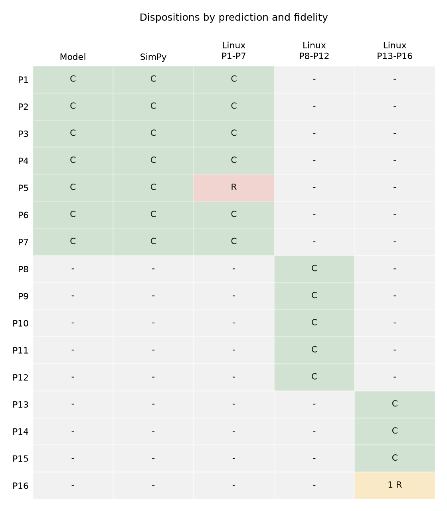

# Which Rewrites Survive? Pre-registered Tests of a Field-Class Model of Encapsulation, Middleboxes and Decapsulation on Linux

**Milan Nikolic** · Independent Researcher · <m_nikolic@yahoo.com>

**Status.** Focused measurement paper. Predictions were frozen in version control at
three commits, each before the corresponding harness code: `96d59f3` (P1–P7),
`46c7b40` (P8–P12), `1b7e6ac` (P13–P16). Results are reported in the linked
results files and summarised here. The dispositions in the tables and in Figure 2
are regenerated from the committed verdict CSVs by
`tools/make_layering_figures.py`; the numeric results are those recorded in the
linked results files, with the reproduction commands in §9.

## Abstract

Packets in practice carry stacked encapsulations (compression, encryption,
tunnelling, fragmentation, sequencing) and cross middleboxes that rewrite headers
and decapsulators that act on outer fields. We ask a narrow question: when layer
order or middlebox behaviour changes, which rewrites corrupt a datagram? We state
a field-class rule: a rewrite is applied iff the field is visible at the wire and
reachable by the middlebox, and breaks delivery iff the field is authenticated or
structural. We test it with predictions committed to version control before any
experiment code, at three fidelities: an executable model, a discrete-event
simulation, and a Linux namespace testbed that runs kernel WireGuard, IPsec
AH/ESP, IPIP and nftables NAT in two real-stack rounds. Of seven initial
predictions, six are confirmed; one is
refuted at the Linux fidelity because a compressor saw real headers and crossed a
fragment boundary. Real-stack runs (20 per case) confirm five further predictions
and show that the rule needs two more classes: quantised fields (WireGuard pads to
16 bytes, so IPIP and WireGuard orderings differ by −4 or +12 bytes) and derived
fields (an inner UDP checksum depends on the outer address). A final, deliberately
failure-prone round, with credences recorded in advance (Brier 0.0833), confirms
17 of 18 predictions, so 28 of 30 scored predictions are confirmed across the
three rounds, and finds that the same outer ECN mark is fatal under IPIP but
harmless under WireGuard and ESP (decapsulation-coupled), that two ESP clients
cannot share a NAT (a middlebox lookup-key failure), and that delivery under
reordering is bounded by the integrity layer's replay window. One prediction is
refuted by our own mis-specified reordering depth. Evidence is one kernel series
(two WSL2 builds), veth links and one NAT; security is not evaluated. The frozen
two-kernel replication clause is **unmet**: both builds are WSL2 kernels of the
same series, so every result here is a one-kernel result. Predictions, harness
and raw data are open.

## 1. Introduction

A packet in the wild is rarely sent as built. It is compressed, encrypted,
tunnelled, fragmented and sequenced, in an order set by whoever configured the
stack, and then crosses devices that rewrite its headers (NAT), mark its
congestion bits (routers), and look up state keyed on fields they can read.
Whether the datagram arrives depends on which fields each device touches and which
fields the receiver treats as authenticated or structural. This knowledge exists,
but scattered across RFCs, middlebox measurement studies and kernel source; it is
rarely stated as one testable rule, and rarely tested against more than one
implementation.

We state such a rule and test it. A rewrite is **applied** iff the targeted field
is **visible** at the wire and **reachable** within the middlebox's parse depth.
It **breaks delivery** iff the field is **authenticated** (inside an integrity
scope) or **structural** (length- or offset-bearing). We test the rule with
predictions that were committed before any experiment code existed, at three
fidelities of increasing realism, and we report every refutation rather than
removing it.

The rule survives, but is incomplete in four specific ways. Fields can be
**quantised** (WireGuard rounds sizes up, so layer order changes wire bytes);
**derived** (an inner UDP checksum depends on the outer address, so a rewrite
breaks delivery without any integrity tag); **keys to a middlebox's own state**
(two ESP clients cannot share a NAT address); and **decapsulation-coupled** (one
outer ECN mark is fatal under IPIP and harmless under WireGuard and ESP).
Reordering adds a state parameter: the integrity layer's replay window decides how
much delay the stack tolerates.

**Contributions.**

1. A compact field-class model — visible, reachable, authenticated, structural,
   quantised, derived, lookup-key, decapsulation-coupled — plus one state
   parameter (the replay window).
2. A method: predictions frozen in version control before harness code, three
   fidelities, mutation and cause gates, explicit dispositions (CONFIRMED,
   REFUTED, INCONCLUSIVE, INVALID, NOT RUN), and credences scored with a Brier
   score.
3. An open, reproducible Linux testbed and the measured facts it produced,
   including the per-decapsulator ECN table and the first-come-first-served
   ESP-through-NAT behaviour.

**What we do not claim.** We do not claim a first measurement of anything; the
middlebox literature and the RFCs are older than this work. We do not claim the
rule generalises to arbitrary middleboxes, kernels or stacks. We do not evaluate
cryptographic security. AH failing under NAT and WireGuard's padding are
documented behaviours: confirming them validates the method and the harness, not
a discovery. The informative results are the cases where the specification leaves
behaviour open (P10, P12, P13, P14, P16).

## 2. The model

The rule has two events, kept separate:

- **The rewrite is applied** iff the field is visible at the wire *and* reachable
  within the middlebox's parse depth.
- **The receiver accepts the datagram** unless the rewritten field is
  authenticated (inside an integrity scope) or structural (length- or
  offset-bearing), which a rewrite invalidates.

Table 1 lists the classes the three rounds forced. Each is traceable to a test
that found it; none is introduced by definition alone. Figure 1 shows, for the
six orderings of tunnelling `T`, encryption `E` and sequencing `S`, which of two
header fields is visible at the wire; visibility is recorded separately and is
not itself a delivery prediction.

**Table 1. Field classes.**

| Class | Definition | Found by | Effect on a rewrite |
|---|---|---|---|
| visible | readable at the wire (not inside an encryption layer) | P3, P4 | rewrite possible |
| reachable | within the middlebox's parse depth | P6 | rewrite possible |
| authenticated | covered by an integrity tag | P3, P8 | receiver rejects |
| structural | length- or offset-bearing | P7, P11 | receiver rejects or mis-parses |
| quantised | size rounded by a layer | P9, P10 | order changes wire bytes; layers no longer commute exactly |
| derived | value computed from a field in another layer | P12 | rewrite elsewhere invalidates it without a tag |
| lookup-key | selects state at the receiver (SA, policy) or the middlebox (conntrack) | P14 (middlebox key); P8b motivates the receiver-side variant | wrong or colliding key drops or merges flows |
| decapsulation-coupled | outer value combined with an inner value on the way out | P13 | outcome depends on the decapsulator implementation |

A state parameter accompanies the classes: the **replay window** of the
integrity layer (P16). With reordering depth at or above the window, valid
packets are dropped though none was lost on the wire.

{width=75%}

**Figure 1.** `T.src_port` is visible only when `T` is applied after `E`; `S.seq`
is visible unless `S` is applied before `E`. Data: the P4 visibility table in
[`layering-results.md`](layering-results.md).

## 3. Method

**Pre-registration.** Three prediction files were committed before the code that
tested them:

| Round | Freeze commit | File |
|---|---|---|
| P1–P7 | `96d59f3` | [`layering-predictions.md`](layering-predictions.md) |
| P8–P12 | `46c7b40` | [`layering-real-stack-predictions.md`](layering-real-stack-predictions.md) |
| P13–P16 | `1b7e6ac` | [`layering-real-stack-predictions-round2.md`](layering-real-stack-predictions-round2.md) |

The files are never edited after the freeze; corrections go to a dated addendum
of the results document.

**Fidelities.** P1–P7 were run in an executable Python model, in a SimPy model
with a finite drop-tail queue, and on Linux network namespaces with a veth pair,
TUN devices and seeded `tc netem` loss. The real-stack rounds run four Linux
namespaces with kernel WireGuard, IPsec AH/ESP, IPIP and nftables masquerade;
round 2 adds an ECN mangler, ESP-in-UDP, a second client namespace, fragment / SPI
/ sequence capture and depth gates. The frozen protocol is 20 runs per case
(round 2: 20 cases, 400 runs, 5,800 observation rows).

**Gates and dispositions.** A case is scored only when its gates pass: warm-up,
checksum offload, ECN mutation, SPI, fragment shape and reordering depth. Every
case receives one disposition: CONFIRMED, REFUTED, INCONCLUSIVE (a cause gate
failed), INVALID (another gate failed or setup error) or NOT RUN (facility
missing). Only CONFIRMED and REFUTED are evidence; the Brier score ignores the
rest. No case in the reported runs is INCONCLUSIVE, INVALID or NOT RUN.

**Credence scoring.** Round 2 recorded a credence per prediction before the run
and scores each outcome with the Brier term `(credence − outcome)²`. The purpose
is to make "the prediction was easy" visible: a cautious set scores well only if
the cases really were easy.

**Environment.** WSL2 Ubuntu 26.04.1 LTS; kernel `6.18.54.1-microsoft-standard-WSL2`
for P1–P7 and `6.18.58.1-microsoft-standard-WSL2` for P8–P16; iproute2 6.19.0;
wireguard-tools 1.0.20250521; nftables 1.1.6; `ipip`, `wireguard`, `esp4`,
`ah4`, `act_pedit`, `act_csum`, `nft_masq` and `sch_netem` present. The Linux
application payload is normalised to `model_payload − 28` bytes so the codec sees
a `model_payload`-byte IP/UDP datagram; this normalisation is recorded in the
predictions file and is the direct cause of the P5 refutation.

## 4. Results I: P1–P7

Table 2 gives the dispositions. The model and the SimPy implementation agree on
all seven; Linux agrees on six and refutes P5.

**Table 2. P1–P7 verdicts by fidelity.** Pasted from
[`paper-tables/tables.md`](paper-tables/tables.md), generated by
`tools/make_paper_tables.py`; do not edit by hand.

| Prediction | Model | SimPy | Linux | Overall |
|---|---|---|---|---|
| P1: compress/encrypt size | CONFIRMED | CONFIRMED | CONFIRMED | CONFIRMED |
| P2: encrypt/fragment overhead | CONFIRMED | CONFIRMED | CONFIRMED | CONFIRMED |
| P3: integrity scope | CONFIRMED | CONFIRMED | CONFIRMED | CONFIRMED |
| P4: fixed-overhead commutation | CONFIRMED | CONFIRMED | CONFIRMED | CONFIRMED |
| P5: compress/fragment delivery | CONFIRMED | CONFIRMED | REFUTED | REFUTED |
| P6: survival sweep | CONFIRMED | CONFIRMED | CONFIRMED | CONFIRMED |
| P7: structural inertness | CONFIRMED | CONFIRMED | CONFIRMED | CONFIRMED |

**Table 2b. P1–P7 key quantities by fidelity.** Generated, same source.

| Quantity | Model | SimPy | Linux |
|---|---|---|---|
| P1 text wire bytes, E→C / C→E (ratio) | 1.902 | 1.902 | 1.878 |
| P2 wire bytes, E→F / F→E | 12100 / 12324 | 12100 / 12324 | 12100 / 12324 |
| P2 byte difference (F→E − E→F) | 224 | 224 | 224 |
| P2 delivery E→F / F→E (%) | 39.35 / 39.35 | 39.35 / 39.35 | 37.98 / 38.17 |
| P4 wire bytes over the six orderings | 1104 (all equal) | 1104 (all equal) | 1104 (all equal) |
| P5 fragments C→F / F→C | 3.0 / 6.0 | 3.0 / 6.0 | 4.0 / 6.0 |
| P5 delivery C→F / F→C (%) | 73.75 / 53.50 | 73.75 / 53.50 | 64.28 / 51.92 |
| P5 delivery difference (pp) | +20.25 | +20.25 | +12.35 |
| P6 cases checked | 54 | 54 | 54 |

P1, P2, P4 and P5 are arithmetic regression tests: confirming them shows that the
three implementations reproduce the specified arithmetic, not that a deployed
network behaves this way. P3, P6 and P7 are the research content of this round.

{width=70%}

**Figure 2.** All sixteen headline predictions against the fidelity that tested
them, built from the committed verdict CSVs. `C` = CONFIRMED, `R` = REFUTED,
`1 R` = one refuted sub-case (P16d), `-` = not tested at that fidelity. P1–P7:
model, SimPy, Linux. P8–P12: round-1 real stack. P13–P16: round-2 real stack.

**P3 (integrity scope).** Three cases: `E→T` with the target inside the AEAD's
AAD, `E→T` with no AAD, and `T→E` where the target is invisible. Acceptance is
exactly 0 %, 100 % and 100 % at every fidelity, with no intermediate value. Case
(a) is the operational shape of the known NAT/IPsec failure; it is confirmed here
for a toy AEAD and a scripted rewriter, which is narrower than the real-world
claim.

**P5 is refuted at Linux.** The frozen prediction was `n1 = 3` fragments for
compress-then-fragment and `n2 = 6` for fragment-then-compress, a delivery
difference of `0.9^3 - 0.9^6 = 19.76` percentage points. The model and SimPy
produce that difference (+20.25 pp on their draws); Linux produces **+12.35 pp**,
outside the frozen 4.0 pp margin. The cause is measured, not guessed: the Linux
`C→F` datagram has **four** fragments because the compressor saw the real 28-byte
IP/UDP header, and with stock zlib 1.3.1 the packet compressed to about 4507 B,
above the three-fragment boundary of 4476 B. Recomputing with the observed count
gives `0.9^4 - 0.9^6 = 12.47` pp, which Linux reproduces. The frozen prediction
stands as refuted; the predictions file is not edited.

**P6 (54 cases).** All six orderings of `T`, `E`, `S` were crossed with two
targets, parser depth 1–3 and AAD scope none or the target where valid: 54 cases.
The formal predictor declares 36 visible and 18 invisible targets, 40 reachable
and 14 unreachable, 32 rewrites applied, 16 authentication failures and 16
delivery failures. Model, SimPy and Linux match the predictor on visibility,
mutation, acceptance and delivery in **every case** (0 mismatches). Because the
predictor and the relay encode the same rule, this is a consistency check of the
implementation, not evidence that the rule matches deployed middleboxes.

**P7 (structural inertness).** With a `T→F` stack and three fragments, both
length-bearing rewrites (`F.length → 0x0009`, `T.udp_len → 0x0009`) give 0 %
delivery at all three fidelities, although neither field is authenticated and
both are visible; the inert source-port rewrite gives 100 %. Excluding a field
from authentication is not sufficient for safe rewriting if it carries framing
structure.

## 5. Results II: P8–P12

Round 1 of the real-stack testbed confirms all twelve cases of the five
predictions (Table 3). The cases are executed 20 times each.

**Table 3. P8, P11 and P12 on the Linux stack.** Pasted from
[`paper-tables/tables.md`](paper-tables/tables.md); the frozen predicted values
are static text, the observed columns are computed from
`validation/real_stack/results/observations.csv`.

| Case | Stack / middlebox | Predicted delivery | Observed % mean (min–max) | Runs | Gates | Verdict |
|---|---|---|---|---|---|---|
| P8a | AH tunnel + NAT | 0 % | 0.0 (0) | 20 | mutation yes, cause yes | CONFIRMED |
| P8a_control | AH tunnel, no NAT | 100 % | 100.0 (100) | 20 | mutation yes, cause yes | CONFIRMED |
| P8b | ESP tunnel + NAT | 100 % | 100.0 (100) | 20 | mutation yes, cause yes | CONFIRMED |
| P8b_control | ESP tunnel, no NAT | 100 % | 100.0 (100) | 20 | mutation yes, cause yes | CONFIRMED |
| P8c | WireGuard + NAT | 100 % | 100.0 (100) | 20 | mutation yes, cause yes, endpoint yes | CONFIRMED |
| P8c_control | WireGuard, no NAT | 100 % | 100.0 (100) | 20 | mutation yes, cause yes | CONFIRMED |
| P11a | WireGuard, UDP length 9, checksum untouched | 0 % | 0.0 (0) | 20 | mutation yes, cause yes | CONFIRMED |
| P11b | WireGuard, UDP length 9, checksum recomputed | 0 % | 0.0 (0) | 20 | mutation yes, cause yes | CONFIRMED |
| P11c | WireGuard, inert ToS rewrite | 100 % | 100.0 (100) | 20 | mutation yes, cause yes | CONFIRMED |
| P12a | ESP transport + NAT, inner UDP checksum | 0 % | 0.0 (0) | 20 | mutation yes, cause yes | CONFIRMED |
| P12b | ESP transport + NAT, inner checksum zero | 100 % | 100.0 (100) | 20 | mutation yes, cause yes | CONFIRMED |
| P12c | ESP transport, no NAT | 100 % | 100.0 (100) | 20 | mutation yes, cause yes | CONFIRMED |

AH dies under NAT while ESP and WireGuard survive (P8). This is textbook
asymmetry — RFC 3715 describes the compatibility problem, RFC 4302 puts the outer
IP header in AH's integrity scope and RFC 4303 does not for ESP — and the run
validates the harness rather than discovering a fact.

P9 is a calibration: the stipulated 56-byte composite (`E = 28`, `T = 28`, no
padding) is low by `4 + (16*ceil(L/16) - L)` bytes. WireGuard is **quantised**.
P10 makes that visible as a commutation failure: swapping IPIP and WireGuard
changes the wire length by −4 or +12 bytes depending on `L mod 16`, and the
quantised model `d(L) = R(L+20) − R(L) − 20` is exact.

**Table 3b. P9: WireGuard wire size against the formula 60 + 16*ceil(L/16).**
Generated from `validation/real_stack/results/observations.csv`.

| Inner length L (B) | R(L) | Predicted wire (B) | Observed wire (B) | Observed − (L + 56) | Match |
|---|---|---|---|---|---|
| 29 | 32 | 92 | 92 | 7 | yes |
| 44 | 48 | 108 | 108 | 8 | yes |
| 60 | 64 | 124 | 124 | 8 | yes |
| 61 | 64 | 124 | 124 | 7 | yes |
| 76 | 80 | 140 | 140 | 8 | yes |
| 100 | 112 | 172 | 172 | 16 | yes |
| 1000 | 1008 | 1068 | 1068 | 12 | yes |
| 1024 | 1024 | 1084 | 1084 | 4 | yes |
| 1400 | 1408 | 1468 | 1468 | 12 | yes |

**Table 3c. P10: IPIP and WireGuard nesting order.** Generated from the same
CSV; `d(L)` is never zero.

| Inner length L (B) | L mod 16 | Wire, IPIP then WG (B) | Wire, WG then IPIP (B) | Difference d(L) | Match |
|---|---|---|---|---|---|
| 64 | 0 | 156 | 144 | +12 (predicted +12) | yes |
| 65 | 1 | 156 | 160 | -4 (predicted -4) | yes |
| 76 | 12 | 156 | 160 | -4 (predicted -4) | yes |
| 77 | 13 | 172 | 160 | +12 (predicted +12) | yes |
| 79 | 15 | 172 | 160 | +12 (predicted +12) | yes |
| 100 | 4 | 188 | 192 | -4 (predicted -4) | yes |
| 1000 | 8 | 1084 | 1088 | -4 (predicted -4) | yes |
| 1008 | 0 | 1100 | 1088 | +12 (predicted +12) | yes |

P11 separates a structural rewrite from a broken mangler. Rewriting the outer UDP
length to 9 breaks delivery whether the checksum is left untouched (0 %) or
recomputed (0 %), while an inert ToS rewrite with a recomputed IP checksum
delivers 100 %. The raw-offset `pedit` form is used because iproute2 6.19 rejects
the layered `udp len` field.

P12 is the **derived** class: ESP transport does not authenticate the outer IP
header, so NAT passes the ESP check, but the inner UDP checksum covers a
pseudo-header containing the rewritten outer address, so it fails (0 %); zeroing
the inner checksum restores delivery (100 %), and the no-NAT control delivers
100 %.

## 6. Results III: P13–P16

Round 2 is deliberately failure-prone: credences were recorded before the run,
and the protocol was designed so that some predictions were expected to fail. Of
18 scored predictions, **17 are confirmed and one (P16d) is refuted**; the Brier
score is **0.0833**.

**Table 4. P13: outer ECN codepoint set to CE or ECT(0) after NAT, by
decapsulator.** Pasted from [`paper-tables/tables.md`](paper-tables/tables.md);
computed from `validation/round2/results/observations.csv`.

| Case | Decapsulator | Inner ECN | Outer ECN set to | Delivery | Inner ECN at receiver | Cause counter | Verdict |
|---|---|---|---|---|---|---|---|
| P13a | IPIP | Not-ECT | CE | 0 % | — | rx_frame_errors 50/run | CONFIRMED |
| P13b | IPIP | Not-ECT | ECT(0) | 100 % | Not-ECT 100 % | rx_frame_errors 0/run | CONFIRMED |
| P13c | IPIP | ECT(0) | CE | 100 % | CE 100 % | rx_frame_errors 0/run | CONFIRMED |
| P13d | WireGuard | Not-ECT | CE | 100 % | Not-ECT 100 % | — | CONFIRMED |
| P13e | WireGuard | ECT(0) | CE | 100 % | CE 100 % | — | CONFIRMED |
| P13f | ESP tunnel | Not-ECT | CE | 100 % | Not-ECT 100 % | — | CONFIRMED |
| P13g | ESP tunnel | ECT(0) | CE | 100 % | CE 100 % | — | CONFIRMED |
| P13h_ipip | IPIP | both | none (control) | 100 % | ECT(0) 50 % / Not-ECT 50 % | rx_frame_errors 0/run | CONFIRMED |
| P13h_wg | WireGuard | both | none (control) | 100 % | ECT(0) 50 % / Not-ECT 50 % | — | CONFIRMED |
| P13h_esp | ESP tunnel | both | none (control) | 100 % | ECT(0) 50 % / Not-ECT 50 % | — | CONFIRMED |

**Table 4b. Decapsulation of an outer CE mark.** The same visible,
unauthenticated field is fatal on one stack and inert on two.

| Decapsulator | Outer CE, inner Not-ECT | Outer CE, inner ECT(0) |
|---|---|---|
| IPIP | drop (50 frame errors/run) | deliver, inner CE |
| WireGuard | deliver, inner Not-ECT | deliver, inner CE |
| ESP tunnel | deliver, inner Not-ECT | deliver, inner CE |

**One field, three answers.** A router marking Congestion Experienced on the
outer header is legitimate behaviour. Under RFC 6040's decapsulation rule an
outer CE over an inner Not-ECT packet should be dropped. We rewrote the outer ECN
codepoint to CE after the NAT and recorded delivery per decapsulator over 20 runs
of 50 datagrams. IPIP dropped every packet (`ipip0` `rx_frame_errors` rose by 50
per run, a frame error rather than a queue drop). WireGuard and ESP tunnel mode
delivered every packet and left the inner field Not-ECT; with an ECT(0) inner,
all three delivered and propagated CE. The same visible, unauthenticated field is
inert on two stacks and fatal on the third, so the rule cannot classify it by
visibility alone: it has to name the decapsulator. This is the
**decapsulation-coupled** class, with a per-implementation table rather than a
field property.

**Two ESP clients and one NAT.** Two client namespaces, each with its own ESP
tunnel-mode SA (distinct SPI and key) to one server behind one masquerade; one
client warms up, then both send concurrently.

**Table 5. P14: two ESP clients behind one NAT.** Pasted from
[`paper-tables/tables.md`](paper-tables/tables.md); counts are per run.

| Case | Setup | Client 1 delivered/sent | Client 2 delivered/sent | ESP SPI on wire (1 / 2) | ESP conntrack entries | Client 2 translated src port | Verdict |
|---|---|---|---|---|---|---|---|
| P14a | ESP tunnel + NAT, client 1 first | 60/60 | 0/50 | 60 / 0 | 1 | — | CONFIRMED |
| P14b | ESP tunnel + NAT, client 2 first | 0/50 | 60/60 | 0 / 60 | 1 | — | CONFIRMED |
| P14c | ESP-in-UDP (NAT-T) + NAT | 60/60 | 50/50 | 60 / 50 | 0 | 1496–64424 | CONFIRMED |
| P14d | ESP tunnel, no NAT | 60/60 | 50/50 | 61 / 51 | 0 | — | CONFIRMED |

The loser's packets never reach the router's egress: the second ESP flow gets no
conntrack entry (one `unknown … 50` entry, not two), because the generic tracker
has no per-flow key for protocol 50 and the reply tuple of a second inside host
collides with the first. This is a lookup-key failure **at the middlebox**, and it
is first-come-first-served: swapping which client sends first swaps the loser.
With ESP-in-UDP both clients succeed, for two separate reasons the capture
distinguishes: the UDP ports give the NAT a usable key (client 2's translated
source port is remapped to a random value in 1496–64424 across runs), and the
receiver, configured with `encap espinudp 4500 4500`, happily decapsulates
packets whose source port is no longer 4500.

**Fragmentation before or after the encryptor.** One inner datagram of 2000 B UDP
payload: encrypt-then-fragment yields **2112 B** per datagram (1500 + 612), and
fragment-then-encrypt yields **2180 B** (1480 + 700), a difference of exactly 68 B
in 20/20 runs. Delivery under 5 % loss is 0.9003 and 0.9041 against a predicted
0.9025 ± 0.015; the difference between orderings is 0.38 pp (limit 1.5 pp), so the
delivery equivalence survives a real fragmenter and a quantising encryptor even
though the wire cost differs.

**Table 5b. P15: fragmentation placement around WireGuard.** Pasted from
[`paper-tables/tables.md`](paper-tables/tables.md); the predicted columns are
the frozen values.

| Ordering | Wire bytes per datagram | Predicted (frozen) | Packets per datagram | Pooled delivery | Predicted delivery (frozen) |
|---|---|---|---|---|---|
| E→F (encrypt, then fragment) | 2112 (all equal) | 2112 | 2 | 0.9003 | 0.9025 ± 0.015 |
| F→E (fragment, then encrypt) | 2180 (all equal) | 2180 | 2 | 0.9041 | 0.9025 ± 0.015 |

**The replay window, not the path, sets the loss.** Netem delays 75 % of a
2000-datagram burst by 100 ms; 25 % go immediately, so the reordering depth is
~2000. Table 6 gives the result.

**Table 6. P16: replay window against reordering.** Pasted from
[`paper-tables/tables.md`](paper-tables/tables.md); computed from
`validation/round2/results/observations.csv`.

| Case | Stack / window / reorder | Observed reorder depth | Delivered (min–max) | Equals reference filter | Sequence errors | Verdict |
|---|---|---|---|---|---|---|
| P16a | ESP, window 32, 100 ms reorder | 1992–1999 | 476–565 of 2000 | yes | 1435–1524 | CONFIRMED |
| P16b | ESP, window 32, 4 ms reorder | 1 | 2000 of 2000 | yes | 0 | CONFIRMED |
| P16c | WireGuard, 100 ms reorder | 1985–1999 | 2000 of 2000 | yes | 0 | CONFIRMED |
| P16d | ESP, window 256, 100 ms reorder | 1991–1999 | 673–717 of 2000 | yes | 1283–1327 | REFUTED |

P16a is exact in the strongest sense the protocol asked for: in 20/20 runs the
delivered count equals the reference filter's count and the
`XfrmInStateSeqError` delta equals `sent − delivered` to the packet. No packet
was lost on the wire; about 74 % were discarded by the receiver for arriving too
late. P16d predicted 100 % at window 256 and is **refuted**: the burst is ~2000
deep, and a 256-packet window cannot span it (673–717 delivered). The mechanism
was confirmed — the reference filter at window 256 matches the kernel exactly —
but the depth was mis-specified: the frozen text assumed a shallower burst than
the sender actually produced. Two caveats: on this kernel/iproute2
`replay-window 256` silently turns the SA into an ESN SA, and the strict/inclusive
boundary of `< window` was never hit exactly, so that edge is untested.

**Credence scoring.** Table 7 gives the 18 scored predictions.

**Table 7. Round-2 credences and outcomes.** Pasted from
[`paper-tables/tables.md`](paper-tables/tables.md); parsed from
`validation/round2/results/calibration.md`.

| Prediction | Credence | Outcome (1 = confirmed) | Brier term |
|---|---|---|---|
| P13h | 0.95 | 1 | 0.0025 |
| P13a | 0.90 | 1 | 0.0100 |
| P13b | 0.90 | 1 | 0.0100 |
| P13c | 0.90 | 1 | 0.0100 |
| P13d | 0.70 | 1 | 0.0900 |
| P13e | 0.70 | 1 | 0.0900 |
| P13f | 0.60 | 1 | 0.1600 |
| P13g | 0.60 | 1 | 0.1600 |
| P14a | 0.60 | 1 | 0.1600 |
| P14b | 0.60 | 1 | 0.1600 |
| P14c | 0.90 | 1 | 0.0100 |
| P14d | 0.95 | 1 | 0.0025 |
| P15_bytes | 0.80 | 1 | 0.0400 |
| P15_delivery | 0.75 | 1 | 0.0625 |
| P16a | 0.85 | 1 | 0.0225 |
| P16b | 0.90 | 1 | 0.0100 |
| P16c | 0.90 | 1 | 0.0100 |
| P16d | 0.70 | 0 | 0.4900 |

*Brier score 0.0833 over 18 scored predictions; expected refutations at these
credences 3.8, observed 1.*

**Table 8. Headline counts.** A prediction is confirmed only if every fidelity
confirms it. Pasted from [`paper-tables/tables.md`](paper-tables/tables.md).

| Round | Confirmed |
|---|---|
| P1-P7 | 6 of 7 |
| P8-P12 | 5 of 5 |
| P13-P16 | 17 of 18 |
| total | 28 of 30 |

Under the stated credences the expected score was 0.15 with 3.8 expected
refutations; the observed score is 0.0833 with one refutation. The credences were
too cautious on the implementation-detail cases (0.6–0.7), all of which came in.
The one failure is not an implementation detail but a parameter: how deep a burst
a 100 ms netem queue with a 33 kpps sender makes. The eight frozen assumptions
about the kernel (A1–A8) all held.

## 7. Related work

**Middlebox behaviour.** Honda et al. measured how widely deployed middleboxes
drop or rewrite options and payloads, and concluded that new transport extensions
are hard to deploy because of such boxes (IMC 2011, DOI
[10.1145/2068816.2068834](https://doi.org/10.1145/2068816.2068834)). The present
paper is narrower: it does not measure middlebox prevalence, it tests a rule
about which field classes break when rewritten, with independently implemented
stacks.

**IPsec, NAT and ECN.** RFC 3715 specifies the IPsec/NAT compatibility problem;
RFC 4302 defines the AH integrity scope (which covers the outer IP header); RFC
4303 defines ESP (which does not); RFC 6040 defines ECN tunnelling and the outer-
CE/inner-Not-ECT drop rule. P8 is an executable restatement of the AH/ESP
asymmetry, so it validates the harness. P13 measures the decapsulation rule per
implementation rather than asserting conformance: Linux contains three different
answers for the same outer field.

**Layering and recursion.** RINA and the "divide and repeat" style of recursive
internetworking treat layering as a repeated composition problem. This paper
contributes a small empirical constraint on that composition: layers with fixed
size effects commute, layers that quantise size do not, and a field's survival
can depend on the decapsulator rather than on the field alone.

**End-to-end.** The survival rule is a framing-level counterpart to the
end-to-end argument of Saltzer, Reed and Clark: what a middlebox can touch is a
property of the header scope and the path, not of the protocol's intent.

## 8. Limitations

- **One kernel series.** Two WSL2 builds of Linux 6.18 (`6.18.54.1` for P1–P7,
  `6.18.58.1` for P8–P16), veth links, nftables masquerade as the only NAT; no
  wireless, no congestion, no cross traffic. The frozen round-2 replication
  clause asks for two kernels; P13's per-decapsulator table and P14's conntrack
  behaviour are the results most likely to move on another kernel, and the
  absence of a second kernel is reported rather than averaged away. The abstract
  states this shortfall explicitly; it is not a hidden caveat.
- **Predictions were written by the same people who built the harness**, from
  specifications they knew. Confirmation validates the method; the informative
  results are the cases where the specification leaves behaviour open (P13, P14,
  P16).
- **P1–P7 use a toy AEAD and a stipulated user-space middlebox**; the real stack
  starts at P8.
- **Replay behaviour was measured at one reordering depth** (about 2000), so P16
  does not locate the threshold between window sizes. Reordering was produced by
  netem delay, not by multipath.
- **P16d is refuted by our own parameter choice**, not by a failure of the
  replay-window mechanism; the depth × rate estimate was missing from the frozen
  text.
- **The P5 refutation is a reproducibility hazard**: compression is
  implementation-dependent (zlib-ng versus stock zlib), and payload normalisation
  can change a discrete fragment count. Any future cross-fidelity prediction with
  compressible data near a fragment boundary must state the encoded input, not
  only the application payload.
- **Security is not evaluated.** Keys, nonces and tags are out of scope; SPI and
  sequence values are read from captures only to attribute packets.
- **Scope.** The conclusions bound these cases, not "all middleboxes".

## 9. Artifact and reproduction

The repository contains the frozen predictions, the harnesses, the raw
observations and the verdict CSVs. The three freeze commits are `96d59f3`
(P1–P7), `46c7b40` (P8–P12) and `1b7e6ac` (P13–P16). Figure 2 is regenerated
from the verdict CSVs, and Figure 1 from the P4 visibility table, by:

```powershell
py tools\make_layering_figures.py --output-dir figures
```

The model and Linux harnesses are reproduced from the repository root:

```powershell
py -3 -m validation.layering.run_model `
  --output validation\layering\results\model_observations.csv
py -3 -m validation.layering.run_simpy `
  --output validation\layering\results\simpy_observations.csv
py -3 -m validation.layering.run_linux `
  --output validation\layering\results\linux_observations.csv
```

The real-stack rounds run under Linux as root;

```bash
python3 -m validation.real_stack.run   # P8-P12, 20 runs per case
python3 -m validation.round2.run        # P13-P16, 20 runs per case
```

The full guide is in [`REPLICATION.md`](../REPLICATION.md). The Linux privileges
and topologies are in [`validation/linux_layering/README.md`](../validation/linux_layering/README.md)
and [`validation/round2/README.md`](../validation/round2/README.md). The
interpretation limits are stated in the results files, not only here.

## Cross-references

- [`layering-predictions.md`](layering-predictions.md) — P1–P7 predictions (frozen at `96d59f3`).
- [`layering-results.md`](layering-results.md) — P1–P7 results, including the P5 refutation.
- [`layering-real-stack-predictions.md`](layering-real-stack-predictions.md) — P8–P12 predictions (frozen at `46c7b40`).
- [`layering-real-stack-results.md`](layering-real-stack-results.md) — P8–P12 results.
- [`layering-real-stack-predictions-round2.md`](layering-real-stack-predictions-round2.md) — P13–P16 predictions (frozen at `1b7e6ac`).
- [`layering-real-stack-results-round2.md`](layering-real-stack-results-round2.md) — P13–P16 results and calibration.
- [`validation/layering/`](../validation/layering/) — model, SimPy and Linux harness for P1–P7.
- [`validation/real_stack/`](../validation/real_stack/) — round-1 real-stack harness.
- [`validation/round2/`](../validation/round2/) — round-2 harness.
