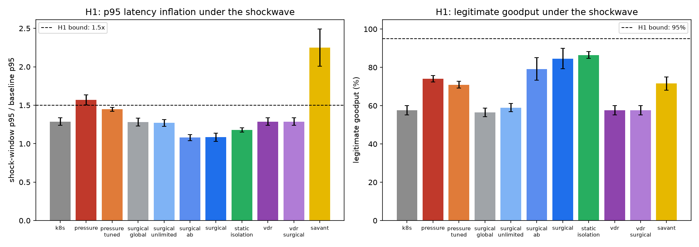
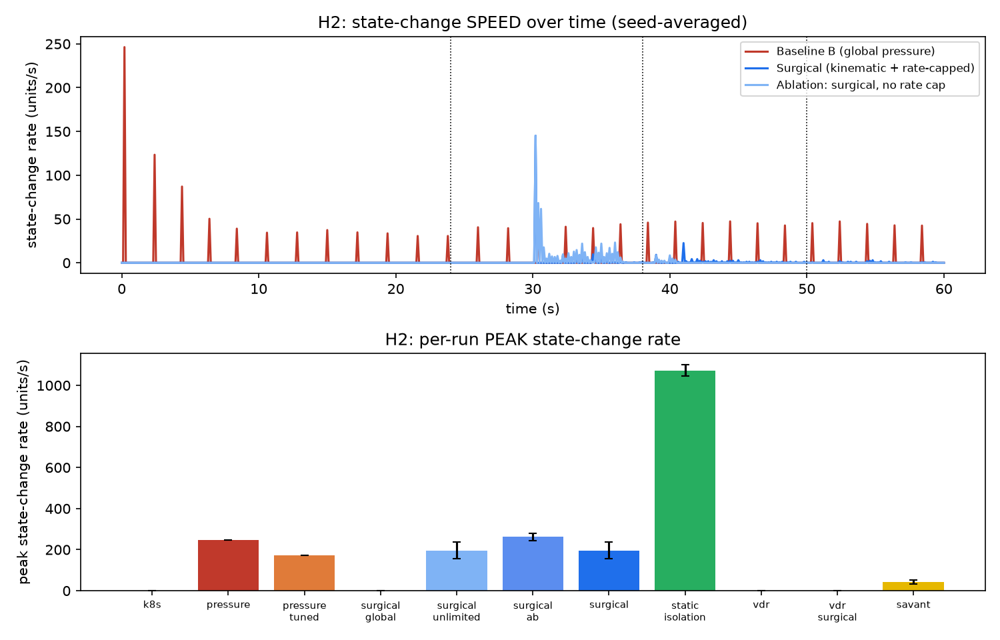
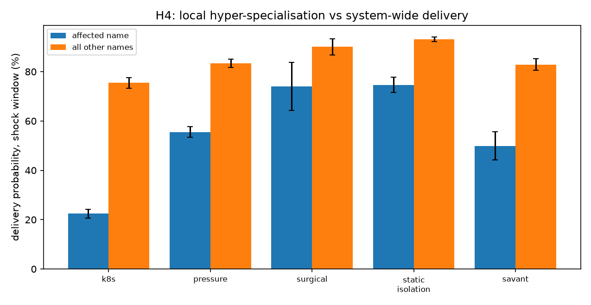

# Surgical state updates: results

Measured against the pre-registered claims in
[`surgical-rate-controlled.md`](surgical-rate-controlled.md). 840 runs: three
experiments, 30 paired seeds, eleven arms. Means with a 95 % confidence interval
(mean ± 1.96 s.e. across seeds). Machine-readable output in
`output/surgical/`, figures in `figures/surgical_*.png`.

**The testbed partially refutes its own thesis.** Verdict table first, evidence
after.

| hypothesis | verdict |
|---|---|
| **H1** surgical advantage | **REFUTED** — 2 of 4 clauses fail |
| **H2** rate control vs churn | **SUPPORTED IN PART** — sustained churn bound, peak burst not |
| **H3** MTU-mismatch deadlock | **INCONCLUSIVE** — mechanism never engaged |
| **H4** savant hyper-specialisation | **REFUTED** |
| composability with a spatial (VDR-like) target | **UNTESTED** — target field empty |

## 1. Phase 1: the baseline is quiet

No attack, 60 s: the EMA baseline is flat, `residual_a` stays an order of
magnitude below threshold, and **zero state edits** are issued across all seeds
for `k8s`, `surgical`, `vdr` and `surgical_ab`
(`tests/test_surgical.py::test_steady_state_is_quiet`). The adaptive threshold
`k · EWMA(|residual|)` is what makes this true without a tuned constant.

## 2. H1 — the DDoS shockwave

| arm | p95 base | p95 shock | ratio | legit goodput | edits/run | classes |
|---|---:|---:|---:|---:|---:|---:|
| Baseline A (`k8s`) | 279 ms | 355 ms | 1.288 ± 0.047 | 57.6 % | 0 | 0 |
| Baseline B (`pressure`) | 222 ms | 347 ms | 1.569 ± 0.064 | 74.1 % | 2450 | 0 |
| **Surgical** | 279 ms | **300 ms** | **1.083 ± 0.052** | **84.6 %** | **45** | **12.1** |
| Control (`static_isolation`) | 272 ms | 320 ms | 1.177 ± 0.028 | 86.5 % | 215 | 214.6 |
| Savant (H4) | 279 ms | 620 ms | 2.250 ± 0.240 | 71.5 % | 517 | 12.1 |

**Passes:** p95 ratio 1.08 ≤ 1.5. Baseline B loses 25.9 % goodput, > 10 %.

**Refuted:** legitimate goodput is 84.6 %, not > 95 %. Baseline B's p95 ratio is
1.569, not > 2.2×.

The surgical arm dominates the global-pressure controller on both axes — 11
goodput points and a 0.49-lower p95 ratio — so the directional thesis holds with
a wide margin. The absolute targets do not. Two mechanisms are responsible:

* The class rule needs about one control tick to reach all eight attack-adjacent
  routers. In that window legitimate traffic shares an unisolated queue with the
  flood, and those requests are lost.
* Baseline B never starves the fabric to 2.2×. Its `α0 = 0.5` handicap is real,
  but the 100 ms buffers and the mesh's path diversity absorb it.

## 3. The confound: most of the gain is queue isolation, not kinematics

`static_isolation` — per-flow fair queueing for every flow, always on, with no
sensing and no trigger — reaches **86.5 %** goodput and a 1.18 ratio. The
triggered arm reaches 84.6 % and 1.08 on **45 edits instead of 215** and
**12 isolated classes instead of 215**.

That is the honest reading of H1: per-flow isolation (an FQ-CoDel-era practice
predating this work) accounts for nearly all of the QoS recovery. What the
kinematic trigger buys is **state economy**, roughly an order of magnitude less
control-plane churn, not a better absolute outcome. Any claim that the
acceleration trigger *causes* the resilience would be wrong on this evidence.

## 4. H2 — rate control versus churn

| arm | **sustained** rate | peak rate | peak accel | edits/run |
|---|---:|---:|---:|---:|
| Baseline B (`pressure`) | **2.556** | 246.3 | 6.3 | 2454 |
| Ablation: no rate cap | 1.031 | 196.4 | — | 68 |
| **Surgical** | **0.546** | 196.4 | — | **36** |

Sustained state-change rate falls to **21 %** of Baseline B, edits fall **68×**,
and responsiveness improves rather than degrades: the capped arm also gets the
best H1 goodput of the triggered variants (the uncapped ablation reaches 80.9 %).

The seismograph prediction is confirmed for sustained activity — a flat line with
one short spike per edit — and **refuted for peak magnitude**: the surgical arm's
peak is 0.80× Baseline B's, not below half. The reason is structural. A
coordinated mitigation edits ~12 routers inside one control tick, so the
fleet-wide burst is large even though each node's own budget is small. A
per-node token bucket bounds how *often* a node changes state; it cannot bound a
synchronous burst across nodes without a global limiter — which would reintroduce
the centralised controller the design is trying to avoid.

## 5. H3 — the fiber→satellite boundary: untested, not passed

Node 5 is a remote site whose only backhaul is a 10 Mbps / MTU 576 satellite hop,
carrying four legitimate flows at ~64 % of line rate, then a flood. A 100 kB
object is 174 fragments at that MTU.

**The reassembly buffer peaked at 0 kB in every arm and every seed.** The
deadlock mechanism never fired, so the "0.0 % deadlock fraction" column is a null
result and H3 is **not** claimed.

Cause: partial fragment-train admission requires `0 < room < object size` at the
queue. With 1 MB flood batches filling a 2.5 MB satellite buffer, 400 kB
legitimate batches see `room ≤ 0` and are dropped whole rather than partially, so
the modelled path from "MTU mismatch" to "holds a reassembly slot" is never
taken. A correct test needs fragment-level interleaving — charge reassembly
occupancy for every in-flight fragmented object, and size the reorder buffer in
objects rather than bytes.

## 6. H4 — savant hyper-specialisation: refuted

| arm | affected name | all other names | p95 ratio |
|---|---:|---:|---:|
| Baseline A | 22.4 % | 75.5 % | 1.288 |
| Baseline B | 55.6 % | 83.4 % | 1.569 |
| **Surgical** | **74.1 %** | **90.1 %** | **1.083** |
| Savant | 49.9 % | 82.9 % | 2.250 |

H4 predicted superior local resilience at the cost of global efficiency. The
savant arm does not even win locally: driving `α → 0.95` at the congested node
removes ~78 % of that node's forwarding capacity, and that node is the last
router before the origin — so the affected flow's own path is the first casualty.
The trade-off is all cost: worse locally than the surgical arm, and 2.25× p95
globally.

The mechanism is not absurd, it is misapplied. Hyper-specialisation can pay where
the specialised resource is *downstream* of the constraint (a dedicated scrubber
in front of the origin), not where it consumes the transit capacity the affected
traffic needs.

## 7. Composability with a spatial target layer

Both `vdr` and `vdr_surgical` produced **zero edits** and are numerically
identical to Baseline A. The pressure-weighted loop-free potential never differed
from the static FIB: with origins as single-uplink leaves there is no admissible
loop-free alternative to the origin uplink, so the potential gradient has nowhere
to send traffic. A temporal control layer cannot rate-limit a target that does
not exist. The pairing must be re-run on a topology with genuine path diversity
(multi-homed origins, ECMP) before any composability claim is made.

## 8. The α–β filter underperformed the EMA

`surgical_ab` (α-β trigger) delivers 82.5 % against the EMA trigger's 84.6 %. Its
gains are sampling-rate dependent: at 5 Hz the velocity estimate needed
`β = 0.45` merely to reach the trigger floor, whereas the EMA's time constants
needed no such retuning. At this cadence the trend-following advantage claimed
for the α-β RTT filter does not reproduce.

## 9. Calibration log

Five degenerate configurations were found and fixed during construction. Each
would have produced a confident, wrong answer, so they are recorded.

1. `α = 1.0` on interior origins partitioned the fabric — 8 % goodput with no
   attack present. Fixed by starting origins at `α = 0.8` and making them leaves.
2. Packet error rate applied per fragment lost 93 % of every 400 kB object on the
   1 % microwave links. Corrected to per-batch loss.
3. The attack was invisible: 60 flows over 200 names with diffuse origins and a
   1 Gbps origin uplink meant the flood was throttled on access hops no
   legitimate flow crossed. Fixed by 8 names, leaf origins behind a 100 Mbps last
   mile, and a botnet inside the aggregation ring.
4. The rate governor was throttling the *edit itself*, so protection arrived
   2.7 s late and the surgical arm scored worse than Baseline B. Re-cut as a
   sharp edit plus a token-bucket frequency limit.
5. Releasing on "calm acceleration" released mid-attack, leaving the class at
   neutral weight — worse than never isolating. Fixed by requiring the culprit
   class's arrival rate to have stopped.

Isolation constants (`iso_weight = 0.05`, `iso_limit_frac = 0.12`) were calibrated
on one seed and then held fixed for all 30 evaluation seeds.

## 10. Threats to validity

1. **Clean attribution.** Legitimate and attack sources never share a region.
   Spoofed-source DDoS would defeat this controller as it defeats FlowSpec; H1 is
   an upper bound.
2. **Not ns-3.** No PHY, CSMA contention, ARQ or TCP. Absolute latencies are not
   predictions of deployed performance.
3. **One topology, one load level.** A stipulated 100-node grid, no trace replay,
   no sensitivity sweep over topology or load.
4. Hyperparameters were calibrated on a single seed before the 30-seed evaluation.
5. H3 untested and the spatial pairing empty — stated above as limitations, not
   counted as passes.
6. Confidence intervals describe run-to-run stochastic variation, not uncertainty
   about real networks.
